<Info>
  Agent Experience is in private preview. Features, limits, and pricing may change before general availability. Send feedback from the **Send feedback** button on the Agent Experience page, or contact your Mintlify team.
</Info>

Agent Experience (AX) shows you how coding agents use your docs. You describe a task that a real user would try, like making a first API call or turning on a feature. AX runs coding agents such as Claude Code, Codex, and opencode against that task in a fresh sandbox, using only your public docs. Each run reports whether the agent reached the finish line, which pages it read, how it rated them, and where it got stuck.

Use AX to:

- Catch docs problems that block agents, like wrong header names, missing setup steps, or broken links.
- Check that onboarding still works after you publish changes.
- Compare how different agents and models handle the same task.

<Frame>
  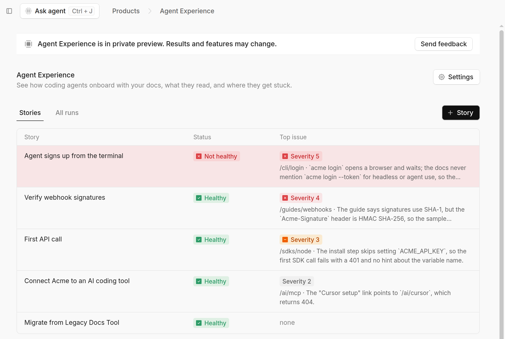
  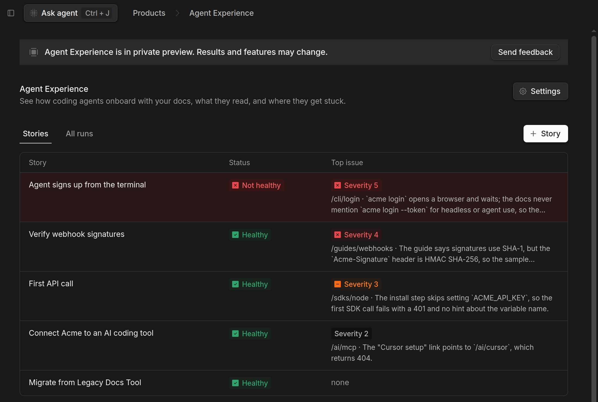
</Frame>

## Before you begin

- Your Mintlify team turns on Agent Experience for your project during the beta. If you don't see it in your dashboard, ask your Mintlify contact.
- AX tests public docs sites. It doesn't support Base projects yet.
- Runs use your organization's [AI credits](/credits). See [Credits and limits](#credits-and-limits).

## Key concepts

| Term | Meaning |
| --- | --- |
| Story | A task an agent tries using only your public docs. A story has a prompt, a finish line, a schedule, and the harnesses and models to run on. |
| Run | One attempt at a story by one harness and model. Each run happens in a fresh sandbox with no prior context. |
| Harness | The coding agent that runs the task: Claude Code, Codex, or opencode. |
| Finish line | The condition that means the agent succeeded, for example "One authenticated request returns a 2xx response." |
| Finding | A docs problem that an agent reported on a specific page, with a severity from 1 to 5. |
| Health | The agent's confidence in its result, from 1 to 5. A run is **Healthy** when the agent reached the finish line. |

## Open Agent Experience

1. In your dashboard, open **Settings**.
2. Under **Products**, select **Agent Experience**.

The page has two tabs:

- **Stories**: every story with its latest status and top open issue. Stories with the most severe open findings appear first.
- **All runs**: every run across all stories, with filters and export.

## Create your first story

Select **Story** to choose how to create a story.

<Frame>
  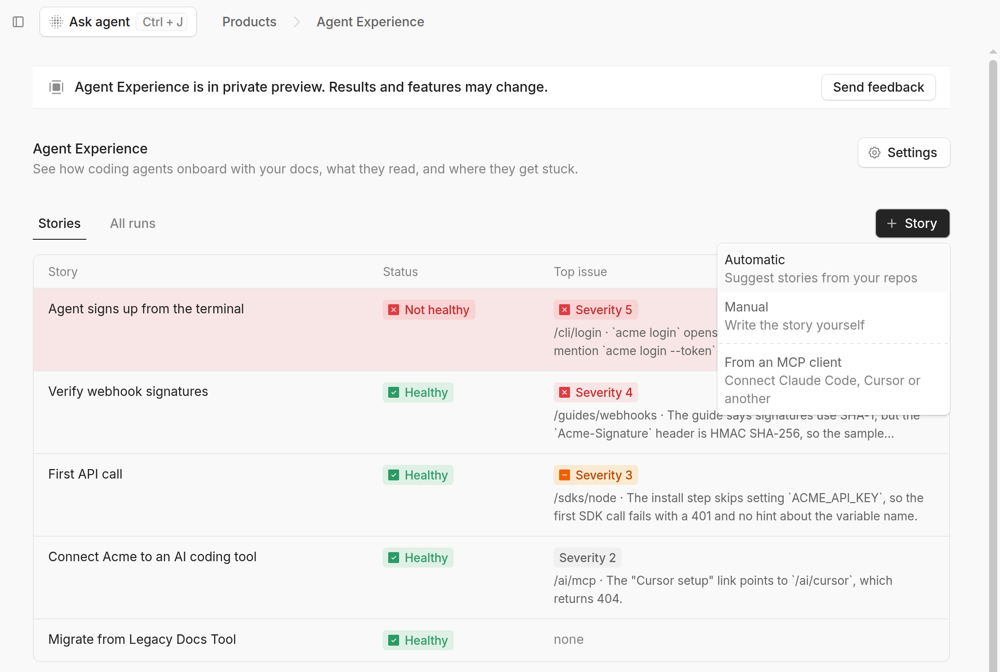
  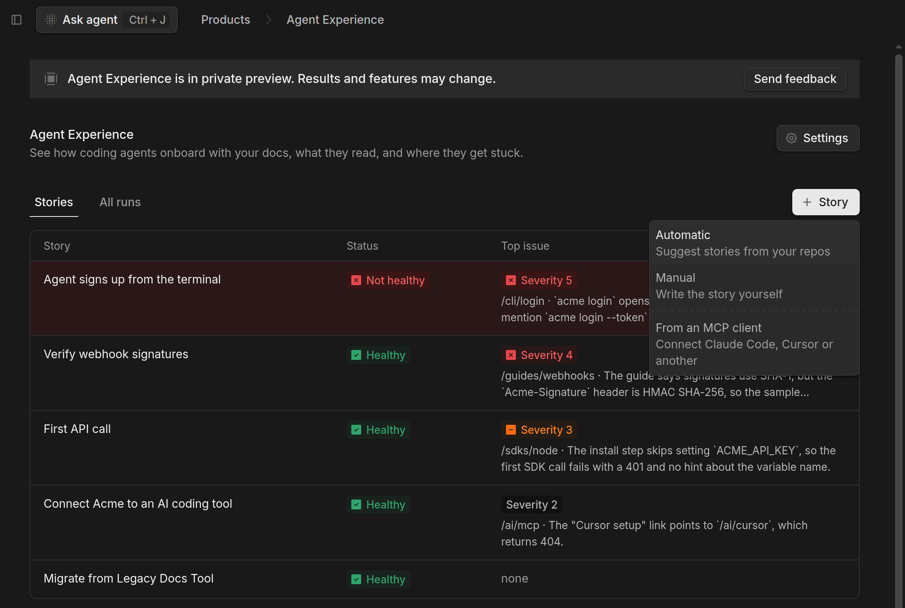
</Frame>

<Tabs>
  <Tab title="Manual">
    Write the story yourself.

    1. Select **Story** > **Manual**.
    2. Enter a **Name**, for example "TypeScript SDK developer."
    3. Enter a **Prompt** that describes who the user is and what they want to do.
    4. Enter a **Finish line** that the agent can check, for example "One API call returns data."
    5. Choose one or more **Harnesses**.
    6. Optional: expand **Advanced** to set the situation, the schedule, and browser access. See [Story settings](#story-settings).
    7. Select **Create story**.

    <Frame>
      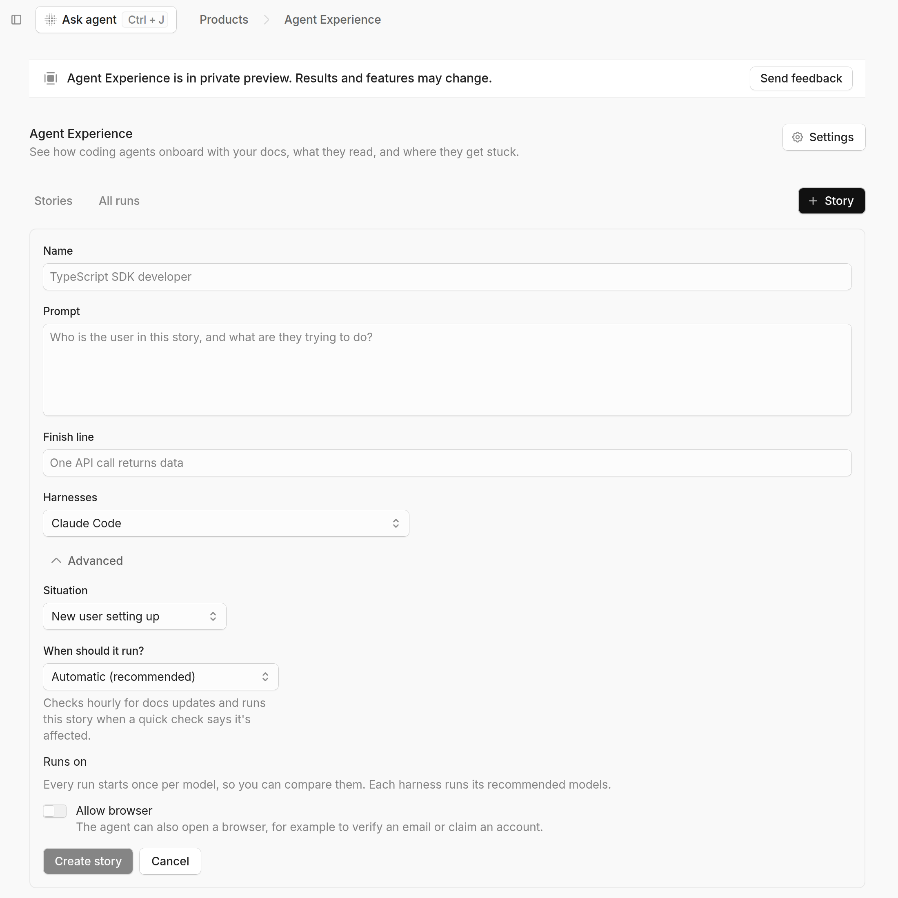
      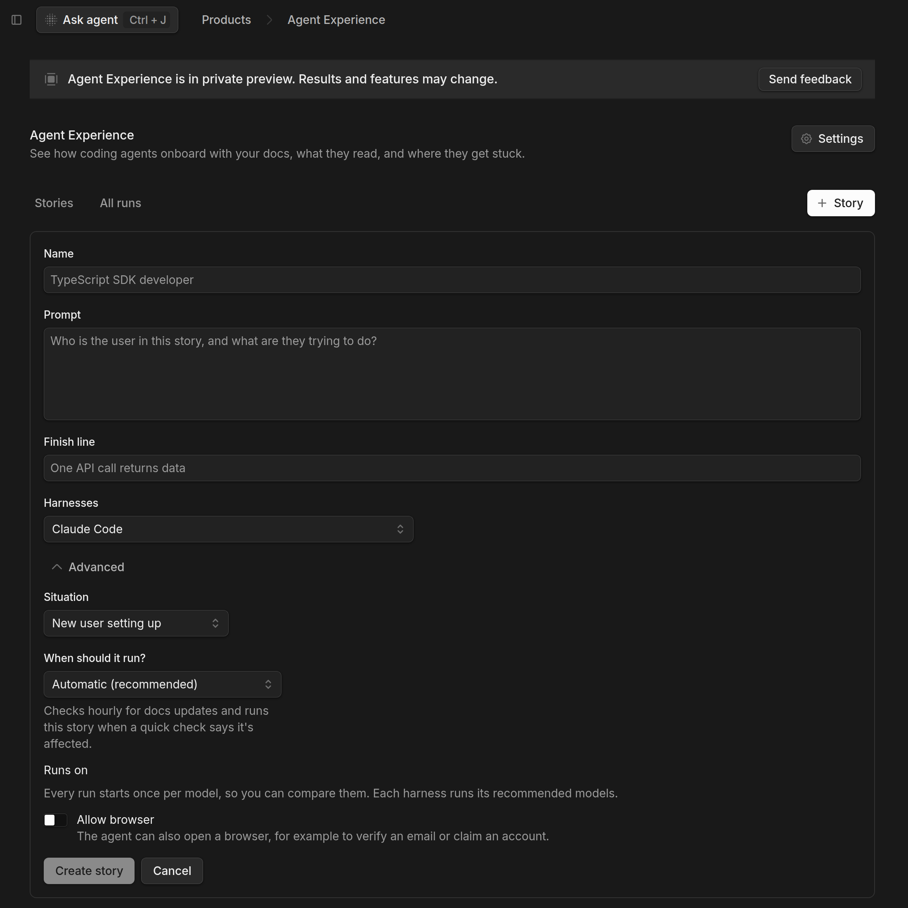
    </Frame>
  </Tab>
  <Tab title="Automatic">
    Let AX suggest stories based on your code and recent docs changes.

    1. Select **Story** > **Automatic**.
    2. Pick up to five repositories. AX reads repositories connected through the Mintlify GitHub app.
    3. Select **Find examples**. If you don't want to share repositories, select **Suggest from docs only**.
    4. Review the suggested stories. Edit the prompts and clear any you don't want.
    5. Select **Add stories**.

    If you don't see your repositories, open your Git settings and give the Mintlify GitHub app access to them.
  </Tab>
  <Tab title="From an MCP client">
    Create and run stories from Claude Code, Cursor, or another MCP client.

    1. Connect your client to the [admin MCP](/ai/mintlify-mcp).
    2. Ask your agent to create an Agent Experience story. For example: "Create an Agent Experience story where a new developer gets an API key and makes their first request."

    Through MCP, your agent can create stories, start runs, list runs and findings, and read run reports. It can also start from these templates:

    | Template | What the agent does |
    | --- | --- |
    | New agent sign up | Sets up the product from the terminal. |
    | First API call | Gets credentials and makes one authenticated request. |
    | Connect AI tools | Connects a coding assistant through MCP or agent setup. |
    | Turn on a new feature | Turns on the newest feature for an existing account. |
    | Migrate from another tool | Moves existing content or configuration over with your migration path. |
  </Tab>
</Tabs>

When you create a story, its first runs start right away. Results usually appear in 3 to 8 minutes.

### Write a good story

- **Describe a real user.** "You are a backend developer evaluating Acme for the first time" works better than "Test the API."
- **Make the finish line checkable.** The agent must be able to tell when it's done, like "The CLI is logged in" or "The webhook signature verifies."
- **Keep each story to one task.** Split onboarding and feature setup into separate stories so findings point to the right pages.
- **Select Improve.** On a story's page, **Improve** rewrites a rough line into a clear task with a finish line.

### Story settings

| Setting | Options |
| --- | --- |
| Situation | **New user setting up** for onboarding tasks, or **Existing user turning on a feature** for enablement tasks. |
| When should it run? | **Automatic (recommended)** checks hourly for docs updates and runs the story when a quick check says it's affected. **Only when I run it**, **Every day**, or **Every week** are also available. |
| Harnesses | Claude Code, Codex, and opencode. Each harness runs its recommended models, and every run starts once per model so you can compare them. Claude Code is selected by default. |
| Allow browser | Lets the agent open a browser, for example to verify an email or claim an account. Works with Claude Code only. Browser runs cost more credits. |

### Test accounts and email

Every run gets its own email address and inbox. If your story asks the agent to sign up, it uses that address, and it can read verification emails sent to it. You can see the messages on the run's **Overview** tab under **Test inbox**.

## Review a story

Select a story to see its health, findings, and run history.

<Frame>
  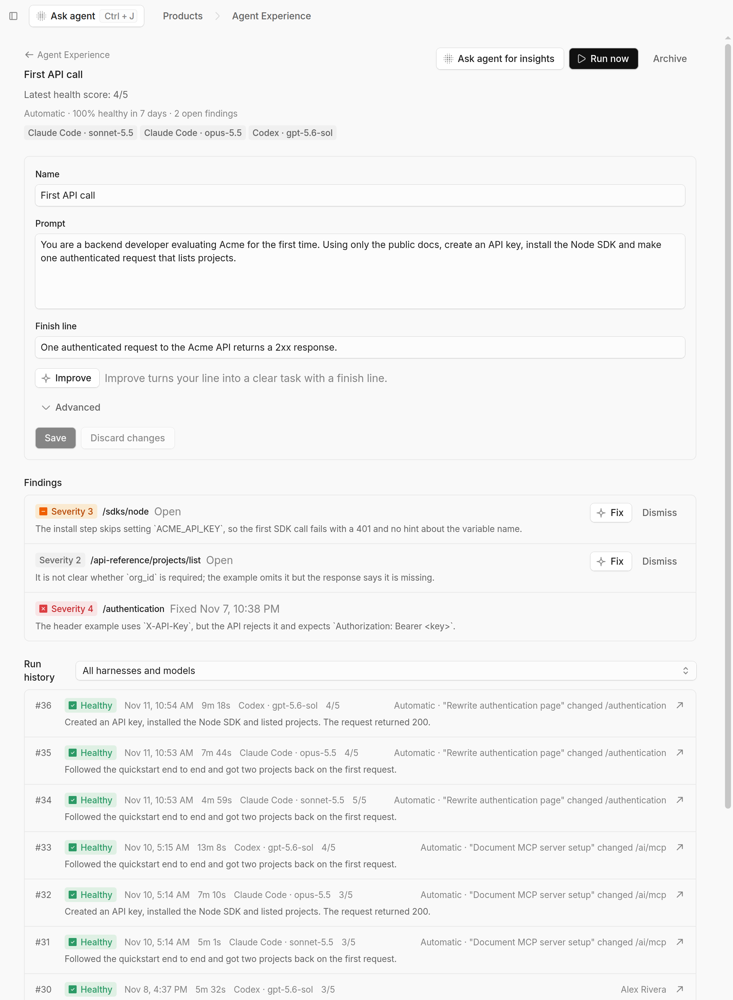
  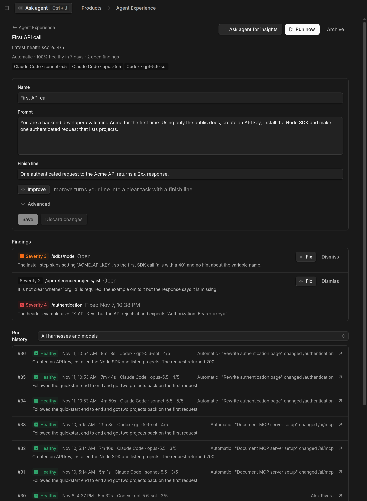
</Frame>

The top of the page shows the latest health score, the schedule, the share of healthy runs in the last seven days, and the number of open findings. From here you can:

- Select **Run now** to start a run on every harness and model.
- Edit the story and select **Save**.
- Select **Ask agent for insights** to ask the editor agent to analyze the story's runs.
- Select **Archive** to stop the story. Past runs stay in **All runs**.

### Work with findings

Each finding shows its severity, the page, its status, and the problem the agent reported.

- Select **Fix** to open the editor agent with a prompt to fix that page.
- Select **Dismiss** if the finding isn't a real problem. Dismissed findings stay dismissed until you select **Reopen**.

AX marks a finding **Fixed** after agents run the story twice more without reporting it. If an agent reports it again later, it reopens.

## Review a run

Select a run to see what the agent did.

<Frame>
  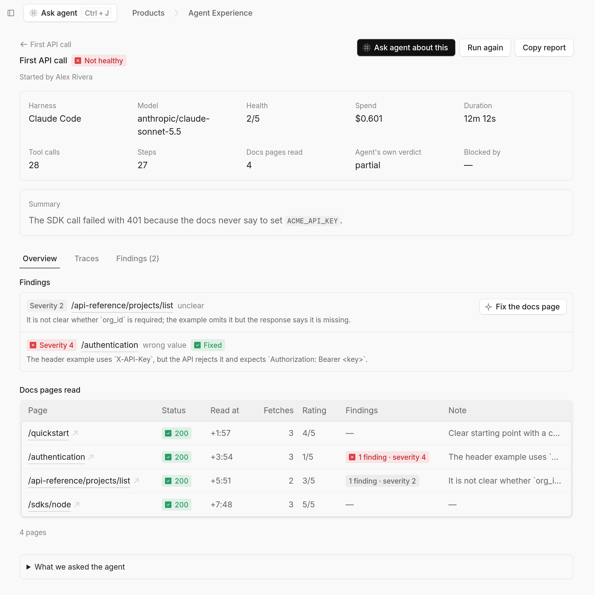
  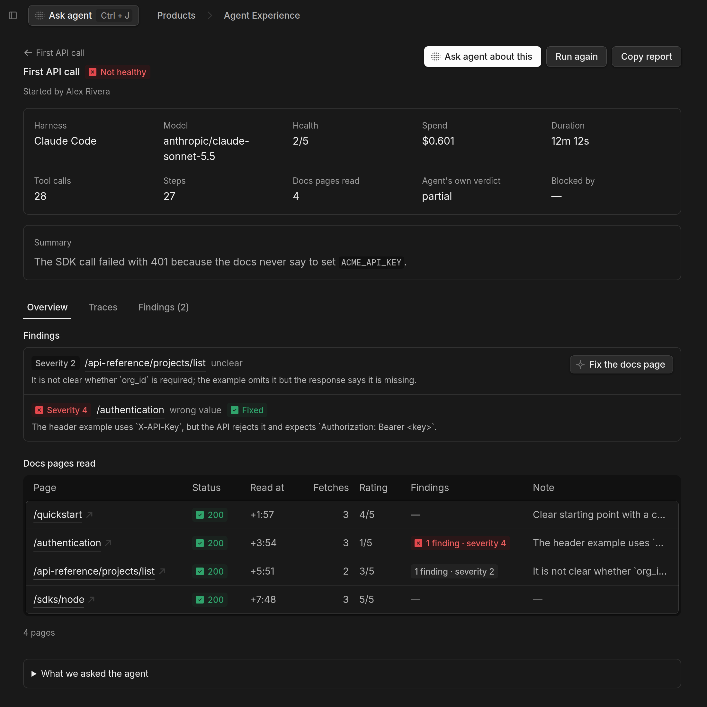
</Frame>

The run page has three tabs:

- **Overview**: the findings from this run, every docs page the agent read with its rating and notes, the exact prompt the agent received, screenshots for browser runs, and problems the agent hit outside your docs.
- **Traces**: a timeline of every step the agent took, colored by tool type, and the grader output.
- **Findings**: every finding from this run.

<Frame>
  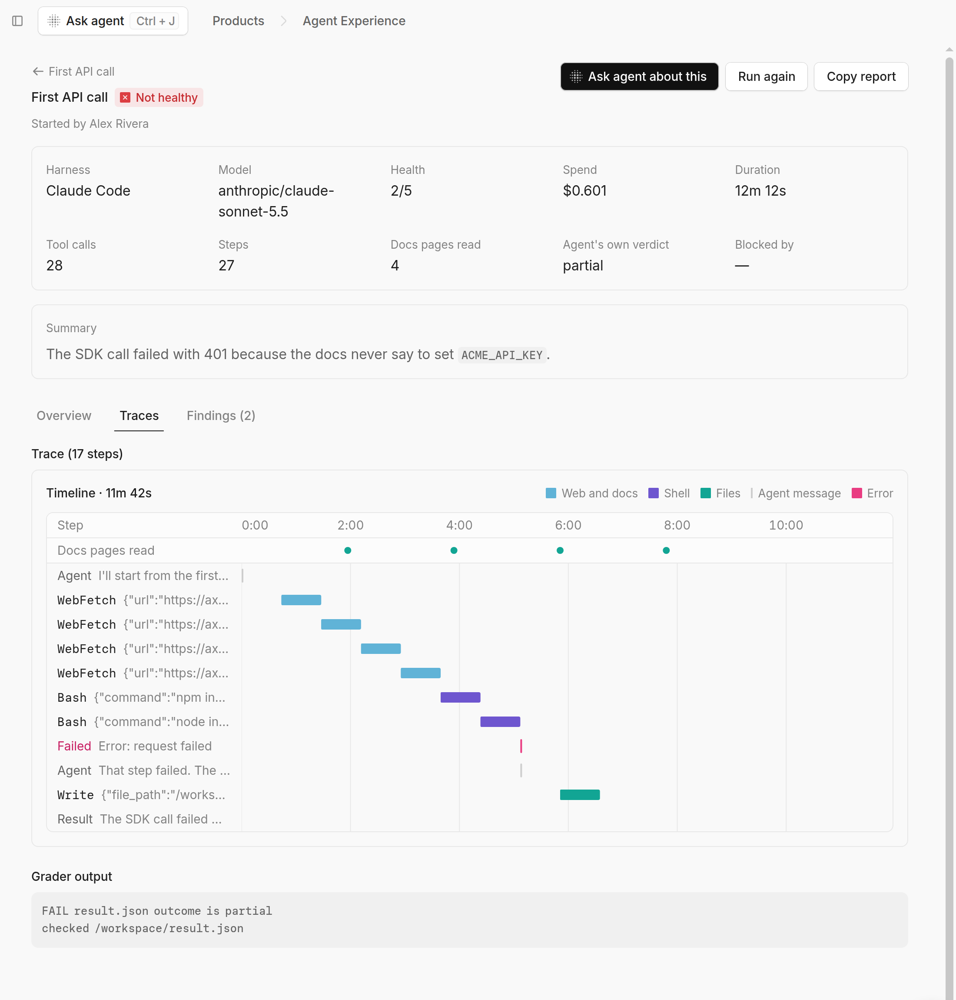
  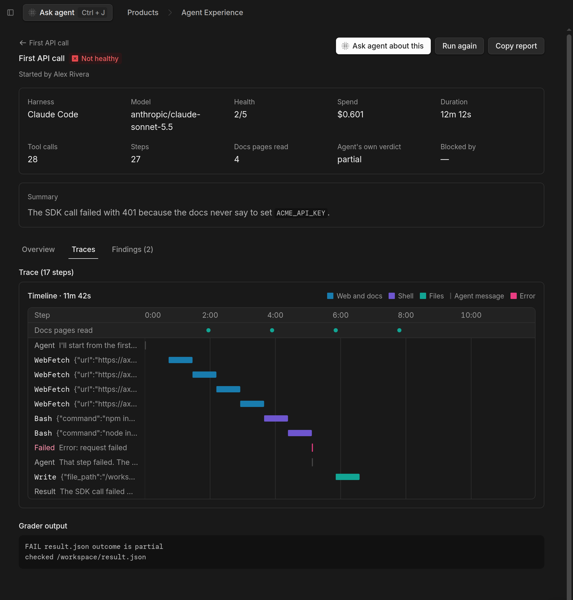
</Frame>

Use **Ask agent about this** to discuss the run with the editor agent, **Run again** to retry, and **Copy report** to copy a Markdown report you can share with your team.

## Track all runs

The **All runs** tab lists every run with its story, harness and model, who or what started it, result, health, summary, spend, and time. Filter by time range, story, harness and model, or status.

<Frame>
  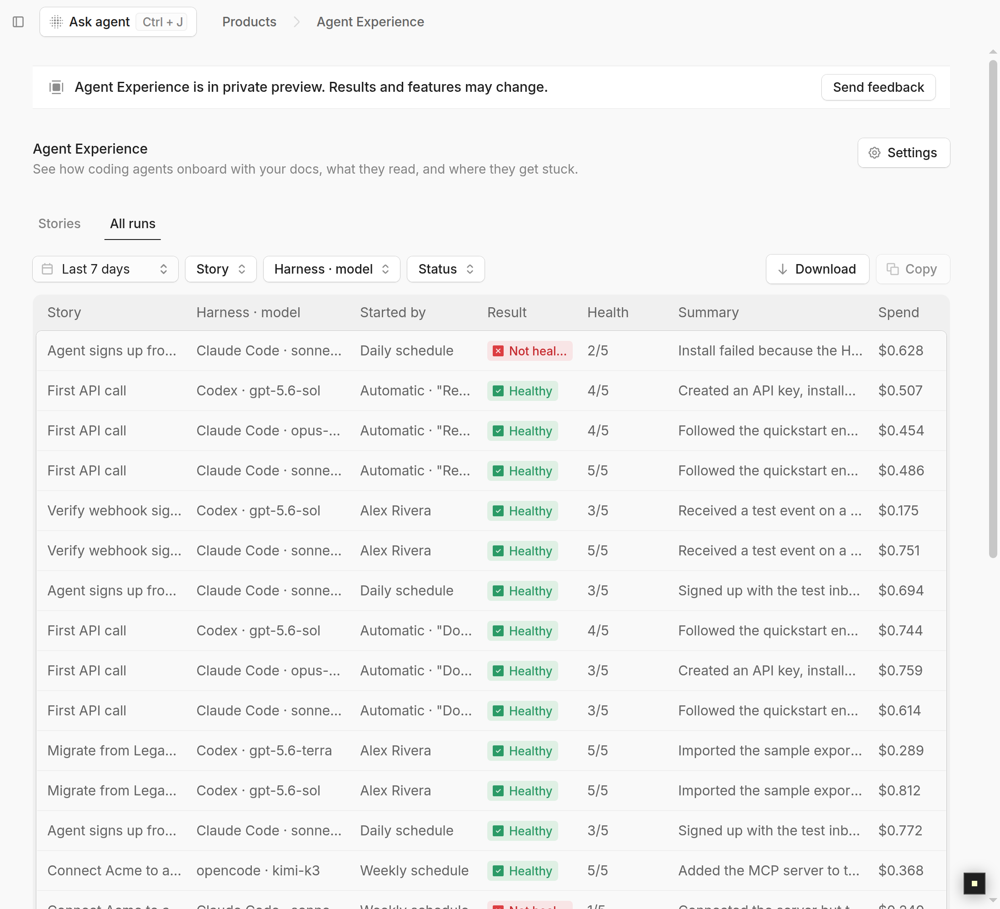
  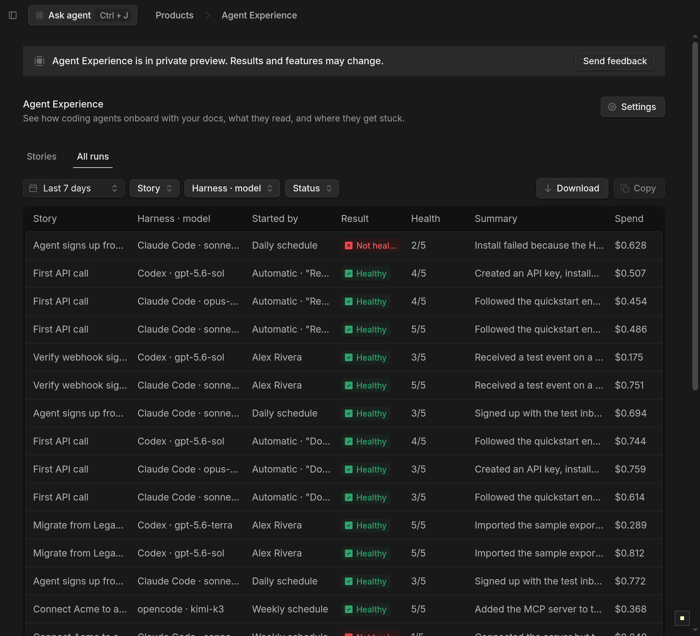
</Frame>

- Select **Download** to export your stories, runs, and findings as JSON.
- Select **Copy** to copy a component you can paste into a Mintlify page to show your runs.

## Credits and limits

| | |
| --- | --- |
| Cost per run | 100 credits, or 200 credits with browser access. You pay for every run that finishes, whether or not the agent reached the finish line. Runs that error or that you cancel are free. |
| Stories | Up to 10 active stories per project. Archive a story to add another. |
| Concurrent runs | Up to 10 runs in progress at once. |
| Daily runs | Up to 50 runs in 24 hours. |
| Run time | Most runs finish in 3 to 8 minutes. A run stops after 20 minutes. |

Stories with several harnesses and models start one run per model, so a story with three targets costs three runs each time it runs.

### Set a spend limit

1. On the Agent Experience page, select **Settings**.
2. Select **Limit spend** and enter the maximum credits per month.

When AX reaches the limit, runs pause until the next month or until you raise the limit.

<Frame>
  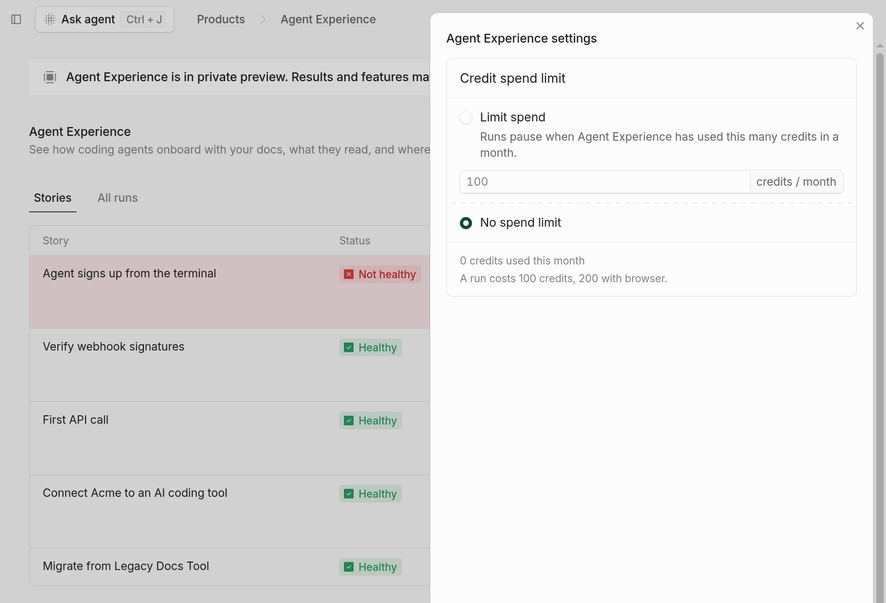
  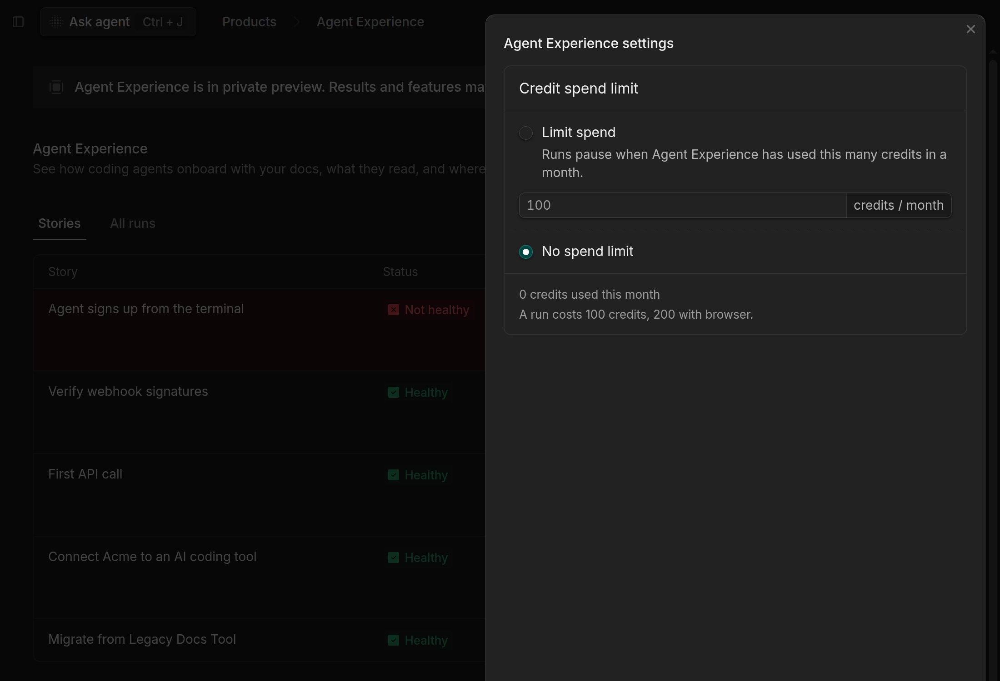
</Frame>

## Suggested first week

1. Create two or three stories that cover your most important onboarding paths, like signing up, getting credentials, and making a first request.
2. Run each on Claude Code and one other harness to see where agents differ.
3. Fix the highest severity findings, publish, and watch the next automatic runs.
4. Share what worked and what didn't with your Mintlify team using **Send feedback**.
