<Info>
  Agent Experience is in private preview. Features, limits, and pricing may change before general availability. Send feedback from the **Send feedback** button on the Agent Experience page, or contact your Mintlify team.
</Info>

Agent Experience (AX) shows you how coding agents use your docs. You describe a task that a real user would try, like making a first API call or turning on a feature. AX runs coding agents such as Claude Code, Codex, and opencode against that task in a fresh sandbox, using only your public docs. Each run reports whether the agent reached the finish line, which pages it read, how it rated them, and where it got stuck.

Use AX to:

- Catch docs problems that block agents, like wrong header names, missing setup steps, or broken links.
- Check that onboarding still works after you publish changes.
- Compare how different agents and models handle the same task.
- Open pull requests that fix the pages where agents get stuck.

<Frame>
  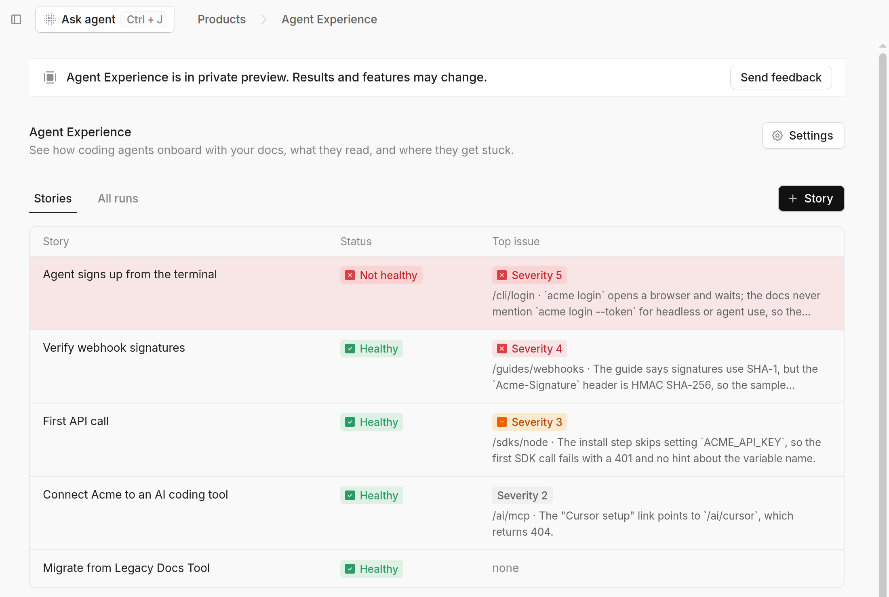
  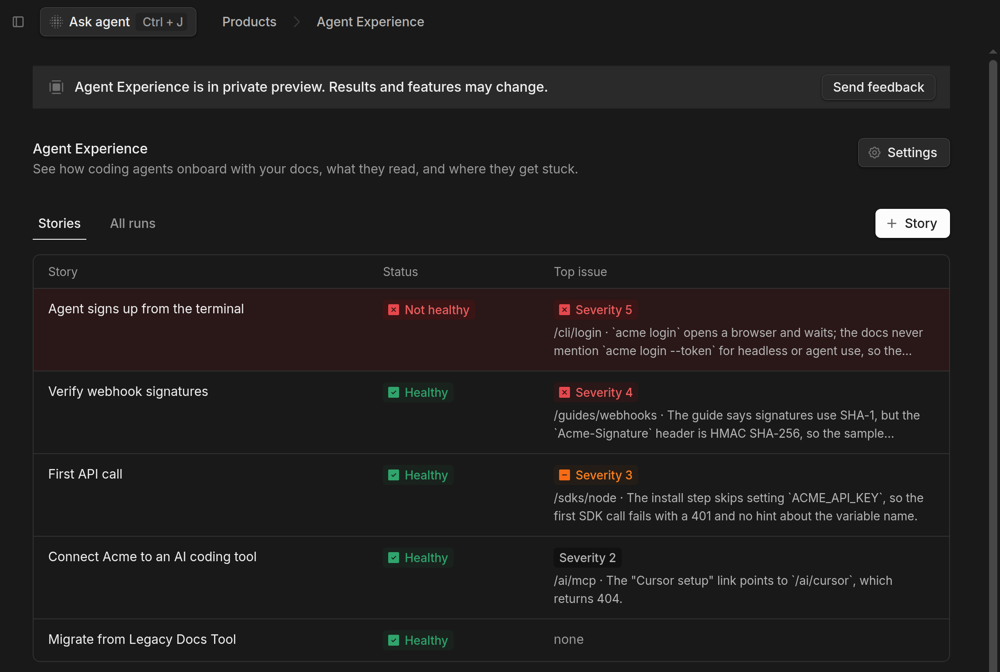
</Frame>

## Before you begin

- Your Mintlify team turns on Agent Experience for your project during the beta. If you don't see it in your dashboard, ask your Mintlify contact.
- AX tests public sites. It doesn't support knowledge bases yet.
- Runs use your organization's [AI credits](/credits). See [Credits and limits](#credits-and-limits).
- Fix pull requests use the [agent](/agent), which requires a Pro or Enterprise plan, and need a GitHub repository connected to your project.
- Only admins can add test credentials and add them to stories, turn on Auto PRs, choose context repos, and change the spend limit.

## Terms

| Term | Meaning |
| --- | --- |
| Story | A task an agent tries using only your public docs. A story has a prompt, a finish line, a schedule, and the harnesses and models to run on. |
| Run | One attempt at a story by one harness and model. Each run happens in a fresh sandbox with no prior context. |
| Harness | The coding agent that runs the task: Claude Code, Codex, or opencode. |
| Finish line | The condition that means the agent succeeded, for example "One authenticated request returns a 2xx response." |
| Finding | A docs problem that an agent reported on a specific page, with a severity from 1 to 5. The story page lists findings under **Open issues**. |
| Test credential | A test API key or test login that you save once and add to the stories that need it. |
| Fix pull request | A pull request that the agent opens to fix the page behind a finding. |
| Health | The agent's confidence in its result, from 1 to 5. A run is **Healthy** when the agent reached the finish line. |

## Open Agent Experience

In your dashboard sidebar, select **Agent Experience**.

The page lists every story with its status, open issues, schedule, and last run. Stories with the most severe open findings appear first. To see runs across all stories, go to [All runs](#track-all-runs).

## Create your first story

Select **Story** to choose how to create a story.

<Frame>
  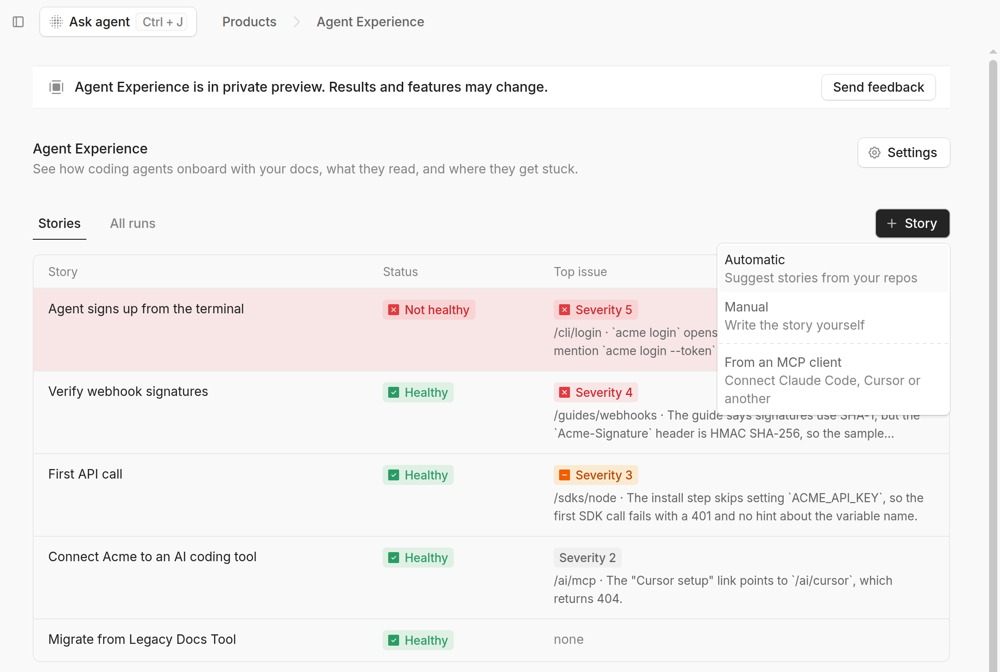
  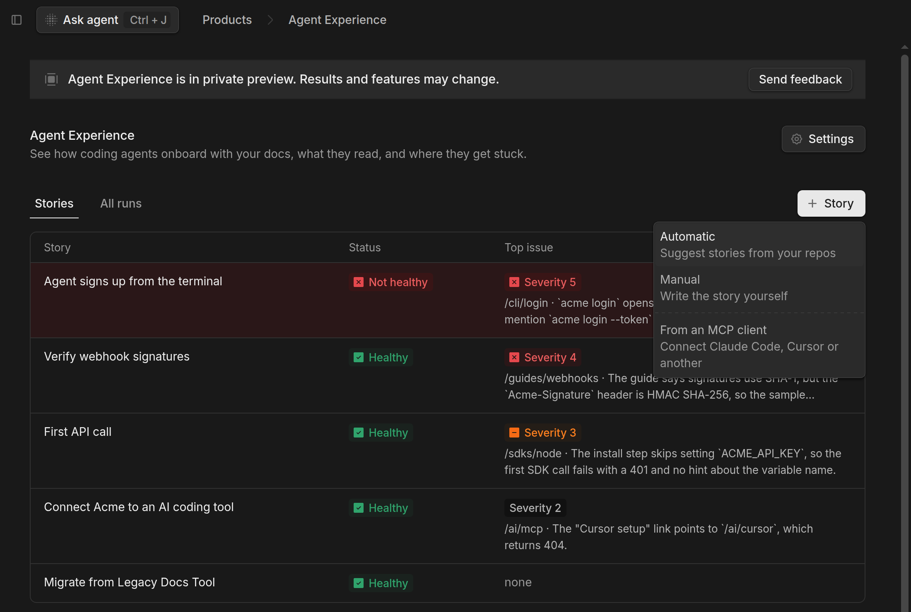
</Frame>

<Tabs>
  <Tab title="Manual">
    Write the story yourself.

    1. Select **Story** > **Manual**.
    2. Enter a **Name**, for example "TypeScript SDK developer."
    3. Enter a **Prompt** that describes who the user is and what they want to do.
    4. Enter a **Finish line** that the agent can check, for example "One API call returns data."
    5. Choose one or more **Harnesses**.
    6. Optional: expand **Advanced** to set the situation, the schedule, browser access, and test credentials. See [Story settings](#story-settings).
    7. Select **Create story**.

    <Frame>
      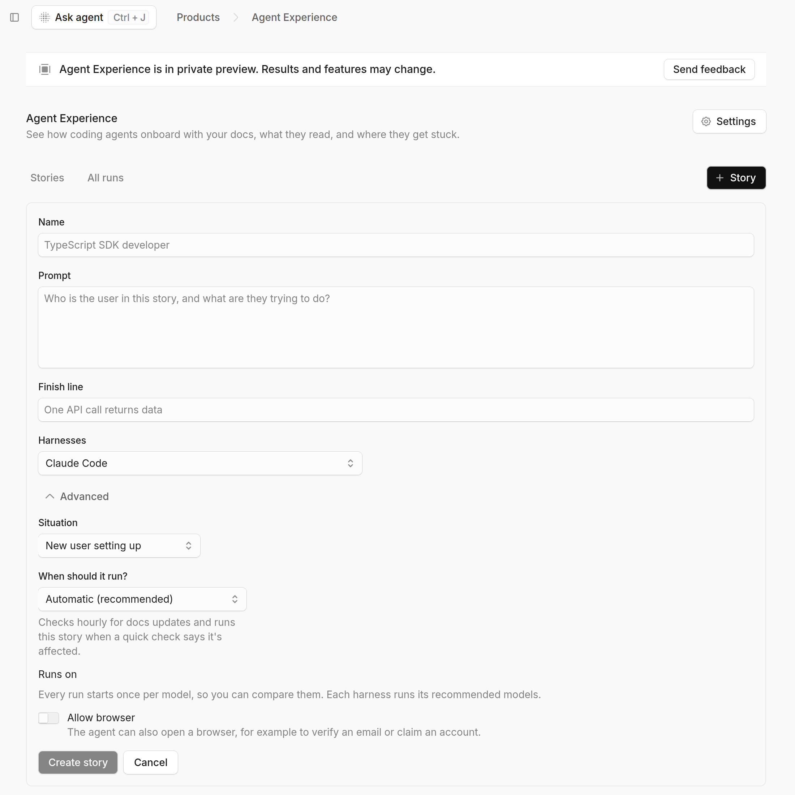
      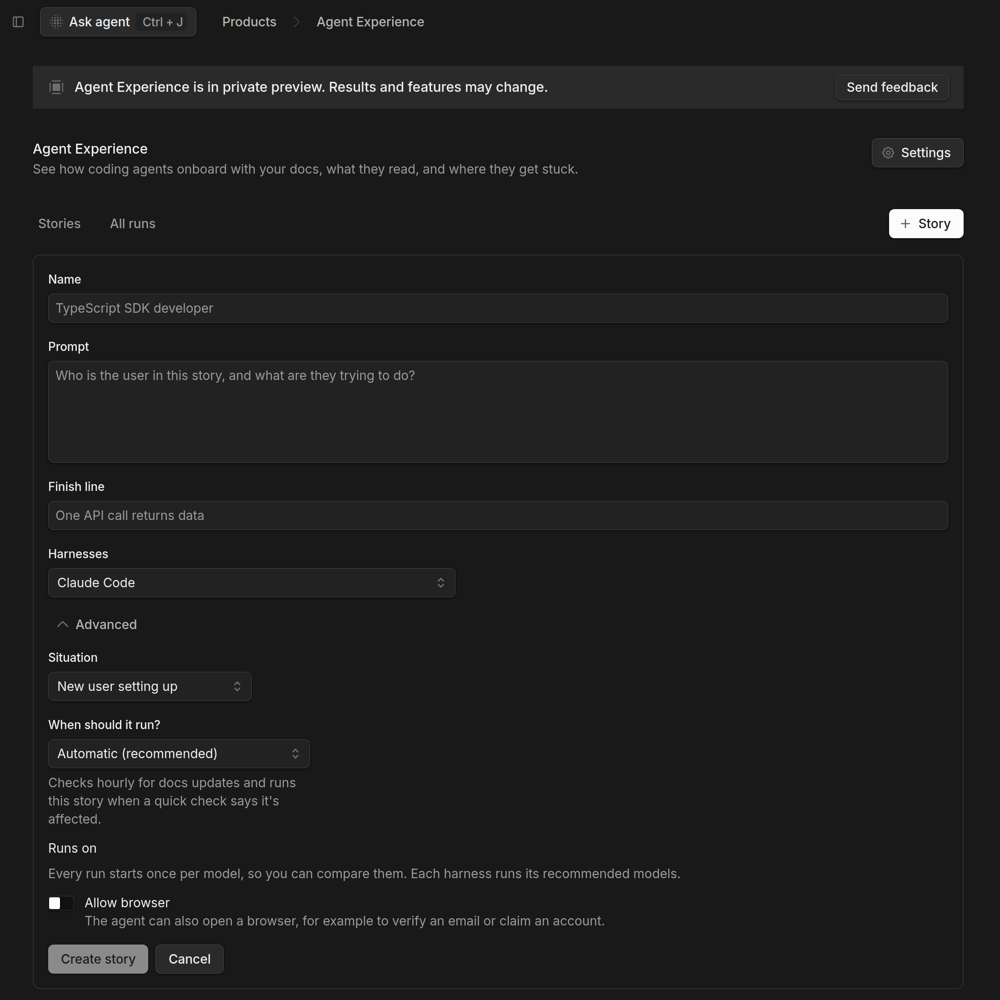
    </Frame>
  </Tab>
  <Tab title="Automatic">
    Let AX suggest stories based on your code and recent docs changes.

    1. Select **Story** > **Automatic**.
    2. Pick up to five repositories. AX reads repositories connected through the Mintlify GitHub app.
    3. Select **Find examples**. If you don't want to share repositories, select **Suggest from docs only**.
    4. Review the suggested stories. Edit the prompts and clear any you don't want.
    5. Select **Add stories**.

    Suggested prompts read like real requests, for example "I want an internal docs site for my team." Each batch mixes two situations:

    - **New user setting up**: someone with a need your product solves who hasn't picked a product yet. The prompt doesn't name your product.
    - **Existing user turning on a feature**: a customer who names your product and states one goal.

    If you don't see your repositories, open your Git settings and give the Mintlify GitHub app access to them.
  </Tab>
  <Tab title="From an MCP client">
    Create and run stories from Claude Code, Cursor, or another MCP client.

    1. Connect your client to the [admin MCP](/ai/mintlify-mcp).
    2. Ask your agent to create an Agent Experience story. For example: "Create an Agent Experience story where a new developer gets an API key and makes their first request."

    Through MCP, your agent can create stories, start runs, list runs and findings, and read run reports. It can also start from these templates:

    | Template | What the agent does |
    | --- | --- |
    | New agent sign up | Sets up the product from the terminal. |
    | First API call | Gets credentials and makes one authenticated request. |
    | Connect AI tools | Connects a coding assistant through MCP or agent setup. |
    | Turn on a new feature | Turns on the newest feature for an existing account. |
    | Migrate from another tool | Moves existing content or configuration over with your migration path. |
  </Tab>
</Tabs>

When you create a story, its first runs start right away. Results usually appear in 3 to 8 minutes.

### Write a good story

- Write the prompt the way a real user would ask, as the outcome they want. "I want an internal docs site for my team" works better than "Test the API" or a list of steps.
- Write a finish line the agent can check, like "The CLI is logged in" or "The webhook signature verifies."
- Keep each story to one task. Put onboarding and feature setup in separate stories so findings point to the right pages.

### Story settings

| Setting | Options |
| --- | --- |
| Situation | **New user setting up** for onboarding tasks, or **Existing user turning on a feature** for enablement tasks. |
| When should it run? | **Automatic (recommended)** checks hourly for docs updates and runs the story when a quick check says it's affected. **Only when I run it**, **Every day**, or **Every week** are also available. |
| Harnesses | Claude Code, Codex, and opencode. Each harness runs its recommended models, and every run starts once per model so you can compare them. Claude Code is selected by default. |
| Allow browser | Lets the agent open a browser, for example to verify an email or claim an account. Works with Claude Code only. Browser runs cost more credits. |
| Test credentials | The saved test credentials the agent gets as environment variables. See [Test credentials](#test-credentials). |

### Test accounts and email

Every run gets its own email address and inbox. If your story asks the agent to sign up, it uses that address, and it can read verification emails sent to it. You can see the messages on the run's **Overview** tab under **Test inbox**.

### Test credentials

Save a test API key or test login so agents can test flows that need an account, like inviting a teammate or making a first API call, without signing up first.

<Warning>
  Agents can read test credentials. Never add production credentials.
</Warning>

1. On the Agent Experience page, select **Settings**.
2. Under **Test credentials**, select **Add test credential**.
3. Enter a **Name** that uses capital letters, numbers, and underscores, like `API_KEY` or `TEST_PASSWORD`.
4. Enter the **Value**.
5. Optional: enter a **Description** that tells agents when to use the credential.
6. Optional: enter **Allowed domains**, like `api.example.com`. AX blocks requests that send the value to any other domain.
7. Select **Save**.

To add the credential to a story, open the story, select **Settings** from the story actions menu, pick it under **Test credentials**, and select **Save**. For a new story, pick it under **Advanced** > **Test credentials**.

Mintlify encrypts each value and never shows it again after you save it. AX removes the values from transcripts, findings, and traces. To change a value, select **Rotate**. If you delete a credential, stories that use it fail until you add it again.

On a story that uses test credentials, only admins can change the prompt, finish line, situation, browser setting, or harnesses.

## Review a story

Select a story to see its status, open issues, and recent runs.

<Frame>
  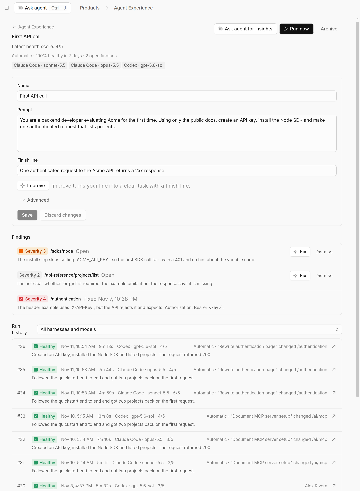
  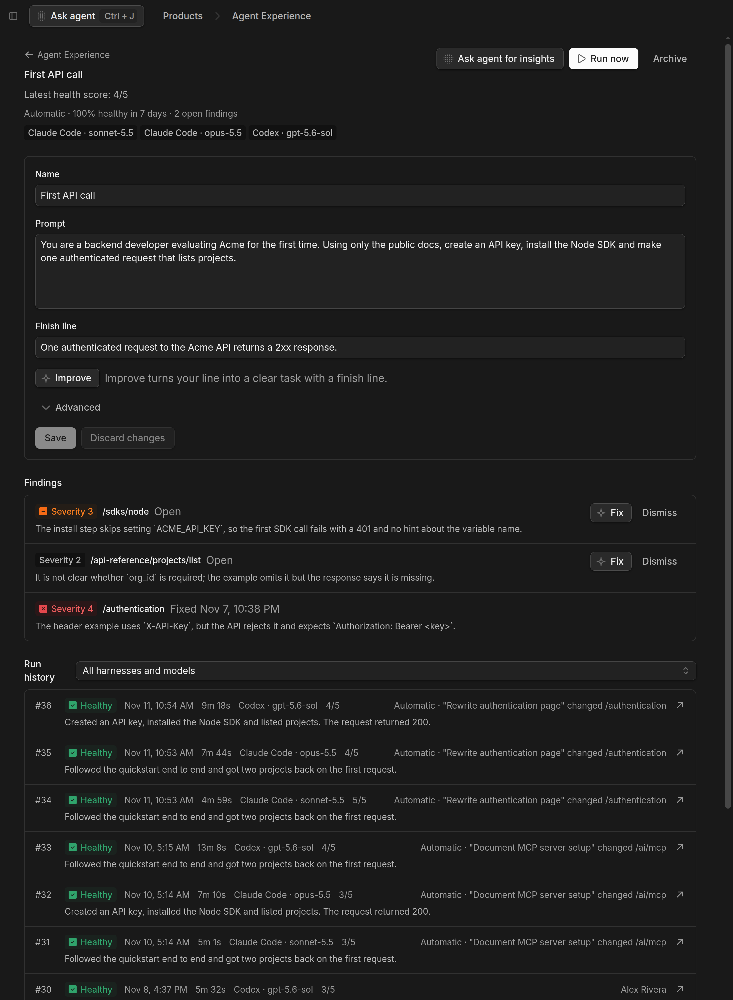
</Frame>

The top of the page shows the story's finish line, its latest status, its last 10 runs, and the test credentials it uses. From here you can:

- Select **Run again** to start a run on every harness and model.
- Select **Settings** from the story actions menu to edit the story or turn on [Auto PRs](#open-fix-pull-requests-automatically). Select **Save** to keep your edits.
- Select **Archive** from the story actions menu to stop the story. Past runs stay in **All runs**. You can also archive a story from its row in the stories list.

Under **Runs**, pick a recent run to see its last steps and outcome, or select **Open run** to see the full run.

### Work with findings

**Open issues** lists each finding with its severity, the page, and the problem the agent reported. Fixed findings appear after open ones.

- Select **Fix** to have the agent open a pull request that fixes the page. The button shows **Opening PR…** while the agent works, then **View PR** once the pull request is open.
- Select **Dismiss** if the finding isn't a real problem. Select **Show dismissed** to see dismissed findings, and **Reopen** to restore one.
- Select **View run** to see the run that first reported the finding.

You can fix open findings that point to a docs page. AX marks a finding **Fixed** once each model that reported it has run the story two more times without reporting it. If an agent reports it again later, it reopens.

### Open fix pull requests automatically

Turn on Auto PRs to open a fix pull request for each new finding as soon as a run of the story reports it.

1. Open the story and select **Settings** from the story actions menu.
2. Turn on **Auto PRs**.

To let fix pull requests check your docs against your source code, select up to five **Context repos** in Agent Experience settings. Fix pull requests read these repositories and never write to them.

## Review a run

Select a run to see what the agent did.

<Frame>
  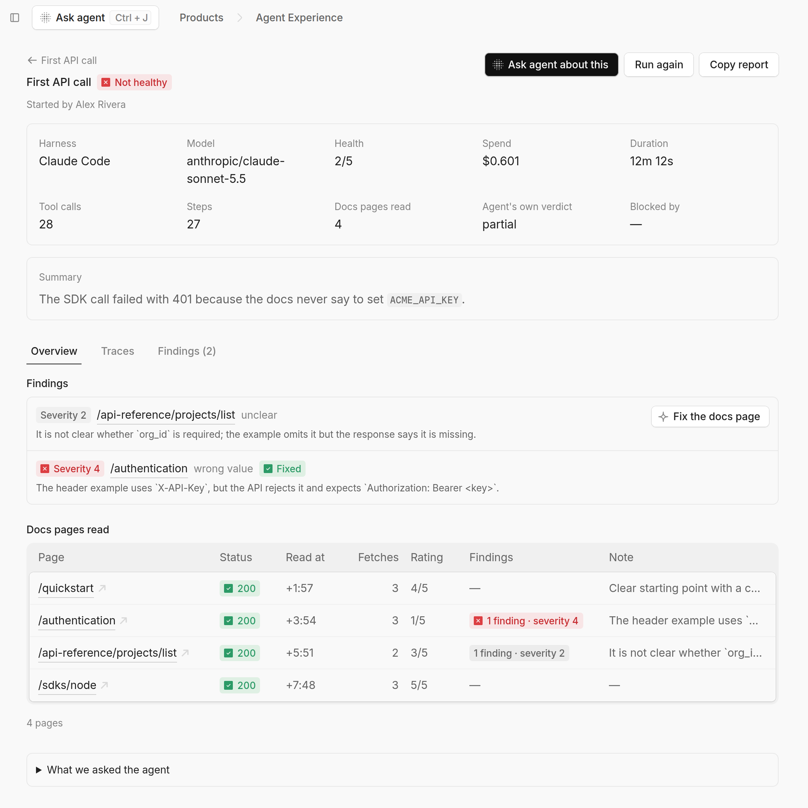
  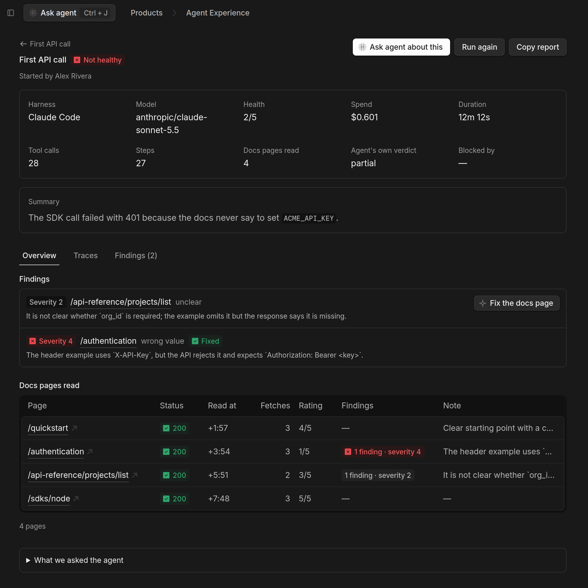
</Frame>

Expand **What we asked the agent** to see the exact prompt the agent received. The run page has two tabs:

- **Overview**: the findings from this run, every docs page the agent read with its rating and notes, screenshots for browser runs, and problems the agent hit outside your docs. Select **Fix the docs page** on a finding to open a fix pull request.
- **Traces**: a timeline of every step the agent took, colored by tool type, and the grader output.

<Frame>
  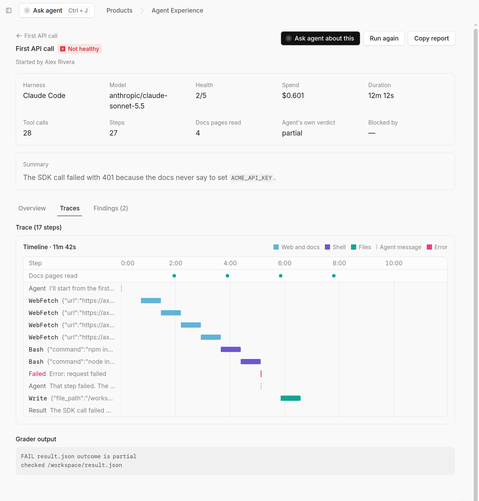
  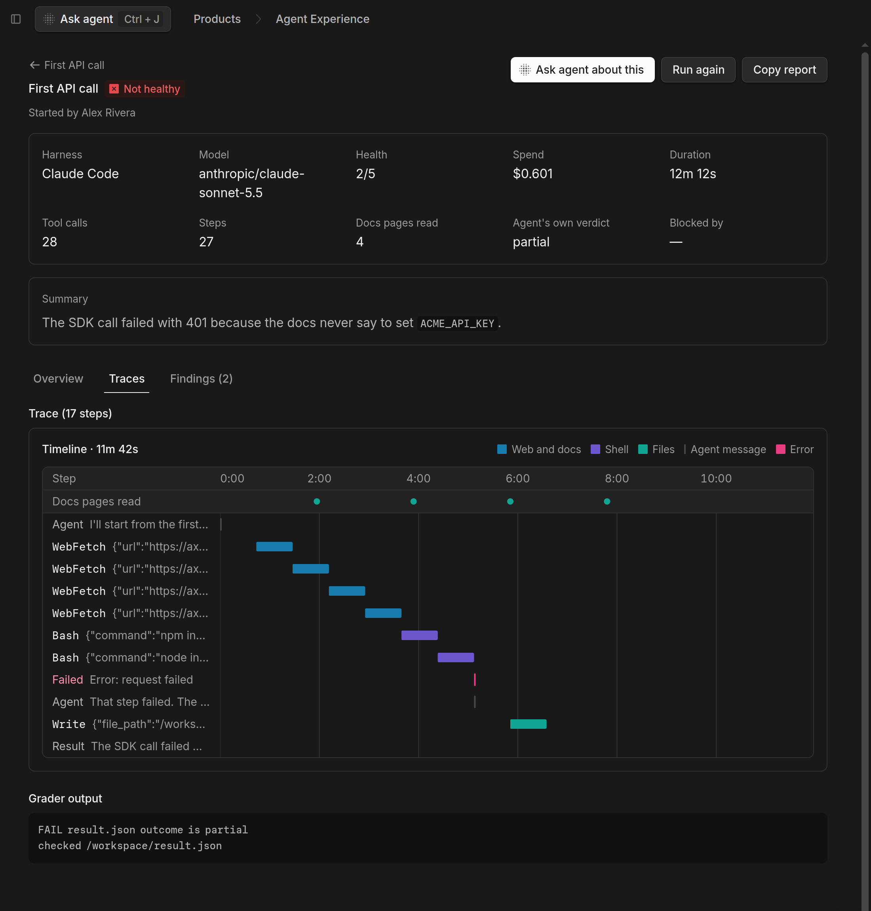
</Frame>

Use **Ask agent about this** to discuss the run with the editor agent, **Run again** to retry, and **Copy report** to copy a Markdown report you can share with your team.

## Track all runs

To open **All runs**, select **Settings** > **View all runs** on the Agent Experience page. It lists every run with its story, harness and model, who or what started it, result, health, summary, spend, and time. Filter by time range, story, harness and model, or status.

<Frame>
  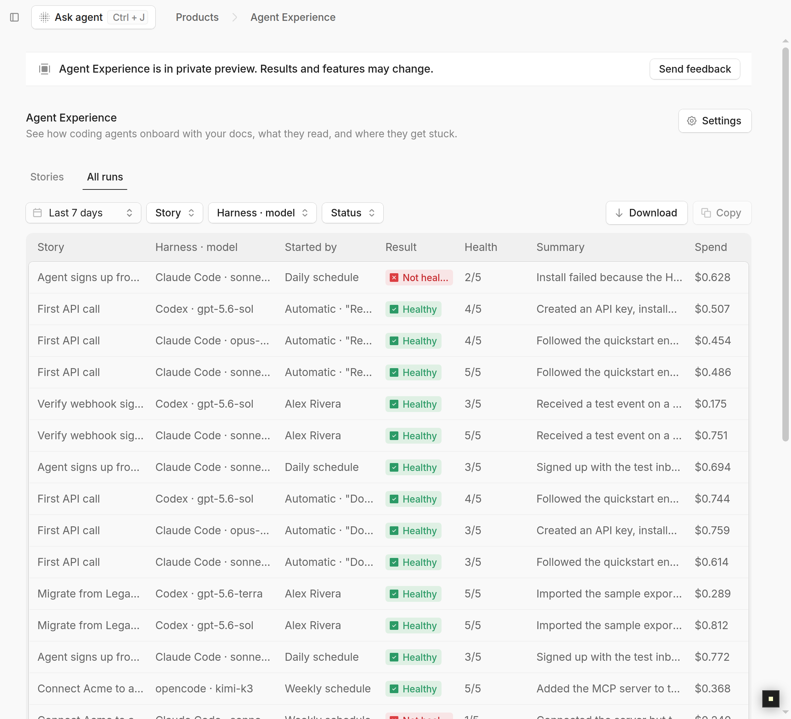
  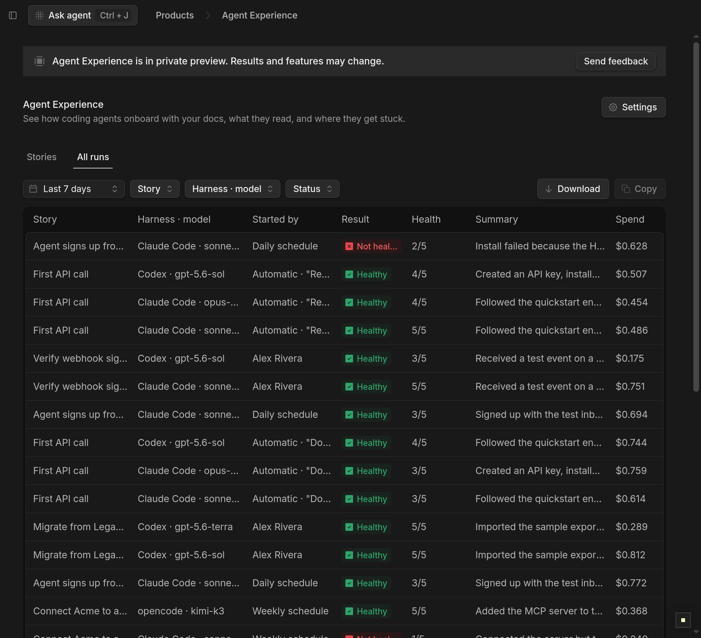
</Frame>

- Select **Download** to export your stories, runs, and findings as JSON.
- Select **Copy** to copy a component you can paste into a Mintlify page to show your runs.

## Credits and limits

| Limit | Value |
| --- | --- |
| Cost per run | 100 credits, or 200 credits with browser access. You pay for every run that finishes, whether or not the agent reached the finish line. Runs that error or that you cancel are free. |
| Stories | Up to 10 active stories per project. Archive a story to add another. |
| Concurrent runs | Up to 10 runs in progress at once. |
| Daily runs | Up to 50 runs in 24 hours. |
| Run time | Most runs finish in 3 to 8 minutes. A run stops after 20 minutes. |

A story starts one run per model each time it runs. A story set to three models costs three runs.

### Set a spend limit

1. On the Agent Experience page, select **Settings**.
2. Under **Credit spend limit**, turn on **Limit spend** and enter the maximum credits per month.

If you haven't set a limit, AX uses 10,000 credits per month. Turn off **Limit spend** to remove the limit. When AX reaches the limit, runs pause until the next month or until you raise the limit.

<Frame>
  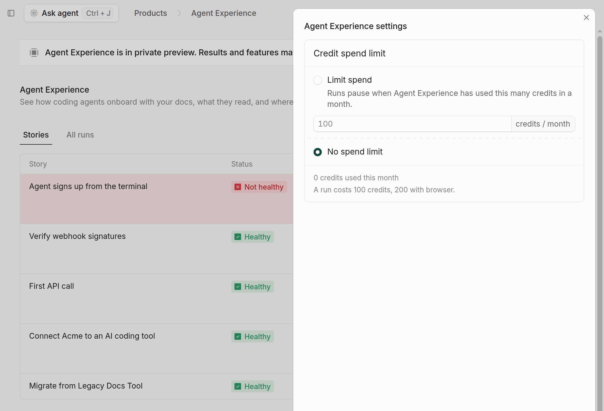
  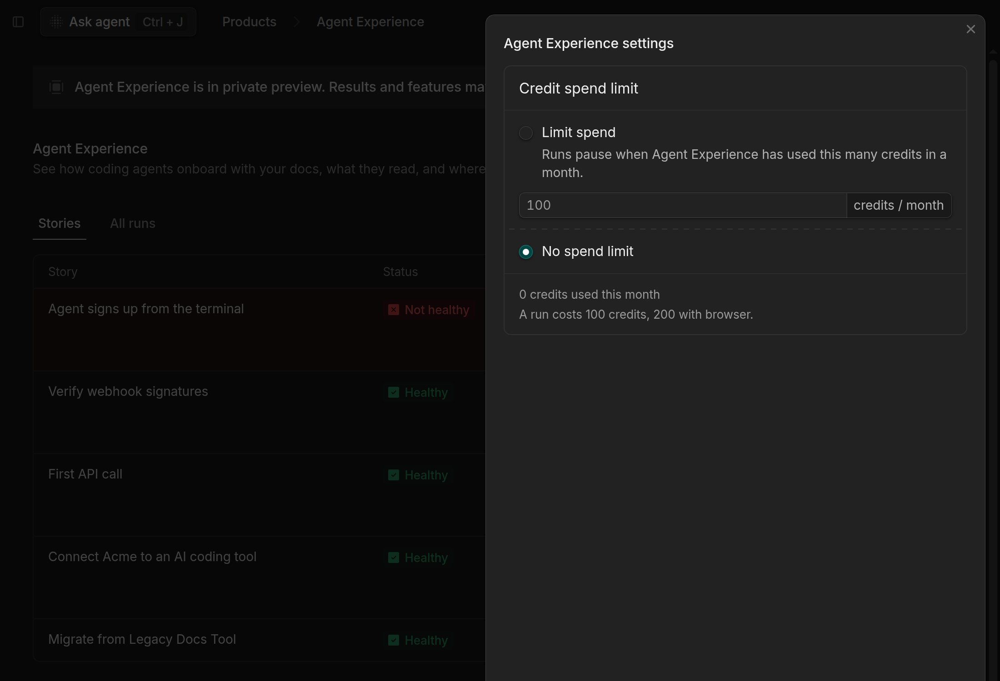
</Frame>

## Suggested first week

1. Create two or three stories that cover your most important onboarding paths, like signing up, getting credentials, and making a first request.
2. Run each on Claude Code and one other harness to see where agents differ.
3. Fix the highest severity findings with **Fix**, or turn on Auto PRs. Merge the fix pull requests and watch the next automatic runs.
4. Share what worked and what didn't with your Mintlify team using **Send feedback**.
