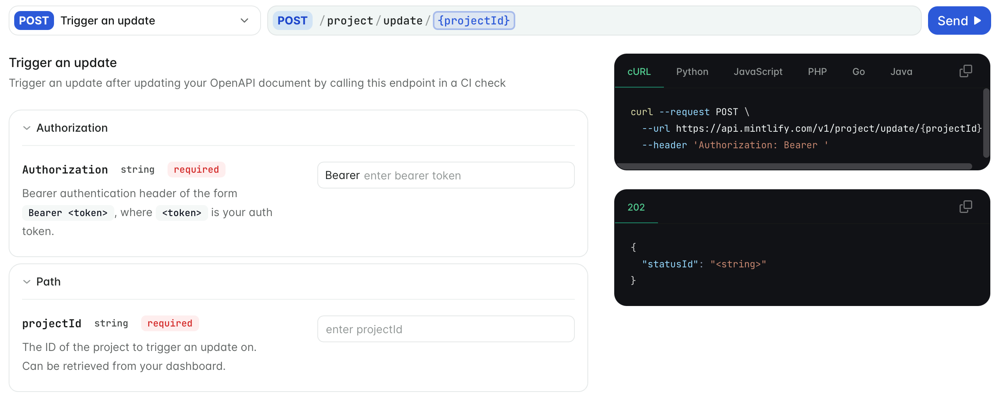
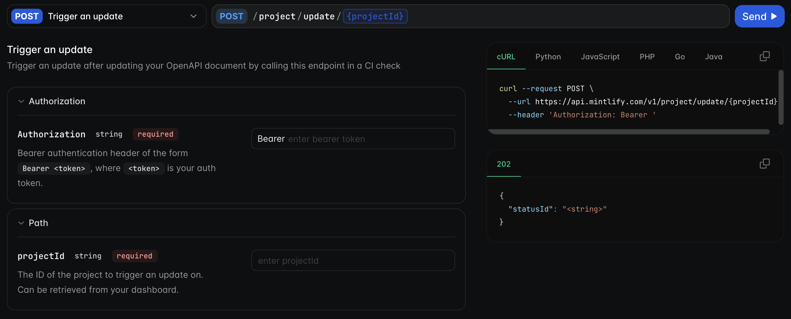

Generate reference pages for your API from the specification you already maintain. Each endpoint gets a page that lists its parameters, shows request and response examples, and includes an interactive API playground where readers can send real requests without leaving your docs. When your specification changes, the pages update.

<Frame>
  
  
</Frame>

To see a generated page, open [Trigger an update](/api/update/trigger) in Mintlify's own API reference. To call Mintlify's API rather than document your own, see the [API reference introduction](/api/introduction).

## What your users can do

- Send requests to your API from the playground and see the responses, including images, audio, video, and streamed responses.
- Copy request examples in their language, or in your SDK.
- Fill in request bodies field by field or [edit them as JSON](#edit-request-bodies-as-json).
- [Navigate to a specific parameter](#link-to-parameters).
- Download your specification, if you [turn the option on](/api-playground/openapi-setup#let-visitors-download-your-spec).

## Choose how to document your API

| Your API is described by | Use | Generates |
| --- | --- | --- |
| An OpenAPI specification | [OpenAPI](/api-playground/openapi-setup) | REST endpoint and webhook pages with the playground. Recommended for HTTP APIs. |
| An AsyncAPI specification | [AsyncAPI](/api-playground/asyncapi-setup) | WebSocket channel pages with a playground. |
| A GraphQL schema | [GraphQL](/api-playground/graphql-setup) | Query, mutation, and type pages. |
| TypeDoc, DocFX, Javadoc, Sphinx, phpDocumentor, or Go output | [SDK reference](/api-playground/sdk-reference-setup) | Class, module, and function pages for your SDK libraries. |
| Nothing or a few endpoints | [Document endpoints without a spec](/api-playground/mdx-setup) | Endpoint pages you write in MDX. |

You can combine approaches, such as an OpenAPI reference for your REST API and an SDK reference for your client libraries.

## Get started with OpenAPI

<CardGroup cols={2}>
  <Card title="Set up OpenAPI" icon="file-braces" href="/api-playground/openapi-setup">
    Add your specification, validate it, and keep it in sync with your API.
  </Card>
  <Card title="Configure the playground" icon="play" href="/api-playground/configure-playground">
    Set your base URL and authentication.
  </Card>
  <Card title="Organize endpoints" icon="list-tree" href="/api-playground/organize-endpoints">
    Group endpoints, combine specifications, and hide internal endpoints.
  </Card>
  <Card title="Endpoint URLs and titles" icon="link" href="/api-playground/endpoint-urls">
    Control page URLs and keep them stable when your specification changes.
  </Card>
  <Card title="Customize endpoint pages" icon="pencil" href="/api-playground/customize-endpoint-pages">
    Change titles and descriptions, add content, and create pages for individual endpoints.
  </Card>
  <Card title="Code examples" icon="code" href="/api-playground/code-examples">
    Choose example languages, or add your own SDK examples.
  </Card>
</CardGroup>

If your API pages don't generate or the playground doesn't send requests, see [Troubleshooting](/api-playground/troubleshooting).

## Edit request bodies as JSON

If an endpoint takes a JSON request body (`application/json` or a `+json` media type), the body section of the playground has a **Form** and **JSON** toggle. Readers use **Form** to fill in one field at a time, or **JSON** to edit the whole body in a code editor, for example to paste a response from another endpoint and change a few values.

- Form and JSON edit the same body, so changes in one view appear in the other. The request and the generated code examples always match the body.
- JSON keeps properties that aren't in your OpenAPI schema and sends them with the request.
- If the JSON is invalid, the playground shows the line, column, and likely cause of the first error. Readers can't send the request until the JSON is valid.
- The playground remembers which view the reader chose and uses it for other endpoints.

The toggle doesn't appear for other request body types, such as `multipart/form-data` or `application/x-www-form-urlencoded`.

## Link to parameters

Every parameter on an endpoint page has an anchor link. Hover over a parameter name and click the link icon to copy a URL to that parameter, for example to share it in a support conversation. The URL format is `your-docs-url/endpoint-path#parameter-name`. For nested parameters, the anchor includes the parent path.
