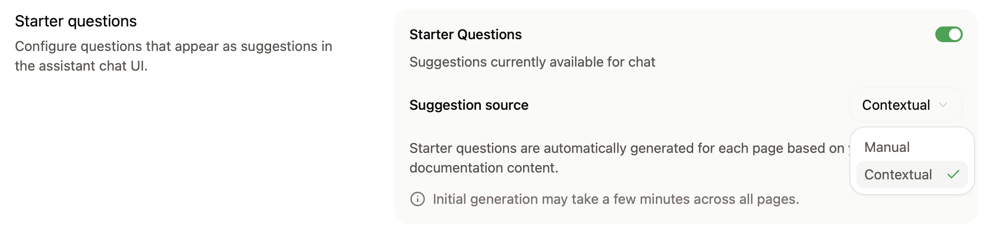
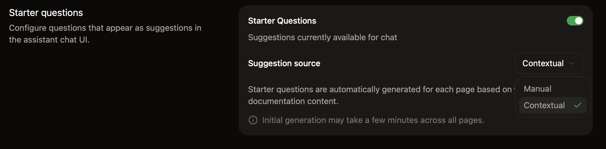

<Info>
  The assistant requires a [Pro or Enterprise plan](https://mintlify.com/pricing?ref=assistant).
</Info>

Configure the assistant on the [Assistant](https://app.mintlify.com/products/assistant) page of your dashboard. Manage billing and usage on the [Usage](https://app.mintlify.com/settings/organization/usage) page.

## Enable or disable the assistant

On the [Assistant](https://app.mintlify.com/products/assistant) page in your dashboard, click the status toggle to enable or disable the assistant for your site.

## Set deflection emails

In the Response Handling section, enable the assistant to prompt users to contact your support and sales teams when it can't answer a question on its own.

The **Support** menu sets where support questions go. It has three options: **Email**, **Link**, and **Direct support ticketing**. This section covers **Email**.

In the **Support** menu, select **Email**, then enter one or both of the following addresses:

- **Support email**: For questions the assistant can't resolve from your documentation.
- **Sales**: For questions about pricing, plans, or purchasing.

When you enable deflection and the assistant detects a matching question, an in-chat contact form appears. The form asks for the user's first name, last name, company, company email, and a message. Mintlify emails the submission to the appropriate team, which can respond directly to the user's email.

The same contact form is available in the [assistant widget](/assistant/widget) embedded on other sites.

<Tip>
If you prefer to route support questions to your existing support channels instead, disable the **Contact form** in the Response Handling section.

When you disable the contact form, the assistant directs users to your support email address in plain text instead of showing the in-chat form. Sales questions still use the in-chat form when you configure a sales email.
</Tip>

## Deflect to a support link

In the **Support** menu, select **Link** to send users to your existing support platform (for example, a help center, ticket portal, or community forum) instead of collecting email through an in-chat form.

Enter the full URL of your support destination. The URL must use `http` or `https` and cannot include credentials.

When the assistant detects a support question, it shows the user a card linking to your support URL. Mintlify appends the assistant thread ID as a `threadId` query parameter so your support tool can attach the conversation transcript to the resulting ticket. Fetch the transcript with the [Get assistant conversation thread](/api/analytics/assistant-thread) endpoint.

With **Link** selected, the assistant does not show the contact form or route sales questions.

## Create tickets in your support platform

The assistant can file support requests as tickets in Plain or Zendesk instead of emailing them.

Before you connect Plain, create a Plain API key with these permissions:

- `customer:create`
- `customer:edit`
- `customer:read`
- `thread:create`
- `thread:read`

1. In the **Support** menu of the **Response Handling** section, select **Direct support ticketing**.
2. Select a **Ticketing platform**: **Plain** or **Zendesk**.
3. On the platform card, click **Connect** and complete the connection in the window that opens. For Plain, use the API key you created.

Mintlify saves direct support ticketing only after the platform connects. Until then, your current support option stays active. The connection is a shared integration for your organization.

When the assistant detects a support question, it shows the in-chat contact form. Mintlify creates a ticket in your connected platform from the submission. The ticket includes the user's contact details and message, plus up to the first three messages of the assistant conversation. If the conversation is longer, the ticket links to the full conversation in your dashboard.

If you saved a **Sales** address under **Email**, sales questions still go to that address by email.

If the Plain API key is missing any of the required permissions, the platform card shows **Scopes misconfigured**. Click **Configure** to see which permissions are missing, then add them to the API key in Plain.

## Search domains

In the Response Handling section, configure domains that the assistant can use for web search to find additional context when answering questions.

- Domains must be publicly available.
- The assistant can't search domains that require JavaScript to load.

For more precise control over what the assistant can search, use filtering syntax.

- **Domain-level filtering**
  - `example.com`: Search only the `example.com` domain
  - `docs.example.com`: Search only the `docs.example.com` subdomain
  - `*.example.com`: Search all subdomains of `example.com`
{/* vale Vale.Terms = NO */}
- **Path-level filtering**
  - `docs.example.com/api`: Search all pages under the `/api` subpath
{/* vale Vale.Terms = YES */}
- **Multiple patterns**
  - Add multiple entries to target different sections of sites

## Add sample questions

Help your users begin conversations with the assistant by adding starter questions.

The assistant can generate page-specific questions based on the page a user is viewing, or you can add persistent questions that are available across pages.

You can add up to three starter questions. Click **Ask Assistant** for recommended questions based on your documentation.

<Frame>
  
  
</Frame>

## Bot protection

In the **Bot Protection** section, enable invisible captcha to protect your assistant from automated abuse. The bot protection is privacy-friendly and invisible to nearly all visitors.

To enable bot protection:

1. Navigate to the [Assistant settings](https://app.mintlify.com/products/assistant/settings) page in your dashboard.
2. In the **Bot Protection** section, toggle **Invisible Captcha** on.

Changes take up to 10 minutes to propagate.

<Note>
  If you use custom [Content Security Policy headers](/deploy/csp-configuration), you must include `hcaptcha.com` and `*.hcaptcha.com` in your allowlist.
</Note>

## Manage billing

The assistant runs on credits. Each question the assistant answers costs 25 credits. If the assistant can't find an answer in your docs and says so, the message costs nothing. See [Credit pricing](/credits) for more information.

<Info>
  Bring your own model requires an [Enterprise plan](https://mintlify.com/pricing?ref=assistant).
</Info>

You can [bring your own model](/ai/bring-your-own-model) to run the assistant on your own LLM provider and API key.

### Change your credit tier

1. Navigate to the [Usage](https://app.mintlify.com/settings/organization/usage) page of your dashboard.
2. In the **Credit packages** section, select a tier from the dropdown menu.
3. Confirm the change to proceed to checkout.

### Allow overages

Your organization shares credits across projects. By default, Mintlify disables overages. You can turn overages on or off for each project. If you disable overages for a project, the assistant becomes unavailable if you spend your organization's shared credit balance. The assistant remains unavailable until your credit balance resets.

To allow overages, turn on the **Overage** toggle on the project's card in the **Usage** section of the [Billing](https://app.mintlify.com/settings/organization/billing) page of your dashboard. If you enable overages, each credit spent beyond the shared balance incurs an overage charge. Choose **Limit spend** to set a maximum overage amount in dollars, or **No spend limit** to bill overages with no ceiling. When a project reaches its spend limit, its credit-powered features pause until the next billing cycle.

### Set usage alerts

In the **Usage** section of the [Billing](https://app.mintlify.com/settings/organization/billing) page, set the **Alert** threshold to email your organization's admins when total usage reaches a certain percentage of its shared credit balance.

### Higher credit volumes

To add up to 90,000 credits per month, buy a [credit add-on](/credits#credit-add-ons). To add a higher amount of credits, [contact sales](https://www.mintlify.com/contact/sales) to discuss a custom credit package.
