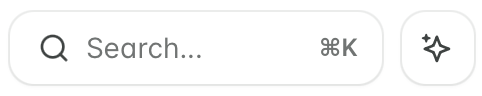
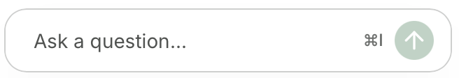
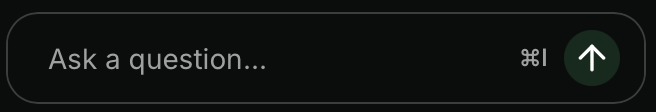
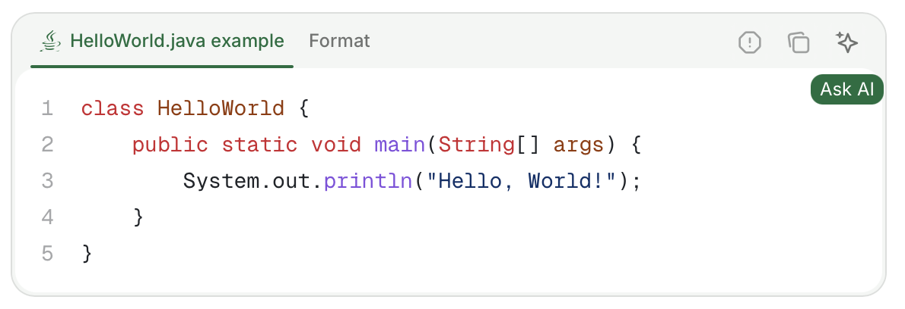
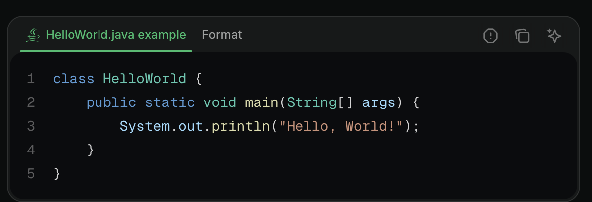

Users open the assistant from its button, a keyboard shortcut, or a link you share. You can change how the button looks, hide it, or turn off the assistant.

## Where the assistant appears

The assistant appears in two locations: as a button next to the search bar and as a bar at the bottom of the page.

<Columns cols={2}>
  <Frame caption="Assistant button next to the search bar.">
    

</Frame>
<Frame caption="Assistant button at the bottom of the page.">


</Frame>
</Columns>

Users can also open the assistant chat panel with the keyboard shortcut <kbd>Cmd</kbd> + <kbd>I</kbd> on macOS and <kbd>Ctrl</kbd> + <kbd>I</kbd> on Windows.

## Open the assistant from your own links

Open the assistant from any page on your documentation site by adding the `?assistant` query parameter to the URL. Use this to deep-link to the assistant from external content like emails, support replies, in-app banners, or onboarding flows.

- `?assistant`: Open the assistant chat panel without sending a message.
- `?assistant=<message>`: Open the assistant chat panel and submit `<message>` as the user's first message. URL-encode the value so spaces and special characters survive the request.

```text Examples
https://yourdocs.mintlify.site/quickstart?assistant
https://yourdocs.mintlify.site/quickstart?assistant=How%20do%20I%20get%20started%3F
```

To let users open the assistant with the current page as context from the page's contextual menu, add the `"assistant"` option to your [contextual menu](/ai/contextual-menu).

## Add context to a question

Users can give the assistant more context than their question. The assistant also knows which page the user is on.

### Highlight text

Highlight text on a page and click the **Add to assistant** button to open the assistant chat panel and add the highlighted text as context. You can add multiple text snippets or code blocks to the assistant's context.

### Code blocks

Click the **Ask Assistant** button in a code block to open the assistant chat panel and add the code block as context. You can add multiple code blocks or text snippets to the assistant's context.

<Frame>


</Frame>

### File attachments

Attach files to assistant messages to provide additional context.

Supported file types:
- **Images**: JPEG, PNG, GIF, WebP, SVG
- **Documents**: PDF
- **Code and text files**: JavaScript (`.js`, `.jsx`, `.mjs`, `.cjs`), TypeScript (`.ts`, `.tsx`), Python, HTML, CSS, Markdown, MDX, JSON, YAML, XML, SQL, CSV, plain text, shell scripts (`.sh`, `.bash`, `.env`), GraphQL, TOML, Go, Rust, Ruby, Java, Kotlin, Swift, C (`.c`, `.h`), C++ (`.cpp`, `.hpp`), C#, PHP, Lua, R, Scala

Limits:
- Maximum file size: 5 MB per attachment
- Maximum attachments per message: 10

## Hide or restyle the assistant

To change how the assistant button looks, or to hide it across your site, target the `[data-layout-item="assistant-entry"]` selector in a [custom CSS](/customize/custom-scripts#add-custom-css) file. See [Custom scripts](/customize/custom-scripts#id-selectors) for the IDs of the assistant button, chat panel, and text input.

## Turn off the assistant

To remove the assistant from your site, [disable the assistant](/assistant/configure#enable-or-disable-the-assistant) in your dashboard.

## Troubleshooting

<Accordion title="Assistant chat bar not visible">
  If the assistant UI is not visible in some browsers, you may need to submit a false positive report to [EasyList](https://easylist.to). Browsers that use the EasyList Cookies List, such as Brave and Comet, sometimes block the assistant or other UI elements. The EasyList Cookies List includes a domain-specific rule that hides fixed elements on certain domains to block cookie banners. This rule inadvertently affects legitimate UI components.

  Report the incorrect block to [EasyList](https://github.com/easylist/easylist) and request removal of the rule. This resolves the issue for all users once the filter list updates.

</Accordion>

<Accordion title="Assistant blocked on a corporate network, VPN, or firewall">
  If the assistant loads on personal networks but fails on a work network, VPN, or other restricted network, the block occurs at the network level. Corporate proxies, VPNs, and firewalls sometimes block the outbound requests the assistant needs to make. The chat panel cannot connect even though the rest of the site loads normally.

  **For readers:** Ask your IT team to allow outbound HTTPS requests to the following hostnames from your network. If you can, try the assistant from a personal network to confirm the issue is network-specific.

  - `leaves.mintlify.com`: Assistant API
  - `hcaptcha.com` and `*.hcaptcha.com`: CAPTCHA verification for the assistant

  **For site owners:** If a reader reports that the assistant does not load on their corporate network or VPN, treat it as an outbound network block. It is not a problem with your documentation. Point them to the preceding hostnames and suggest that they share the list with their IT team. This allowlist applies to the visitor's device or network. You cannot configure it from your site. If you self-host behind a reverse proxy that overwrites the default CSP, see [CSP configuration](/deploy/csp-configuration) for the domains to allow.

</Accordion>

<Accordion title="Message contains `[REDACTED_SECRET]`">
  The assistant scans each message for values that look like credentials, such as API keys, access tokens, passwords in URLs, JSON Web Tokens, and private keys. It also scans the text of attached files and any context sent with the message. Images are not scanned. Mintlify replaces each detected value with `[REDACTED_SECRET]` before the assistant model sees the message or Mintlify stores the conversation.

  The assistant never receives the original value. It does not ask you to paste the value again. If an answer depends on the exact value, the assistant tells you that the value was redacted. To get help with a credential, describe it or replace it with a placeholder like `YOUR_API_KEY`.

</Accordion>
