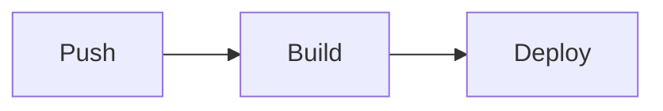

Theme v2 is a redesigned version of the [Mint theme](/customize/themes). It changes the site layout, navigation, search, and assistant panel, and adds components and props that version 1 doesn't have. Version 1 stays the default, so your site only changes when you turn on theme v2.

## Turn on theme v2

Theme v2 is only available for the `mint` theme. Set `themeVersion` to `2` in your `docs.json`:

```json docs.json
{
  "theme": "mint",
  "themeVersion": 2
}
```

Your deployed site and `mint dev` render theme v2 after you make this change. To go back to version 1, remove `themeVersion` or set it to `1`. Other themes ignore `themeVersion`.

## Check your pages

Theme v2 removes or changes some components and props. Before you deploy, run [`mint validate`](/cli/commands#theme-v2-component-checks). On a theme v2 site, it warns about each component or prop that theme v2 doesn't support, says what renders instead, and says what to write. Run `mint validate --fix` to apply the fixes that have one safe replacement, such as renaming `<Tip>` to `<Check>`.

`mint dev` runs the same checks while you edit and prints new warnings each time you save.

## Limitations

- The [editor](/editor) doesn't show a live preview for theme v2 sites.
- `<Update>`, `<Tile>`, `<Variation>`, and GitHub components render only their content, without their own styling.
- Theme v2 renders different markup than version 1, so custom CSS and JavaScript that target version 1 classes and IDs may no longer apply.

## Components and props in theme v2

Theme v2 renders the following components and props. Sites on version 1 ignore them.

### List

Wrap a Markdown list in `<List>` to set its marker.

| Prop | Description |
| --- | --- |
| `marker` | `dot`, `number`, or `box` (numbers in grey boxes). Nested lists of the same kind use the same marker. |
| `start` | The first number. Applies to the top-level list only. |

```mdx
<List marker="box" start={3}>
1. Install the CLI.
2. Run `mint dev`.
</List>
```

### Table

Build a table from parts: `<Table>`, `<Table.Header>`, `<Table.Body>`, `<Table.Row>`, `<Table.HeaderCell>`, `<Table.RowHeader>`, and `<Table.Cell>`.

| Prop | On | Description |
| --- | --- | --- |
| `variant` | `Table` | `minimal` or `grid`. |
| `layout` | `Table` | `equal` or `auto`. |
| `aria-label` | `Table` | A name for the table for screen readers. |
| `align` | Cells | `start`, `center`, or `end`. |
| `variant` | `Table.Cell` | `subtle` or `strong`. |

```mdx
<Table variant="grid">
  <Table.Header>
    <Table.Row>
      <Table.HeaderCell>Plan</Table.HeaderCell>
      <Table.HeaderCell align="end">Seats</Table.HeaderCell>
    </Table.Row>
  </Table.Header>
  <Table.Body>
    <Table.Row>
      <Table.RowHeader>Team</Table.RowHeader>
      <Table.Cell align="end" variant="strong">10</Table.Cell>
    </Table.Row>
  </Table.Body>
</Table>
```

To style a Markdown table, wrap it in `<Table variant="grid">`. HTML tables always use the default style.

Version 1 renders the parts as a plain table.

### Quote

Use `<Quote>` to style a quote.

| Prop | Description |
| --- | --- |
| `variant` | `rule` (default), `card`, or `plain`. `card` and `plain` add curly quotes around the text. |
| `author` | The attribution under the quote. |
| `img` | An avatar next to the author. |
| `icon` | An icon above the quote. |

```mdx
<Quote variant="card" author="Ada Lovelace" img="/images/ada.png">
  The engine might compose elaborate pieces of music.
</Quote>
```

Without `author`, a last line that starts with `--`, an en dash, or an em dash becomes the attribution. This also works in Markdown block quotes:

```mdx
> The engine might compose elaborate pieces of music.
>
> -- Ada Lovelace
```

Version 1 renders `<Quote>` as a plain block quote.

### Steps variants

`<Steps>` takes these props in theme v2:

| Prop | Description |
| --- | --- |
| `variant` | `timeline` (default) or `divided`. `divided` separates steps with lines and zero-padded numbers. |
| `marker` | For `timeline`: `box` (default), `circle`, `dot`, or `number`. |
| `line` | For `timeline`: `solid` (default) or `dashed`. |
| `background` | For `divided`: set to `true` to add a background. |
| `start` | The first step's number. |

Each `<Step>` also takes `description`, a line under its title.

```mdx
<Steps variant="divided" start={2}>
  <Step title="Connect your repository" description="Takes about a minute.">
    Install the GitHub app.
  </Step>
  <Step title="Deploy">
    Push to your deploy branch.
  </Step>
</Steps>
```

### Columns and cards

`<Columns>` takes these props in theme v2:

| Prop | Description |
| --- | --- |
| `joined` | Puts the cards on one shared surface with dividers. A joined group always uses `background`. |
| `variant` | `background` (default), `plain`, or `separator`. Every card in the group uses it. `separator` needs vertical cards with icons. |

A `<Card>` outside `<Columns>` takes `variant` too.

```mdx
<Columns cols={2} joined>
  <Card title="Quickstart" icon="rocket" href="/quickstart">
    Deploy your first site.
  </Card>
  <Card title="Components" icon="shapes" href="/components">
    Build rich pages.
  </Card>
</Columns>
```

### Link and tooltip icons

Links and `<Tooltip>` take `iconPosition`: `right` (default), `left`, or `none`. On a link to another site, it moves or hides the external link arrow. On `<Tooltip>`, it moves or hides the info icon.

```mdx
<a href="https://example.com" iconPosition="none">Example</a>

<Tooltip tip="Application programming interface" iconPosition="left">API</Tooltip>
```

### Inline code block buttons

Add `inline` to a code fence, or to `<CodeBlock>`, to show its buttons, such as copy, next to the first line of code instead of in a header.

````mdx
```bash inline
npm i -g mint
```
````

A title, an icon, or `expandable` turns `inline` off. Version 1 reads `inline` as part of the code block's title.

### Mermaid diagram titles

Add a `title` to a Mermaid code fence, or to `<Mermaid>`, to show it in the diagram's header and full-screen view. Screen readers use it as the diagram's name.

````mdx

````
