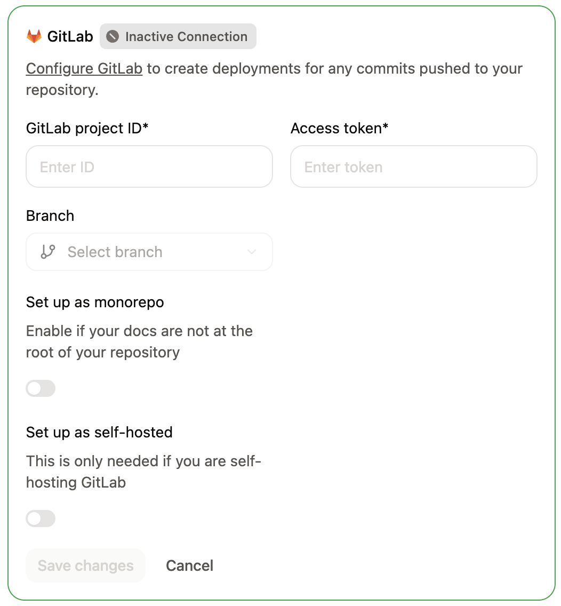
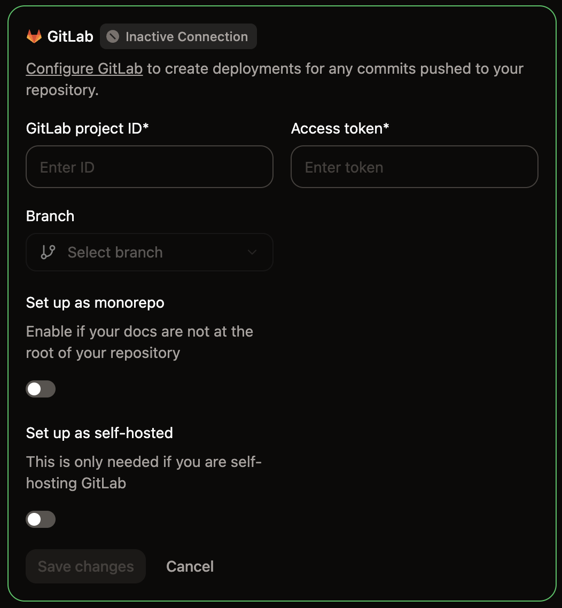

Mintlify uses access tokens and webhooks to authenticate and sync changes between GitLab and Mintlify.

- Mintlify uses access tokens to pull information from GitLab.
- GitLab uses webhooks to notify Mintlify when you make changes, which enables preview deployments for merge requests. Mintlify adds the webhook to your project when you connect it.

## Set up the connection

When you open [Git Settings](https://app.mintlify.com/settings/project/git-settings) for the first time, a setup wizard guides you through connecting your GitLab repository.

<Steps>
  <Step title="Select GitLab as your provider">
    On the [Git Settings](https://app.mintlify.com/settings/project/git-settings) page, click **Connect to GitLab** and then click **Continue**.
  </Step>
  <Step title="Download your content">
    <Tip>
      If you already have a GitLab repository with your documentation, you can skip the download and click **Continue setup** directly.
    </Tip>
    
    If Mintlify hosts your documentation, download it as a zip file.
    * Create a new repository in GitLab.
    * Extract the zip contents.
    * Push the contents to your repository.

    Click **Continue setup** to proceed.
  </Step>
  <Step title="Find your project ID">
    In your GitLab project, navigate to **Settings** > **General** and locate your **Project ID**.
  </Step>
  <Step title="Generate an access token">
    Navigate to **Settings** > **Access Tokens** and click **Add new token**.

    Configure the token with these settings:
    - **Name**: Mintlify
    - **Role**: Maintainer
    - **Scopes**: `api` and `read_api`

    Click **Create project access token** and copy the token.

    When you save a new token, Mintlify checks it first. If the token doesn't have the `api` scope or can't publish to your deploy branch, Mintlify rejects it with the message "This GitLab token can't publish changes. Use a project access token with the Maintainer role and the api scope."

    <Note>
      If Project Access Tokens are not available, you can use a Personal Access Token instead. Personal Access Tokens expire, so you must update them when they do.
    </Note>
  </Step>
  <Step title="Connect your repository">
    Back in the setup wizard, fill in the following fields:

    - **Project ID**: The project ID from your GitLab project settings.
    - **Branch**: Select the branch to deploy your documentation from.
    - **Deployment token**: The access token you generated.
    - **Self-hosted GitLab instance**: Leave off for `gitlab.com`. For a self-hosted instance, turn it on and enter your instance URL in **GitLab instance URL**, for example, `https://gitlab.example.com`. Your instance must be publicly accessible for Mintlify to reach it. The URL must use `https://` on the default port 443 and can't include a username or password.

    Click **Connect**.
    <Frame>
      
      
    </Frame>
  </Step>
</Steps>

## Update an existing connection

To modify your GitLab connection settings after the initial setup, go to [Git Settings](https://app.mintlify.com/settings/project/git-settings) and update your project ID, access token, branch, or instance URL directly.

## Revalidate Git settings

If your project shows unexpected behavior, such as missing branch options or stale configuration, you can force Mintlify to refresh your Git source.

<Steps>
  <Step title="Navigate to Git Settings">
    Go to [Git Settings](https://app.mintlify.com/settings/project/git-settings) in your dashboard.
  </Step>
  <Step title="Revalidate your settings">
    Click the green **Active** badge in the corner of the GitLab settings box to revalidate your Git source.
  </Step>
</Steps>

## Create the webhook

Webhooks notify Mintlify when you push changes so that deployments trigger
automatically.

When you save your GitLab connection, Mintlify uses your access token to add the webhook to your project for you. Each Mintlify project connected to the same GitLab project gets its own webhook.

When you save the connection again, Mintlify keeps the webhook it added. If that webhook was deleted or its URL changed, Mintlify adds a new one.

If Mintlify can't add the webhook, for example because the token doesn't have the Maintainer role, the dashboard opens the **Add the GitLab webhook** dialog. The dialog shows the webhook URL and secret token to copy, and an **Open GitLab webhooks** link to your project's webhook settings.

Either save the connection again with a token that has the Maintainer role and `api` scope, or follow these steps to create the webhook manually with the values from the dialog.

<Steps>
  <Step title="Add new webhook">
  1. In GitLab, navigate to **Settings** > **Webhooks**.
  2. Click **Add new webhook**.
  </Step>
  <Step title="Set up URL and webhook">
    Name the webhook **Mintlify**.

    In the **URL** field, enter the endpoint `https://leaves.mintlify.com/gitlab-webhook`.
  </Step>
  <Step title="Get the webhook token">
    In your Mintlify dashboard, click **Show webhook token**. Copy the webhook token.
  </Step>
  <Step title="Paste the webhook token">
    In GitLab, paste the webhook token from your Mintlify dashboard in the **Secret token** field.
  </Step>
  <Step title="Select events">
    Select the following events to trigger the webhook:
    - **Push events** (All branches)
    - **Merge requests events**
  </Step>
  <Step title="Verify the webhook">
    You should see the following settings after configuring the webhook:
    
    - **Name**: Mintlify
    - **URL**: `https://leaves.mintlify.com/gitlab-webhook`
    - **Secret token**: The webhook token from your Mintlify dashboard
    - **Events**: **Push events** (All branches) and **Merge requests events**

    Add the webhook.
  </Step>
  <Step title="Test the webhook">
    After you create the webhook, click the **Test** dropdown. Click **Push events** to send a sample payload. If the test returns `Hook executed successfully: HTTP 200`, you configured the webhook correctly.

  </Step>
</Steps>

## Fix connection warnings

Mintlify checks your access token and webhook when you open [Git Settings](https://app.mintlify.com/settings/project/git-settings). If either one stops working, Git Settings shows a warning at the top of your GitLab settings, and pushes don't deploy until you fix it. Only members who can edit Git settings see the warning.

| Warning | How to fix it |
| --- | --- |
| Your access token expired, someone revoked it, GitLab no longer accepts it, or it can no longer open the project | Create a new token with the Maintainer role and the `api` scope, enter it in **Deployment token**, and save. |
| The Mintlify webhook is missing from the project | Click **Set up webhook** to open the **Add the GitLab webhook** dialog, then [create the webhook](#create-the-webhook) in GitLab with the values from the dialog. |
| GitLab turned off the Mintlify webhook after failed deliveries | Click **Open GitLab webhooks** and turn the webhook back on in GitLab. |
| The Mintlify webhook has push events turned off | Click **Open GitLab webhooks** and turn on **Push events** for the webhook in GitLab. |

Webhook warnings also show when Mintlify last received a webhook from your project. Mintlify checks the connection again after you save your settings and when you return to the browser tab with Git Settings open, so the warning clears once you fix the problem.

## Deployment status in GitLab

Mintlify reports the status of your deployments in GitLab, so you can see whether a build succeeded without opening the dashboard.

When you open a pull request against your deploy branch, Mintlify comments on it with the status of its [preview deployment](/deploy/preview-deployments). If the preview fails, the comment includes the reason for the failure.

When you push to your deploy branch, Mintlify adds a **Mintlify Deployment (`<subdomain>`)** commit status to the pushed commit. The status shows whether the production deployment is running, succeeded, or failed, and links to your docs site. Its description explains the result, such as the reason a deployment failed.
