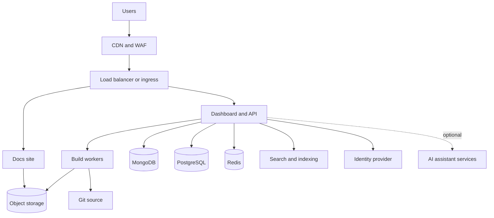

<Info>
  Self-hosting requires an [Enterprise plan](https://mintlify.com/pricing?ref=self-host). Reach out to your account team to scope a deployment.
</Info>

Self-hosting runs Mintlify inside your own cloud account or data center, so your content, build pipeline, analytics, and logs stay within your network boundary. It's designed for teams with data-residency, compliance, or air-gap requirements that a cloud-hosted deployment can't meet.

Every self-hosted deployment is a scoped engagement with your account team, not a self-serve install. This page describes what you provision, how the deployment runs, and the tradeoffs against cloud hosting so you can evaluate self-hosting before committing to it.

## Choose between cloud and self-hosted

Cloud hosting is the right fit for most teams, including teams with strict security requirements. It has every feature and runs on Mintlify's global edge network. Before you commit to self-hosting, check whether the [trust center](https://security.mintlify.com) answers your security team's questions. Your account team can also share audit reports and certifications, and can bring Mintlify's security team into the review.

Self-hosting takes longer to set up, and some features are cloud-only. Depending on the deployment model, your team also operates the infrastructure. See [Features](#features) for what's available in each.

## Deployment models

| Model | Who operates it | Where it runs |
| --- | --- | --- |
| [Static export](/api/static-export/overview) | You serve the files | Any static host, including air-gapped networks. No platform to run |
| Bring your own cloud | Mintlify, with access you grant | Your account on AWS, Azure, or Google Cloud |
| Self-managed | Your team, with releases and support from Mintlify | Your Kubernetes cluster, in a cloud account or your own data center |
| Managed on-premises | Mintlify and your team together, under a statement of work | Your data center or private cloud |

The more access Mintlify has to the environment, the faster the deployment goes and the more features it can run. Bring your own cloud on AWS is the closest to the cloud-hosted product.

## Platform support

| Platform | Method |
| --- | --- |
| <Icon icon="/images/logos/aws-mark.svg" className="mr-2 my-2" /> Amazon Web Services | AWS Cloud Development Kit (CDK) app |
| <Icon icon="/images/logos/aws-mark.svg" className="mr-2 my-2" /> Amazon EKS | Helm chart on Amazon Elastic Kubernetes Service (EKS) |
| <Icon icon="/images/logos/azure.svg" className="mr-2 my-2" /> Microsoft Azure | Helm chart on Azure Kubernetes Service (AKS) |
| <Icon icon="/images/logos/gcp.svg" className="mr-2 my-2" /> Google Cloud | Helm chart on Google Kubernetes Engine (GKE) |
| <Icon icon="/images/logos/oracle-mark.svg" className="mr-2 my-2" /> Oracle Cloud | Helm chart on Oracle Container Engine for Kubernetes (OKE) |
| <Icon icon="/images/logos/openshift.svg" className="mr-2 my-2" /> Red Hat OpenShift | Helm chart |
| <Icon icon="/images/logos/kubernetes.svg" className="mr-2 my-2" /> Any Kubernetes | Helm chart |

## How self-hosting compares to cloud hosting

Authoring works the same way in both hosting models. Your team maintains content with the editor or their Git workflow, and every change flows through your repository's review process. What changes is who operates the platform and where data resides.

| Area | Cloud-hosted | Self-hosted |
| --- | --- | --- |
| Initial setup | Same day | One-time deployment engagement with your account team. Plan for two to three months. It can take a few weeks when access, approvals, and resources on your side are ready early |
| Infrastructure | Mintlify operates everything | Depends on the [deployment model](#deployment-models). In a self-managed deployment, you operate the cluster, network, and data stores. Mintlify ships versioned releases with upgrade guides and supports the application tier |
| Platform updates | Continuous, automatic | Versioned releases that you review and deploy on your own schedule |
| Data boundary | Processed in Mintlify's cloud | Content, builds, analytics, and logs stay inside your network with no third-party egress |
| AI features | On by default | Ship disabled until your security or AI governance team approves them. Run on Amazon Bedrock in your AWS account |
| Integrations | Full catalog | Google Drive and Google Docs, through an OAuth client you own. Other integrations are cloud-only |
| Edge delivery | Mintlify's global edge network with caching and bot protection | Your own CDN and WAF. Page load speed and bot protection depend on how you configure them |
| New features | Available as they ship | Arrive in later versioned releases |
| Monitoring | Managed by Mintlify | You connect your own observability stack |

If you need the platform in your own cloud account but don't want to operate it, Mintlify can deploy and run it for you in a dedicated AWS account that you provide. Your data stays in your account, and Mintlify handles the deployment and upgrades. Ask your account team whether this fits your requirements.

Self-hosted deployments usually start narrow and expand. A common path is to start with public documentation, then add authenticated content, the web editor, and AI features as you complete security reviews.

## Features

The tables below show which features each hosting model includes. In the self-hosted column, **Optional** means the feature ships turned off and you turn it on during setup. **Partial** means a narrower version is available, and the notes say what's missing.

Features in beta or private preview on cloud reach self-hosted deployments after they're generally available, in a later versioned release.

### Delivery and performance

| Feature | Cloud | Self-hosted | Notes |
| --- | :---: | :---: | --- |
| Global edge network and caching | <Icon icon="circle-check" color="#16a34a" /> | <Icon icon="x" color="#dc2626" /> | Self-hosted sites serve from your ingress. Put your own CDN in front |
| Bot detection and DDoS protection | <Icon icon="circle-check" color="#16a34a" /> | <Icon icon="x" color="#dc2626" /> | Use your own WAF |
| Assistant abuse protection (CAPTCHA) | <Icon icon="circle-check" color="#16a34a" /> | <Icon icon="x" color="#dc2626" /> | Rate-limit the assistant endpoint at your WAF |
| Custom domains | <Icon icon="circle-check" color="#16a34a" /> | Partial | Each site is served at `<subdomain>.client.<your-domain>`. You manage DNS and TLS on your ingress |

### Agent experience

| Feature | Cloud | Self-hosted | Notes |
| --- | :---: | :---: | --- |
| [llms.txt and llms-full.txt](/ai/llmstxt) | <Icon icon="circle-check" color="#16a34a" /> | <Icon icon="circle-check" color="#16a34a" /> |  |
| [Markdown export](/ai/markdown-export) | <Icon icon="circle-check" color="#16a34a" /> | <Icon icon="circle-check" color="#16a34a" /> |  |
| [Contextual menu](/ai/contextual-menu) | <Icon icon="circle-check" color="#16a34a" /> | <Icon icon="circle-check" color="#16a34a" /> |  |
| [Search MCP server](/ai/model-context-protocol) | <Icon icon="circle-check" color="#16a34a" /> | <Icon icon="circle-check" color="#16a34a" /> | Hosted AI tools can only connect if the docs site is reachable from the internet |
| [Admin MCP server](/ai/mintlify-mcp) | <Icon icon="circle-check" color="#16a34a" /> | Optional | Off by default |
| [skill.md](/ai/skillmd) | <Icon icon="circle-check" color="#16a34a" /> | Partial | Serve a custom `skill.md` from your repository. Automatic generation is cloud-only |

### AI

| Feature | Cloud | Self-hosted | Notes |
| --- | :---: | :---: | --- |
| [Assistant](/assistant) | <Icon icon="circle-check" color="#16a34a" /> | Optional | Ships disabled. Runs on Amazon Bedrock in your AWS account |
| Semantic search for the assistant and MCP server | <Icon icon="circle-check" color="#16a34a" /> | Optional | Amazon Bedrock embeddings stored in your PostgreSQL. Keyword search works without it |
| [Automations](/automations) | <Icon icon="circle-check" color="#16a34a" /> | Optional | Scheduled and manual runs against repositories on github.com, including GitHub Enterprise Cloud. GitLab and GitHub Enterprise Server aren't supported. Runs in isolated sandboxes in your cluster, on Amazon Bedrock |
| [Autopilot](/autopilot) | <Icon icon="circle-check" color="#16a34a" /> | <Icon icon="x" color="#dc2626" /> | Use automations with your own prompts instead |
| [Bring your own model](/ai/bring-your-own-model) | <Icon icon="circle-check" color="#16a34a" /> | Partial | Amazon Bedrock only |
| Translations | <Icon icon="circle-check" color="#16a34a" /> | <Icon icon="x" color="#dc2626" /> |  |
| Assistant insights | <Icon icon="circle-check" color="#16a34a" /> | <Icon icon="x" color="#dc2626" /> |  |

### Authoring and publishing

| Feature | Cloud | Self-hosted | Notes |
| --- | :---: | :---: | --- |
| Web editor | <Icon icon="circle-check" color="#16a34a" /> | <Icon icon="circle-check" color="#16a34a" /> |  |
| Git-backed workflow | <Icon icon="circle-check" color="#16a34a" /> | <Icon icon="circle-check" color="#16a34a" /> | GitHub, GitHub Enterprise Server, GitLab including self-managed, Bitbucket, or an internally owned proxy API |
| [Preview deployments](/deploy/preview-deployments) | <Icon icon="circle-check" color="#16a34a" /> | <Icon icon="circle-check" color="#16a34a" /> |  |
| [Custom React components](/customize/react-components) | <Icon icon="circle-check" color="#16a34a" /> | <Icon icon="circle-check" color="#16a34a" /> | Client-side code only |
| [Third-party libraries](/customize/third-party-libraries) | <Icon icon="circle-check" color="#16a34a" /> | <Icon icon="x" color="#dc2626" /> | npm packages aren't installed in self-hosted builds. Build components as snippets instead |
| [Static export](/api/static-export/overview) | <Icon icon="circle-check" color="#16a34a" /> | Partial | AWS (CDK) deployments |

### Access and identity

| Feature | Cloud | Self-hosted | Notes |
| --- | :---: | :---: | --- |
| [Authenticated content](/deploy/authentication-setup) | <Icon icon="circle-check" color="#16a34a" /> | <Icon icon="circle-check" color="#16a34a" /> | Password, private authentication, OAuth 2.0, and JWT. Needs an AWS KMS key, including on clusters outside AWS. If you turn it on, every site in the deployment must require sign-in, so run public sites in a separate deployment |
| Dashboard SSO | <Icon icon="circle-check" color="#16a34a" /> | Partial | OIDC. SAML is cloud-only |
| SCIM user provisioning | <Icon icon="circle-check" color="#16a34a" /> | <Icon icon="x" color="#dc2626" /> |  |

### Search and analytics

| Feature | Cloud | Self-hosted | Notes |
| --- | :---: | :---: | --- |
| [Search](/optimize/search) | <Icon icon="circle-check" color="#16a34a" /> | <Icon icon="circle-check" color="#16a34a" /> | Same keyword ranking as cloud, indexed in your PostgreSQL |
| Analytics | <Icon icon="circle-check" color="#16a34a" /> | Optional | Needs ClickHouse. Data stays in your network |
| Third-party analytics and support widgets | <Icon icon="circle-check" color="#16a34a" /> | <Icon icon="circle-check" color="#16a34a" /> | Configured with your own keys |

### Integrations

| Feature | Cloud | Self-hosted | Notes |
| --- | :---: | :---: | --- |
| [Slack agent](/agent/slack) | <Icon icon="circle-check" color="#16a34a" /> | <Icon icon="x" color="#dc2626" /> | Mentioning the agent, interactive buttons, and automations triggered by Slack messages |
| Slack notifications and read access | <Icon icon="circle-check" color="#16a34a" /> | Optional | Automation notifications to channels and direct messages, and read-only access to channels, threads, and users for agents. Uses a Slack app and bot token you own |
| [Integrations](/automations/integrations) | <Icon icon="circle-check" color="#16a34a" /> | Partial | Google Drive and Google Docs, through an OAuth client you own |
| SDK generation integrations | <Icon icon="circle-check" color="#16a34a" /> | <Icon icon="x" color="#dc2626" /> |  |

## Architecture

A self-hosted deployment is a set of services with clear dependencies. Provision the data stores first, then the services that depend on them, then the edge.



| Resource | Purpose | Required |
| --- | --- | :---: |
| Load balancer or ingress | TLS termination and routing | <Icon icon="circle-check" color="#16a34a" /> |
| Docs site | Serves rendered documentation | <Icon icon="circle-check" color="#16a34a" /> |
| Dashboard and API | Admin, auth, and build orchestration | <Icon icon="circle-check" color="#16a34a" /> |
| Build workers | Build and publish documentation sites | <Icon icon="circle-check" color="#16a34a" /> |
| MongoDB | Content store | <Icon icon="circle-check" color="#16a34a" /> |
| PostgreSQL | Project and user metadata | <Icon icon="circle-check" color="#16a34a" /> |
| Redis | Build queue and caching | <Icon icon="circle-check" color="#16a34a" /> |
| Object storage | Built site bundles and static exports | <Icon icon="circle-check" color="#16a34a" /> |
| Search and indexing | Docs search. The index rebuilds on publish | <Icon icon="circle-check" color="#16a34a" /> |
| Identity provider | OIDC SSO for the dashboard, and sign-in for authenticated content | <Icon icon="circle-check" color="#16a34a" /> |
| AI assistant services | Assistant, semantic search, and automations, on Amazon Bedrock | Optional |
| ClickHouse | Analytics | Optional |
| AWS KMS key | Signs reader sessions for authenticated content | Optional |

Your documentation source can be GitHub, GitHub Enterprise Server, GitLab (including self-managed), or Bitbucket.

If your organization can't grant repository credentials to a third-party service, front your Git hosting with an internally owned proxy API instead. Fully air-gapped environments use [static export](/api/static-export/overview) with no Git connection at all.

### Sizing

As a starting point, a production deployment runs on roughly 45 to 60 vCPU, 160 to 220 GB of memory, and about 1 TB of solid-state storage across services. Non-production environments run at about half that. Your account team sizes the deployment with you based on page count, traffic, and which features you enable.

## Set up your platform

<Tabs>
  <Tab title="AWS" icon="/images/logos/aws-mark.svg">
    AWS deployments use an AWS CDK app that provisions and updates the full stack in your account. The CDK app pins container images to specific versions, so every deployment is reproducible and reviewable.

    ### What you provide

    | Component | Requirement | Notes |
    | --- | --- | --- |
    | Compute | Amazon ECS cluster | Runs the Mintlify services |
    | Content store | Amazon DocumentDB | MongoDB-compatible |
    | Metadata store | Amazon RDS for PostgreSQL | Project and user metadata |
    | Cache and queue | Amazon ElastiCache for Redis | Build queue and caching |
    | Object storage | Amazon S3 | Built site bundles and static exports |
    | CDN | Amazon CloudFront | Serves the docs site at the edge |
    | Networking | VPC with public and private subnets, Application Load Balancer | Isolates workloads |
    | TLS and DNS | AWS Certificate Manager, Amazon Route 53 | HTTPS and routing for your domain |
    | Secrets | AWS Secrets Manager | Database credentials and signing secrets |
    | Identity | OIDC provider | Dashboard SSO |

    ### Setup

    <Steps>
      <Step title="Scope the deployment">
        Your account team reviews your network topology, Git hosting, identity provider, and compliance requirements, then delivers the CDK app and access to versioned container images.
      </Step>
      <Step title="Configure and deploy">
        Set your domain, certificate, and networking in the CDK context, review the change set, and deploy.

        ```bash
        cdk diff
        cdk deploy --all
        ```
      </Step>
      <Step title="Connect Git and SSO">
        Grant the deployment access to your documentation repositories and connect your identity provider.
      </Step>
      <Step title="Cut over">
        Verify builds and search on your staging domain, then point your production DNS at the deployment.
      </Step>
    </Steps>
  </Tab>

  <Tab title="Kubernetes" icon="/images/logos/kubernetes.svg">
    Kubernetes deployments use the Mintlify enterprise Helm chart and run on any certified Kubernetes cluster. The same chart covers managed Kubernetes on any cloud and on-premises clusters:

    - **AWS**: EKS, with Amazon Bedrock for AI features and AWS KMS for authenticated content. On other platforms, these features need AWS credentials that you give the server.
    - **Azure**: AKS, with Microsoft Entra ID for SSO and Azure managed data services.
    - **Google Cloud**: GKE, with Cloud SQL, Memorystore, and Cloud Storage.
    - **Oracle Cloud**: OKE, with OCI managed databases and OCI Object Storage.
    - **OpenShift**: ships OpenShift-compatible security contexts and uses Routes for ingress.

    ### What you provide

    | Component | Requirement | Notes |
    | --- | --- | --- |
    | Cluster | Kubernetes or OpenShift cluster | Hosts the Helm release |
    | Content store | MongoDB | Managed or in-cluster |
    | Metadata store | PostgreSQL | Managed or in-cluster |
    | Cache and queue | Redis | Build queue and caching |
    | Object storage | S3-compatible bucket | Built site bundles |
    | Ingress | Ingress controller or OpenShift Route with TLS | Serves HTTPS. A WAF in front is recommended |
    | Registry | Private container registry | Hosts the delivered images |
    | Identity | OIDC provider | Dashboard SSO |

    ### Setup

    <Steps>
      <Step title="Scope the deployment">
        Your account team reviews your cluster, Git hosting, identity provider, and compliance requirements, then delivers the Helm chart, a values template, and versioned container images for your registry.
      </Step>
      <Step title="Provision data stores">
        Stand up MongoDB, PostgreSQL, Redis, and object storage, managed by your cloud provider or in-cluster.
      </Step>
      <Step title="Configure and install">
        Point the values file at your data stores, ingress, and registry, then install the release.

        ```bash
        helm upgrade --install mintlify ./mintlify-enterprise \
          --namespace mintlify --create-namespace -f values.yaml
        ```
      </Step>
      <Step title="Connect Git and SSO, then cut over">
        Grant the deployment access to your documentation repositories, connect your identity provider, verify on staging, and point production DNS at the deployment.
      </Step>
    </Steps>
  </Tab>
</Tabs>

## Updates

Platform updates and content updates move independently. You control when the platform changes, and your documentation stays current on its own.

### Platform updates

Mintlify ships versioned releases with upgrade guides and release notes from your account team. Each release pins specific image versions, so you can test a release in a non-production environment before deploying it and roll back to the previous version if needed.

<CodeGroup>

```bash AWS (CDK)
# review the change set for the new release, then roll it out
cdk diff
cdk deploy --all
```

```bash Kubernetes (Helm)
# upgrade to a delivered release, or roll back
helm upgrade mintlify ./mintlify-enterprise \
  --namespace mintlify -f values.yaml
helm rollback mintlify
```

</CodeGroup>

Updates roll out with no downtime. New tasks or pods start, pass health checks, and replace the old ones.

On Kubernetes, you can also enable the optional release control plane that ships with the Helm chart. It runs in your cluster, reads a release feed signed by Mintlify, and upgrades or rolls back the release under a policy you set: manual, approval required, or automatic within a maintenance window. It only makes outbound requests for the feed and the chart, so Mintlify has no access to your cluster.

### Content updates

Content flows through your Git source, not through platform releases. When you push to your documentation repository, the build workers rebuild the site and publish it to object storage automatically. Content changes never require a platform deploy.

## Air-gapped deployments

Environments with no Git webhook path serve documentation as [static export bundles](/api/static-export/overview). Self-contained builds of your site are published to object storage and served through your CDN. Regenerate the bundle when content changes, or automate the loop with a GitHub Action. AI features that require outbound network access are disabled in air-gapped deployments.

## Next steps

<Columns cols={2}>
  <Card title="Talk to your account team" icon="messages-square" href="https://www.mintlify.com/enterprise">
    Scope a self-hosted deployment on your platform and plan your launch.
  </Card>
  <Card title="Static export" icon="package" href="/api/static-export/overview">
    Generate self-contained bundles of your documentation for air-gapped serving.
  </Card>
</Columns>
