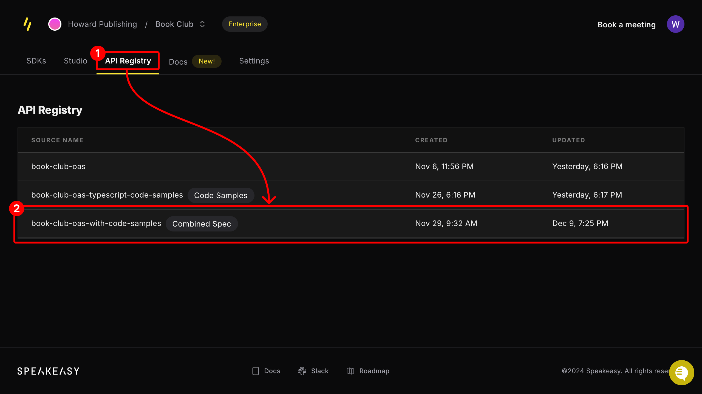

Cada página de endpoint muestra ejemplos de código de solicitud junto al playground. De forma predeterminada, Mintlify los genera a partir de tu especificación OpenAPI en los lenguajes que elijas. Si tus usuarios llaman a tu API mediante un SDK o una CLI, agrega tus propios ejemplos con la extensión `x-codeSamples` u obtenlos de Speakeasy.

<div id="choose-example-languages">
  ## Elegir los lenguajes de los ejemplos
</div>

Configura `api.examples.languages` en tu `docs.json` para elegir qué lenguajes aparecen en los ejemplos generados. Los lenguajes se muestran en el orden en que los enumeras.

```json docs.json
{
  "api": {
    "examples": {
      "languages": ["curl", "python", "javascript"],
      "defaults": "required"
    }
  }
}
```

Configura `defaults` como `required` para omitir los parámetros opcionales de los ejemplos generados. El valor predeterminado, `all`, los incluye.

<Accordion title="Todos los lenguajes compatibles">
| Nombre visible | Clave | Alias |
| --- | --- | --- |
| cURL | `bash` | `curl`, `sh`, `shell` |
| Python | `python` | `py` |
| JavaScript | `javascript` | `js` |
| Node.js | `node` | `nodejs`, `node.js` |
| PHP | `php` | |
| Go | `go` | `golang` |
| Java | `java` | |
| Ruby | `ruby` | `rb` |
| PowerShell | `powershell` | |
| Swift | `swift` | |
| C# | `csharp` | `c#` |
| .NET | `dotnet` | `.net`, `.NET`, `dot-net` |
| TypeScript | `typescript` | `ts` |
| C | `c` | |
| C++ | `c++` | `cpp` |
| Kotlin | `kotlin` | `kt` |
| Rust | `rust` | `rs` |
| Dart | `dart` | `flutter` |
</Accordion>

Para mostrar solo los ejemplos que escribes, configura `api.examples.autogenerate` como `false`. Las páginas de endpoint mostrarán entonces solo los `x-codeSamples` de tu especificación, o los componentes `<RequestExample>` en las páginas MDX.

<div id="write-your-own-examples">
  ## Escribir tus propios ejemplos
</div>

Agrega la propiedad `x-codeSamples` a cualquier operación. Tiene el siguiente esquema.

<ParamField body="lang" type="string" required>
  El lenguaje del ejemplo de código.
</ParamField>

<ParamField body="label" type="string">
  La etiqueta del ejemplo. Es útil cuando se proporcionan varios ejemplos para un mismo endpoint.
</ParamField>

<ParamField body="source" type="string" required>
  El código fuente del ejemplo.
</ParamField>

El siguiente ejemplo muestra ejemplos de código para una aplicación de seguimiento de plantas que cuenta tanto con una herramienta CLI de Bash como con un SDK de JavaScript.

```yaml
paths:
  /plants:
    get:
      # ...
      x-codeSamples:
        - lang: bash
          label: List all unwatered plants
          source: |
            planter list -u
        - lang: javascript
          label: List all unwatered plants
          source: |
            const planter = require('planter');
            planter.list({ unwatered: true });
        - lang: bash
          label: List all potted plants
          source: |
            planter list -p
        - lang: javascript
          label: List all potted plants
          source: |
            const planter = require('planter');
            planter.list({ potted: true });
```

<div id="generate-examples-with-speakeasy">
  ## Generar ejemplos con Speakeasy
</div>

Si generas tus SDK con [Speakeasy](https://www.speakeasy.com), puedes incorporar sus fragmentos autogenerados a tu referencia de API en lugar de mantenerlos manualmente. Los fragmentos aparecen en el [área de pruebas interactiva](/es/api-playground/overview) junto a tus endpoints.

<Steps>
<Step title="Obtén la URL de la especificación combinada desde el registro">

Ve a tu [Panel de Speakeasy](https://app.speakeasy.com) y abre la pestaña **API Registry**. Abre la entrada `*-with-code-samples` de tu API.

<Frame>

</Frame>

<Note>
  Si la entrada no está etiquetada como **Combined Spec**, asegúrate de que tu API tenga configurada una [URL de ejemplos de código automáticos](https://www.speakeasy.com/docs/code-samples/automated-code-sample-urls).
</Note>

Desde la página de la entrada del registro, copia la URL pública proporcionada.
</Step>
<Step title="Agrega la URL de la especificación combinada a tu archivo `docs.json`">

Agrega la URL de la especificación combinada a un anchor o a una pestaña en el objeto `navigation` de tu archivo `docs.json`.

<CodeGroup>

```json title="Anchor"
{
  "navigation": {
    "anchors": [
      {
        "anchor": "API reference",
        "icon": "square-terminal",
        // !mark
        "openapi": "SPEAKEASY_COMBINED_SPEC_URL"
      }
    ]
  }
}
```

```json title="Tab"
{
  "navigation": {
    "tabs": [
      {
        "tab": "API reference",
        // !mark
        "openapi": "SPEAKEASY_COMBINED_SPEC_URL"
      }
    ]
  }
}
```
</CodeGroup>
</Step>
<Step title="Verifica la integración">

Después de volver a desplegar tu documentación, abre cualquier endpoint en tu referencia de API y confirma que los fragmentos de lenguaje aparecen en el área de pruebas. El conjunto de lenguajes disponibles coincide con los targets de SDK configurados en tu proyecto de Speakeasy.

Si los fragmentos no aparecen, comprueba que:

- La URL `openapi` en `docs.json` apunte a la entrada de la especificación combinada `*-with-code-samples`, no al archivo OpenAPI de origen.
- La URL de la especificación combinada sea accesible públicamente desde el navegador.
- Tu proyecto de Speakeasy tenga configurada una [URL de ejemplos de código automatizados](https://www.speakeasy.com/docs/code-samples/automated-code-sample-urls) y al menos un target de SDK habilitado.

</Step>
</Steps>
