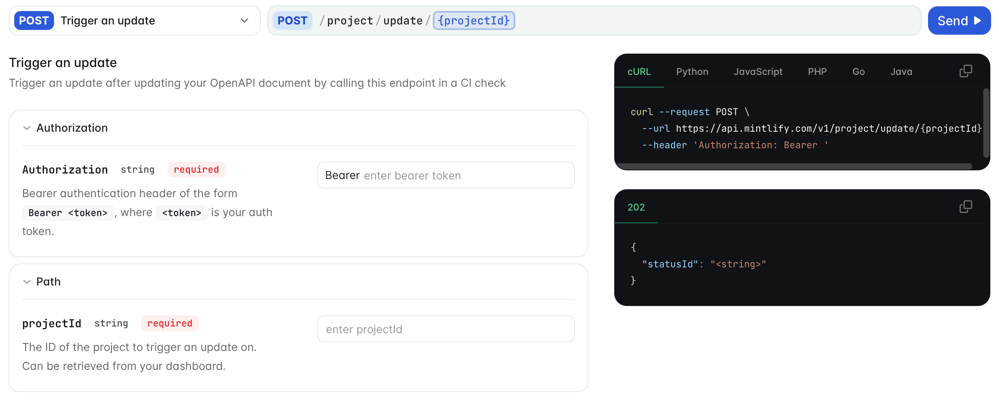
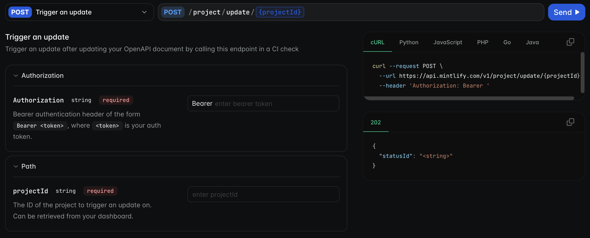

Genera páginas de referencia para tu API a partir de la especificación que ya mantienes. Cada endpoint obtiene una página que enumera sus parámetros, muestra ejemplos de solicitud y respuesta e incluye un playground de API interactivo donde los lectores pueden enviar solicitudes reales sin salir de tu documentación. Cuando tu especificación cambia, las páginas se actualizan.

<Frame>
  
  
</Frame>

Para ver una página generada, abre [Trigger an update](/es/api/update/trigger) en la referencia de API de Mintlify. Para llamar a la API de Mintlify en lugar de documentar la tuya, consulta la [introducción a la referencia de API](/es/api/introduction).

  ## Qué pueden hacer tus usuarios

- Enviar solicitudes a tu API desde el playground y ver las respuestas, incluidas imágenes, audio, video y respuestas en streaming.
- Copiar ejemplos de solicitud en su lenguaje o en tu SDK.
- Completar los cuerpos de solicitud campo por campo o [editarlos como JSON](#edit-request-bodies-as-json).
- [Ir directamente a un parámetro específico](#link-to-parameters).
- Descargar tu especificación, si [activas la opción](/es/api-playground/openapi-setup#let-visitors-download-your-spec).

  ## Elige cómo documentar tu API

| Tu API se describe con | Usa | Genera |
| --- | --- | --- |
| Una especificación OpenAPI | [OpenAPI](/es/api-playground/openapi-setup) | Páginas de endpoints REST y webhooks con el playground. Recomendado para APIs HTTP. |
| Una especificación AsyncAPI | [AsyncAPI](/es/api-playground/asyncapi-setup) | Páginas de canales WebSocket con un playground. |
| Un esquema GraphQL | [GraphQL](/es/api-playground/graphql-setup) | Páginas de consultas, mutaciones y tipos. |
| Salida de TypeDoc, DocFX, Javadoc, Sphinx, phpDocumentor o Go | [Referencia de SDK](/es/api-playground/sdk-reference-setup) | Páginas de clases, módulos y funciones para tus bibliotecas de SDK. |
| Nada o unos pocos endpoints | [Documentar endpoints sin una especificación](/es/api-playground/mdx-setup) | Páginas de endpoints que escribes en MDX. |

Puedes combinar enfoques, como una referencia OpenAPI para tu API REST y una referencia de SDK para tus bibliotecas cliente.

  ## Primeros pasos con OpenAPI

<CardGroup cols={2}>
  <Card title="Configurar OpenAPI" icon="file-braces" href="/es/api-playground/openapi-setup">
    Agrega tu especificación, valídala y mantenla sincronizada con tu API.
  </Card>
  <Card title="Configurar el playground" icon="play" href="/es/api-playground/configure-playground">
    Configura tu URL base y la autenticación.
  </Card>
  <Card title="Organizar endpoints" icon="list-tree" href="/es/api-playground/organize-endpoints">
    Agrupa endpoints, combina especificaciones y oculta endpoints internos.
  </Card>
  <Card title="URLs y títulos de endpoints" icon="link" href="/es/api-playground/endpoint-urls">
    Controla las URLs de las páginas y mantenlas estables cuando tu especificación cambie.
  </Card>
  <Card title="Personalizar páginas de endpoints" icon="pencil" href="/es/api-playground/customize-endpoint-pages">
    Cambia títulos y descripciones, agrega contenido y crea páginas para endpoints individuales.
  </Card>
  <Card title="Ejemplos de código" icon="code" href="/es/api-playground/code-examples">
    Elige los lenguajes de los ejemplos o agrega tus propios ejemplos de SDK.
  </Card>
</CardGroup>

Si tus páginas de API no se generan o el playground no envía solicitudes, consulta [Solución de problemas](/es/api-playground/troubleshooting).

  ## Editar cuerpos de solicitud como JSON

Si un endpoint acepta un cuerpo de solicitud JSON (`application/json` o un tipo de medio `+json`), la sección del cuerpo del playground muestra un selector **Form** y **JSON**. Los lectores usan **Form** para completar un campo a la vez, o **JSON** para editar todo el cuerpo en un editor de código, por ejemplo, para pegar una respuesta de otro endpoint y cambiar algunos valores.

- Form y JSON editan el mismo cuerpo, por lo que los cambios en una vista aparecen en la otra. La solicitud y los ejemplos de código generados siempre coinciden con el cuerpo.
- JSON conserva las propiedades que no están en tu esquema OpenAPI y las envía con la solicitud.
- Si el JSON no es válido, el playground muestra la línea, la columna y la causa probable del primer error. Los lectores no pueden enviar la solicitud hasta que el JSON sea válido.
- El playground recuerda la vista que eligió el lector y la usa para otros endpoints.

El selector no aparece para otros tipos de cuerpo de solicitud, como `multipart/form-data` o `application/x-www-form-urlencoded`.

  ## Enlazar a parámetros

Cada parámetro de una página de endpoint tiene un enlace de anclaje. Pasa el cursor sobre el nombre de un parámetro y haz clic en el ícono de enlace para copiar una URL a ese parámetro, por ejemplo, para compartirla en una conversación de soporte. El formato de la URL es `tu-url-de-docs/ruta-del-endpoint#nombre-del-parametro`. Para parámetros anidados, el anclaje incluye la ruta del elemento padre.
