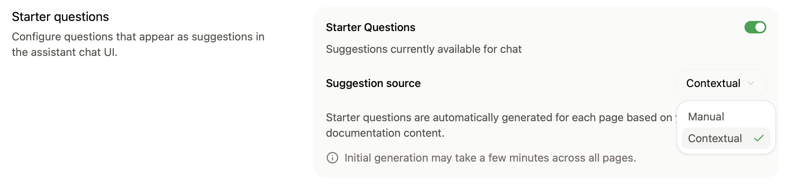
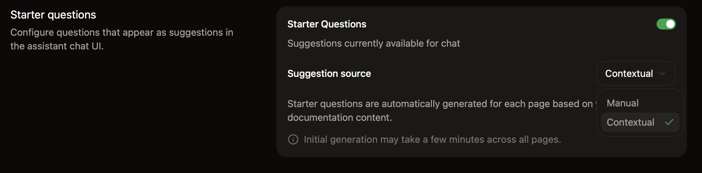

<Info>
  El assistant requiere un [plan Pro o Enterprise](https://mintlify.com/pricing?ref=assistant).
</Info>

Configura el assistant en la página [Assistant](https://app.mintlify.com/products/assistant) de tu dashboard. Después de activarlo y añadir preguntas iniciales, elige a dónde van las preguntas que el assistant no puede responder y, a continuación, pruébalo.

  ## Habilitar o deshabilitar el assistant

En la página [Assistant](https://app.mintlify.com/products/assistant) de tu dashboard, haz clic en el interruptor de estado para habilitar o deshabilitar el assistant en tu sitio.

  ## Agregar preguntas de ejemplo

Ayuda a tus usuarios a iniciar conversaciones con el assistant agregando preguntas iniciales.

El assistant puede generar preguntas específicas de la página basándose en la página que el usuario está viendo, o puedes agregar preguntas persistentes que estén disponibles en todas las páginas.

Puedes agregar hasta tres preguntas iniciales. Haz clic en **Ask Assistant** para obtener preguntas recomendadas basadas en tu documentación.

<Frame>
  
  
</Frame>

  ## Elegir a dónde van las preguntas sin respuesta

Cuando el assistant no puede responder una pregunta, puede enviar al usuario a tu equipo de soporte o ventas por correo, mediante un enlace a tu centro de ayuda o con un ticket en Plain o Zendesk. Consulta [Dirigir preguntas a tu equipo](/es/assistant/support-routing).

  ## Protección contra bots

En la sección **Bot Protection**, habilita captcha invisible para proteger tu assistant de abusos automatizados. La protección contra bots respeta la privacidad y es invisible para casi todos los visitantes.

Para habilitar la protección contra bots:

1. Ve a la página de [configuración del Assistant](https://app.mintlify.com/products/assistant/settings) en tu dashboard.
2. En la sección **Bot Protection**, activa **Invisible Captcha**.

Los cambios tardan hasta 10 minutos en propagarse.

<Note>
  Si usas [encabezados de Content Security Policy](/es/deploy/csp-configuration) personalizados, debes incluir `hcaptcha.com` y `*.hcaptcha.com` en tu lista de permitidos.
</Note>

  ## Probar el assistant

El assistant está disponible en tu previsualización local cuando inicias sesión con la CLI. Usa la previsualización local para probar las respuestas y las instrucciones personalizadas en `Assistant.md` mientras escribes.

1. Si aún no lo has hecho, instala la CLI con `npm i -g mint`.
2. Ejecuta `mint login` para autenticarte.
3. Ejecuta `mint dev` para iniciar la previsualización local.

El assistant en la previsualización local usa el mismo contenido indexado que tu sitio de documentación desplegado.
