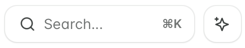
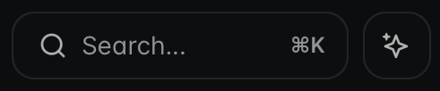
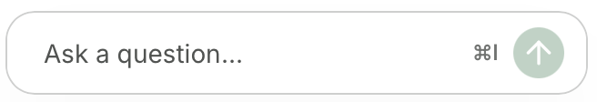
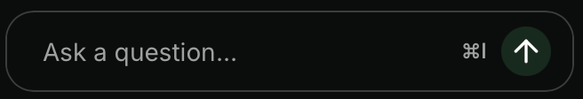
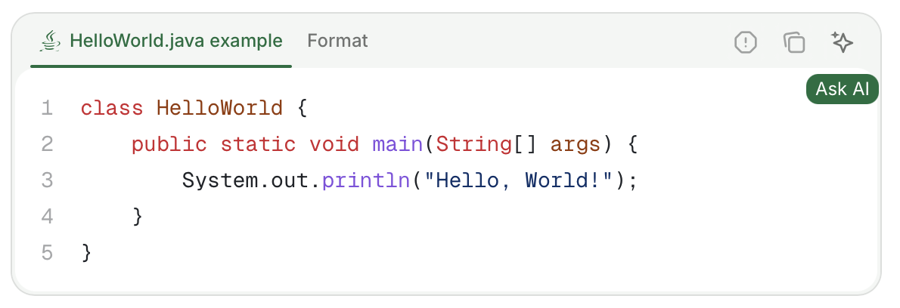
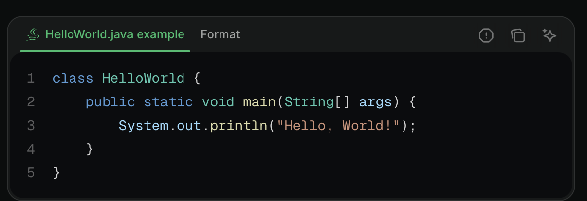

Los usuarios abren el assistant desde su botón, un atajo de teclado o un enlace que compartas. Puedes cambiar el aspecto del botón, ocultarlo o desactivar el assistant.

<div id="where-the-assistant-appears">
  ## Dónde aparece el assistant
</div>

El assistant aparece en dos ubicaciones: como un botón junto a la barra de búsqueda y como una barra en la parte inferior de la página.

<Columns cols={2}>
  <Frame caption="Botón del assistant junto a la barra de búsqueda.">
    

</Frame>
<Frame caption="Botón del assistant en la parte inferior de la página.">


</Frame>
</Columns>

Los usuarios también pueden abrir el panel de chat del assistant con el atajo de teclado <kbd>Cmd</kbd> + <kbd>I</kbd> en macOS y <kbd>Ctrl</kbd> + <kbd>I</kbd> en Windows.

<div id="open-the-assistant-from-your-own-links">
  ## Abrir el assistant desde tus propios enlaces
</div>

Abre el assistant desde cualquier página de tu sitio de documentación añadiendo el parámetro de consulta `?assistant` a la URL. Úsalo para crear enlaces directos al assistant desde contenido externo como correos, respuestas de soporte, banners en la aplicación o flujos de incorporación.

- `?assistant`: Abre el panel de chat del assistant sin enviar ningún mensaje.
- `?assistant=<mensaje>`: Abre el panel de chat del assistant y envía `<mensaje>` como el primer mensaje del usuario. Codifica el valor en URL para que los espacios y caracteres especiales se conserven en la solicitud.

```text Ejemplos
https://yourdocs.mintlify.site/quickstart?assistant
https://yourdocs.mintlify.site/quickstart?assistant=How%20do%20I%20get%20started%3F
```

Para que los usuarios puedan abrir el assistant con la página actual como contexto desde el menú contextual de la página, añade la opción `"assistant"` a tu [menú contextual](/es/ai/contextual-menu).

<div id="add-context-to-a-question">
  ## Añadir contexto a una pregunta
</div>

Los usuarios pueden dar al assistant más contexto que su pregunta. El assistant también sabe en qué página está el usuario.

<div id="highlight-text">
  ### Resaltar texto
</div>

Resalta texto en una página y haz clic en el botón emergente **Add to assistant** para abrir el panel de chat del assistant y agregar el texto resaltado como contexto. Puedes agregar múltiples fragmentos de texto o bloques de código al contexto del assistant.

<div id="code-blocks">
  ### Bloques de código
</div>

Haz clic en el botón **Ask Assistant** en un bloque de código para abrir el panel de chat del assistant y agregar el bloque de código como contexto. Puedes agregar múltiples bloques de código o fragmentos de texto al contexto del assistant.

<Frame>


</Frame>

<div id="file-attachments">
  ### Archivos adjuntos
</div>

Adjunta archivos a los mensajes del assistant para proporcionar contexto adicional.

Tipos de archivo compatibles:
- **Imágenes**: JPEG, PNG, GIF, WebP, SVG
- **Documentos**: PDF
- **Archivos de código y texto**: JavaScript (`.js`, `.jsx`, `.mjs`, `.cjs`), TypeScript (`.ts`, `.tsx`), Python, HTML, CSS, Markdown, MDX, JSON, YAML, XML, SQL, CSV, texto plano, scripts de shell (`.sh`, `.bash`, `.env`), GraphQL, TOML, Go, Rust, Ruby, Java, Kotlin, Swift, C (`.c`, `.h`), C++ (`.cpp`, `.hpp`), C#, PHP, Lua, R, Scala

Límites:
- Tamaño máximo de archivo: 5 MB por adjunto
- Máximo de adjuntos por mensaje: 10

<div id="hide-or-restyle-the-assistant">
  ## Ocultar o cambiar el estilo del assistant
</div>

Para cambiar el aspecto del botón del assistant, u ocultarlo en todo tu sitio, apunta al selector `[data-layout-item="assistant-entry"]` en un archivo de [CSS personalizado](/es/customize/custom-scripts#add-custom-css). Consulta [Scripts personalizados](/es/customize/custom-scripts#id-selectors) para ver los IDs del botón del assistant, el panel de chat y el campo de texto.

<div id="turn-off-the-assistant">
  ## Desactivar el assistant
</div>

Para quitar el assistant de tu sitio, [deshabilita el assistant](/es/assistant/configure#enable-or-disable-the-assistant) en tu dashboard.

<div id="troubleshooting">
  ## Solución de problemas
</div>

<Accordion title="La barra de chat del assistant no es visible">
  Si la interfaz del assistant no es visible en ciertos navegadores, es posible que necesites enviar un reporte de falso positivo a [EasyList](https://easylist.to). Los navegadores que usan EasyList Cookies List, como Brave y Comet, a veces bloquean el assistant u otros elementos de la interfaz. EasyList Cookies List incluye una regla específica de dominio que oculta elementos fijos en ciertos dominios para bloquear banners de cookies. Esta regla afecta inadvertidamente a componentes legítimos de la interfaz.

  Envía un reporte de falso positivo a [EasyList](https://github.com/easylist/easylist) para solicitar la eliminación de la regla. Esto resuelve el problema para todos los usuarios una vez que se actualice la lista de filtros.

</Accordion>

<Accordion title="Assistant bloqueado en una red corporativa, VPN o firewall">
  Si el assistant se carga en redes personales pero falla en una red del trabajo, VPN u otra red restringida, el bloqueo está ocurriendo a nivel de red y no en el sitio de documentación. Los proxies corporativos, las VPN y los firewalls a veces bloquean las solicitudes salientes que el assistant necesita hacer, por lo que el panel de chat no puede conectarse aunque el resto del sitio se cargue con normalidad.

  **Para lectores:** Pídele a tu equipo de TI que permita solicitudes HTTPS salientes a los siguientes hosts desde tu red. Si puedes, prueba el assistant desde una red personal para confirmar que el problema es específico de la red.

  - `leaves.mintlify.com`—API del assistant
  - `hcaptcha.com` y `*.hcaptcha.com`—verificación CAPTCHA para el assistant

  **Para propietarios del sitio:** Si un lector informa que el assistant no se carga en su red corporativa o VPN, casi siempre se trata de un bloqueo de red saliente y no de un problema con tu documentación. Indícale los hosts anteriores y sugiérele que comparta la lista con su equipo de TI. Se trata de una lista de permitidos a nivel de red que se aplica al dispositivo o la red del visitante, no algo que puedas configurar desde tu sitio. Si tu documentación está autoalojada detrás de un proxy inverso que sobrescribe la CSP predeterminada, consulta [Configuración de CSP](/es/deploy/csp-configuration) para conocer los dominios que debes permitir.

</Accordion>

<Accordion title="El mensaje contiene `[REDACTED_SECRET]`">
  El assistant analiza cada mensaje en busca de valores que parezcan credenciales, como claves de API, tokens de acceso, contraseñas en URL, JSON Web Tokens y claves privadas. También analiza el texto de los archivos adjuntos y cualquier contexto enviado con el mensaje. Las imágenes no se analizan. Mintlify reemplaza cada valor detectado por `[REDACTED_SECRET]` antes de que el modelo del assistant vea el mensaje o de que Mintlify almacene la conversación.

  El assistant nunca recibe el valor original. No te pide que pegues el valor de nuevo. Si una respuesta depende del valor exacto, el assistant te indica que el valor fue ocultado. Para obtener ayuda con una credencial, descríbela o reemplázala por un marcador de posición como `YOUR_API_KEY`.

</Accordion>
