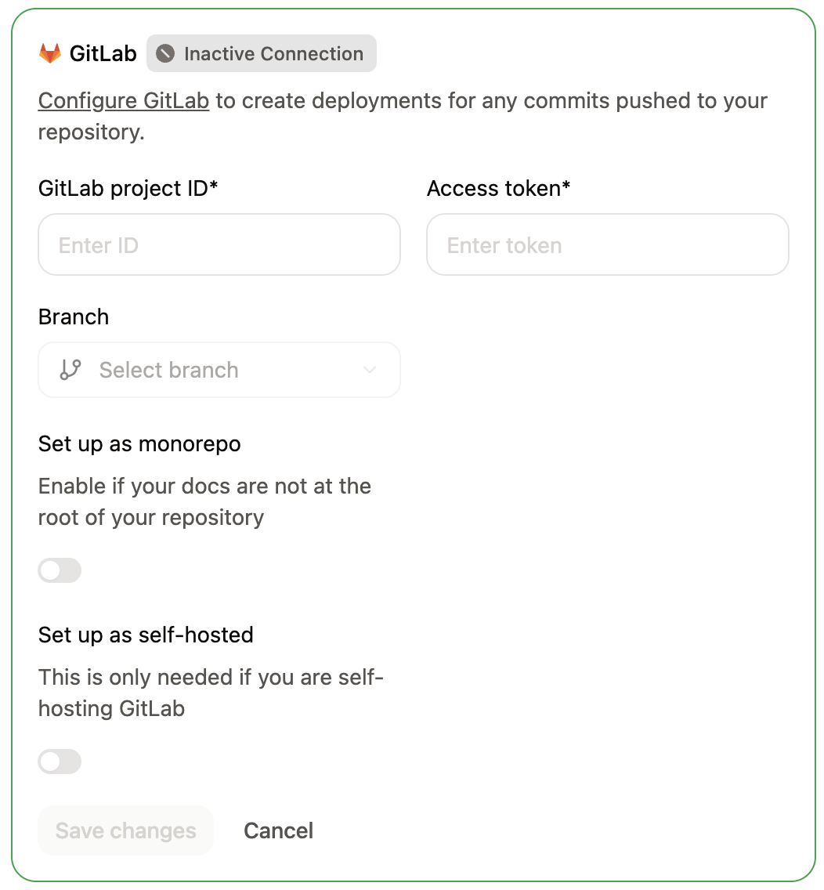
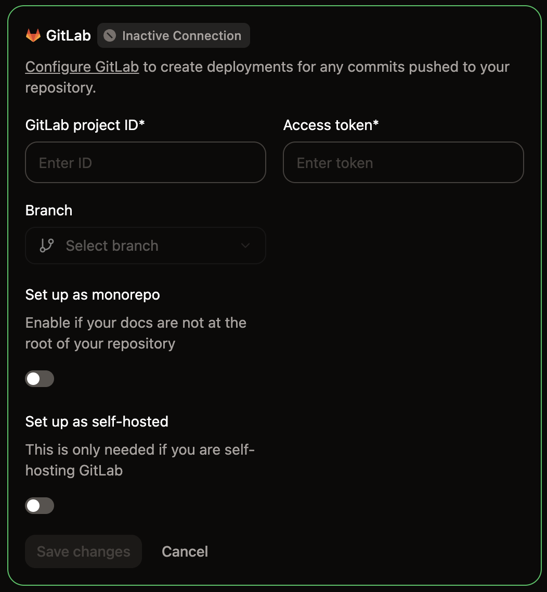

Mintlify usa tokens de acceso y webhooks para autenticar y sincronizar cambios entre GitLab y Mintlify.

- Mintlify usa tokens de acceso para extraer información de GitLab.
- GitLab usa webhooks para notificar a Mintlify cuando realizas cambios, lo que habilita implementaciones de vista previa para las merge requests. Mintlify agrega el webhook a tu proyecto cuando lo conectas.

  ## Configura la conexión

Cuando abras [Git Settings](https://app.mintlify.com/settings/project/git-settings) por primera vez, un asistente de configuración te guía a través de la conexión de tu repositorio de GitLab.

<Steps>
  <Step title="Select GitLab as your provider">
    En la página de [Git Settings](https://app.mintlify.com/settings/project/git-settings), selecciona **Connect to GitLab** y haz clic en **Continue**.
  </Step>
  <Step title="Download your content">
    <Tip>
      Si ya tienes un repositorio de GitLab con tu documentación, puedes omitir la descarga y hacer clic en **Continue setup** directamente.
    </Tip>
    
    Si tu documentación está alojada en Mintlify, descárgala como un archivo zip.
    * Crea un nuevo repositorio en GitLab.
    * Extrae el contenido del zip.
    * Sube el contenido a tu repositorio.

    Haz clic en **Continue setup** para continuar.
  </Step>
  <Step title="Find your project ID">
    En tu proyecto de GitLab, ve a **Settings** > **General** y ubica tu **Project ID**.
  </Step>
  <Step title="Generate an access token">
    Ve a **Settings** > **Access Tokens** y selecciona **Add new token**.
    
    Configura el token con estos parámetros:
    - **Name**: Mintlify
    - **Role**: Maintainer
    - **Scopes**: `api` y `read_api`
    
    Haz clic en **Create project access token** y copia el token.

    Cuando guardas un token nuevo, Mintlify lo comprueba primero. Si el token no tiene el scope `api` o no puede publicar en tu rama de despliegue, Mintlify lo rechaza con el mensaje "Este token de GitLab no puede publicar cambios. Usa un token de acceso de proyecto con el rol Maintainer y el scope api."

    <Note>
      Si los Project Access Tokens no están disponibles, puedes usar un Personal Access Token en su lugar. Ten en cuenta que los Personal Access Tokens caducan y deben actualizarse.
    </Note>
  </Step>
  <Step title="Connect your repository">
    De vuelta en el asistente de configuración, completa los siguientes campos:

    - **Project ID**: El ID del proyecto de la configuración de tu proyecto de GitLab.
    - **Branch**: Selecciona la rama desde la cual desplegar tu documentación.
    - **Deployment token**: El token de acceso que generaste.
    - **Self-hosted GitLab instance**: Déjalo desactivado para `gitlab.com`. Para una instancia autoalojada, actívalo e ingresa la URL de tu instancia en **GitLab instance URL**, por ejemplo, `https://gitlab.example.com`. Tu instancia debe ser accesible públicamente para que Mintlify pueda conectarse. La URL debe usar `https://` en el puerto predeterminado 443 y no puede incluir un nombre de usuario ni una contraseña.

    Haz clic en **Connect**.
    <Frame>
      
      
    </Frame>
  </Step>
</Steps>

  ## Actualizar una conexión existente

Para modificar la configuración de tu conexión con GitLab después de la configuración inicial, ve a [Git Settings](https://app.mintlify.com/settings/project/git-settings) y actualiza tu ID de proyecto, token de acceso, rama o URL de instancia directamente.

  ## Volver a validar la configuración de Git

Si tu proyecto muestra un comportamiento inesperado, como opciones de rama faltantes o una configuración desactualizada, puedes forzar a Mintlify a actualizar tu origen de Git.

<Steps>
  <Step title="Ir a Git Settings">
    Ve a [Git Settings](https://app.mintlify.com/settings/project/git-settings) en tu Dashboard.
  </Step>
  <Step title="Volver a validar la configuración">
    Haz clic en la insignia verde **Active** en la esquina del recuadro de configuración de GitLab para volver a validar tu origen de Git.
  </Step>
</Steps>

  ## Crear el webhook

Los webhooks notifican a Mintlify cuando envías cambios, para que las implementaciones se activen automáticamente.

Cuando guardas tu conexión de GitLab, Mintlify usa tu token de acceso para agregar el webhook a tu proyecto por ti. Cada proyecto de Mintlify conectado al mismo proyecto de GitLab obtiene su propio webhook.

Cuando vuelves a guardar la conexión, Mintlify conserva el webhook que agregó. Si ese webhook se eliminó o su URL cambió, Mintlify agrega uno nuevo.

Si Mintlify no puede agregar el webhook, por ejemplo porque el token no tiene el rol Maintainer, el dashboard abre el cuadro de diálogo **Add the GitLab webhook**. El cuadro de diálogo muestra la URL del webhook y el token secreto para copiarlos, y un enlace **Open GitLab webhooks** a la configuración de webhooks de tu proyecto.

Vuelve a guardar la conexión con un token que tenga el rol Maintainer y el scope `api`, o sigue estos pasos para crear el webhook manualmente con los valores del cuadro de diálogo.

<Steps>
  <Step title="Agregar nuevo webhook">
  1. En GitLab, ve a **Settings** > **Webhooks**.
  2. Haz clic en **Add new webhook**.
  </Step>
  <Step title="Configurar la URL y el webhook">
    Asigna al webhook el nombre **Mintlify**.

    En el campo **URL**, introduce el endpoint `https://leaves.mintlify.com/gitlab-webhook`.
  </Step>
  <Step title="Obtener el token del webhook">
    En tu Dashboard de Mintlify, haz clic en **Show webhook token**. Copia el token del webhook.
  </Step>
  <Step title="Pegar el token del webhook">
    En GitLab, pega el token del webhook desde tu Dashboard de Mintlify en el campo **Secret token**.
  </Step>
  <Step title="Seleccionar eventos">
    Selecciona los siguientes eventos para activar el webhook:
    - **Push events** (All branches)
    - **Merge requests events**
  </Step>
  <Step title="Verificar el webhook">
    Deberías ver la siguiente configuración después de configurar el webhook:
    
    - **Name**: Mintlify
    - **URL**: `https://leaves.mintlify.com/gitlab-webhook`
    - **Secret token**: el token del webhook de tu Dashboard de Mintlify
    - **Events**: **Push events** (All branches) y **Merge requests events**

    Añade el webhook.
  </Step>
  <Step title="Probar el webhook">
    Después de crear el webhook, haz clic en el menú desplegable **Test**. Haz clic en **Push events** para enviar un payload de prueba. Si la prueba devuelve `Hook executed successfully: HTTP 200`, configuraste el webhook correctamente.

  </Step>
</Steps>

  ## Corregir advertencias de conexión

Mintlify comprueba tu token de acceso y tu webhook cuando abres [Git Settings](https://app.mintlify.com/settings/project/git-settings). Si alguno de ellos deja de funcionar, Git Settings muestra una advertencia en la parte superior de tu configuración de GitLab, y los pushes no se despliegan hasta que lo corrijas. Solo los miembros que pueden editar la configuración de Git ven la advertencia.

| Advertencia | Cómo corregirla |
| --- | --- |
| Tu token de acceso caducó, alguien lo revocó, GitLab ya no lo acepta o ya no puede abrir el proyecto | Crea un token nuevo con el rol Maintainer y el scope `api`, introdúcelo en **Deployment token** y guarda. |
| Falta el webhook de Mintlify en el proyecto | Haz clic en **Set up webhook** para abrir el cuadro de diálogo **Add the GitLab webhook** y, a continuación, [crea el webhook](#create-the-webhook) en GitLab con los valores del cuadro de diálogo. |
| GitLab desactivó el webhook de Mintlify después de entregas fallidas | Haz clic en **Open GitLab webhooks** y vuelve a activar el webhook en GitLab. |
| El webhook de Mintlify tiene los push events desactivados | Haz clic en **Open GitLab webhooks** y activa **Push events** para el webhook en GitLab. |

Las advertencias del webhook también muestran cuándo recibió Mintlify el último webhook de tu proyecto. Mintlify vuelve a comprobar la conexión después de que guardas tu configuración y cuando regresas a la pestaña del navegador con Git Settings abierto, por lo que la advertencia desaparece en cuanto corriges el problema.

  ## Estado del despliegue en GitLab

Mintlify informa del estado de tus despliegues en GitLab, para que puedas ver si una compilación se completó correctamente sin abrir el dashboard.

Cuando abres un pull request contra tu rama de despliegue, Mintlify publica un comentario en él con el estado de su [despliegue de vista previa](/es/deploy/preview-deployments). Si la vista previa falla, el comentario incluye el motivo del fallo.

Cuando haces push a tu rama de despliegue, Mintlify añade un estado de commit **Mintlify Deployment (`<subdomain>`)** al commit enviado. El estado muestra si el despliegue de producción está en curso, se completó correctamente o falló, y enlaza a tu sitio de documentación. Su descripción explica el resultado, por ejemplo, el motivo por el que falló un despliegue.
