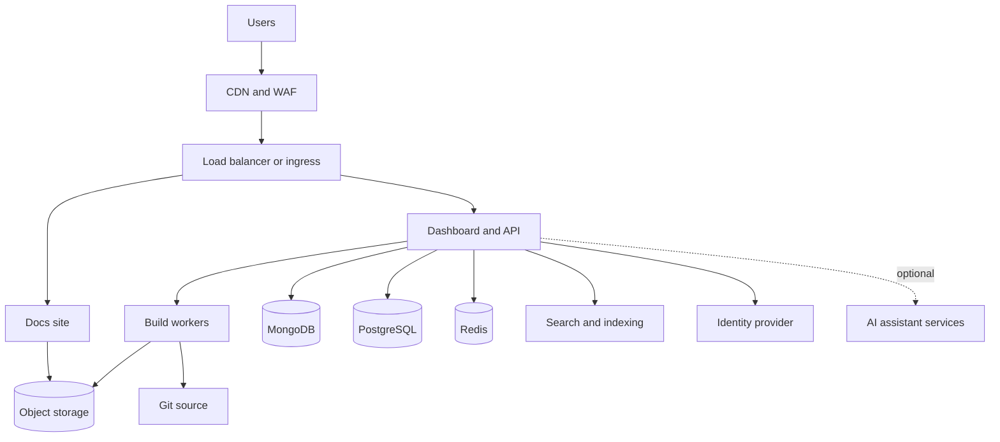

<Info>
  El autoalojamiento requiere un [plan Enterprise](https://mintlify.com/pricing?ref=self-host). Ponte en contacto con tu equipo de cuenta para dimensionar un despliegue.
</Info>

El autoalojamiento ejecuta Mintlify dentro de tu propia cuenta en la nube o centro de datos, de modo que tu contenido, tu pipeline de compilación, las analíticas y los logs se mantienen dentro de los límites de tu red. Está diseñado para equipos con requisitos de residencia de datos, cumplimiento normativo o air-gap que un despliegue alojado en la nube no puede satisfacer.

Cada despliegue autoalojado es un compromiso definido con tu equipo de cuenta, no una instalación autoservicio. Esta página describe qué aprovisionas, cómo se ejecuta el despliegue y las contrapartidas frente al alojamiento en la nube para que puedas evaluar el autoalojamiento antes de comprometerte con él.

<div id="choose-between-cloud-and-self-hosted">
  ## Elige entre la nube y el autoalojamiento
</div>

El alojamiento en la nube es la opción adecuada para la mayoría de los equipos, incluidos los equipos con requisitos de seguridad estrictos. Incluye todas las funciones y se ejecuta en la red edge global de Mintlify. Antes de comprometerte con el autoalojamiento, comprueba si el [trust center](https://security.mintlify.com) responde a las preguntas de tu equipo de seguridad. Tu equipo de cuenta también puede compartir informes de auditoría y certificaciones, y puede involucrar al equipo de seguridad de Mintlify en la revisión.

El autoalojamiento tarda más en configurarse y algunas funciones solo están disponibles en la nube. Según el modelo de despliegue, tu equipo también opera la infraestructura. Consulta [Funciones](#features) para ver qué está disponible en cada uno.

<div id="deployment-models">
  ## Modelos de despliegue
</div>

| Modelo | Quién lo opera | Dónde se ejecuta |
| --- | --- | --- |
| [Exportación estática](/es/api/static-export/overview) | Tú sirves los archivos | Cualquier hosting estático, incluidas las redes air-gapped. Sin plataforma que ejecutar |
| Trae tu propia nube | Mintlify, con el acceso que tú concedes | Tu cuenta en AWS, Azure o Google Cloud |
| Autogestionado | Tu equipo, con versiones y soporte de Mintlify | Tu clúster de Kubernetes, en una cuenta en la nube o en tu propio centro de datos |
| On-premises gestionado | Mintlify y tu equipo juntos, según una declaración de trabajo | Tu centro de datos o nube privada |

Cuanto más acceso tenga Mintlify al entorno, más rápido avanza el despliegue y más funciones puede ejecutar. Trae tu propia nube en AWS es lo más parecido al producto alojado en la nube.

<div id="platform-support">
  ## Plataformas compatibles
</div>

| Plataforma | Método |
| --- | --- |
| <Icon icon="/images/logos/aws-mark.svg" className="mr-2 my-2" /> Amazon Web Services | Aplicación de AWS Cloud Development Kit (CDK) |
| <Icon icon="/images/logos/aws-mark.svg" className="mr-2 my-2" /> Amazon EKS | Helm chart en Amazon Elastic Kubernetes Service (EKS) |
| <Icon icon="/images/logos/azure.svg" className="mr-2 my-2" /> Microsoft Azure | Helm chart en Azure Kubernetes Service (AKS) |
| <Icon icon="/images/logos/gcp.svg" className="mr-2 my-2" /> Google Cloud | Helm chart en Google Kubernetes Engine (GKE) |
| <Icon icon="/images/logos/oracle-mark.svg" className="mr-2 my-2" /> Oracle Cloud | Helm chart en Oracle Container Engine for Kubernetes (OKE) |
| <Icon icon="/images/logos/openshift.svg" className="mr-2 my-2" /> Red Hat OpenShift | Helm chart |
| <Icon icon="/images/logos/kubernetes.svg" className="mr-2 my-2" /> Cualquier Kubernetes | Helm chart |

<div id="how-self-hosting-compares-to-cloud-hosting">
  ## Cómo se compara el autoalojamiento con el alojamiento en la nube
</div>

La redacción funciona igual en ambos modelos de alojamiento. Tu equipo mantiene el contenido con el editor o con su flujo de trabajo de Git, y cada cambio pasa por el proceso de revisión de tu repositorio. Lo que cambia es quién opera la plataforma y dónde residen los datos.

| Área | Alojado en la nube | Autoalojado |
| --- | --- | --- |
| Configuración inicial | El mismo día | Implementación única acompañada por tu equipo de cuenta. Planifica entre dos y tres meses. Puede llevar unas pocas semanas si el acceso, las aprobaciones y los recursos de tu lado están listos pronto |
| Infraestructura | Mintlify opera todo | Depende del [modelo de despliegue](#deployment-models). En un despliegue autogestionado, tú operas el clúster, la red y los almacenes de datos. Mintlify entrega versiones con guías de actualización y da soporte a la capa de aplicación |
| Actualizaciones de la plataforma | Continuas y automáticas | Versiones que tú revisas y despliegas en tu propio calendario |
| Frontera de datos | Se procesan en la nube de Mintlify | El contenido, las compilaciones, las analíticas y los logs permanecen dentro de tu red, sin egreso a terceros |
| Funciones de IA | Activadas por defecto | Se entregan desactivadas hasta que tu equipo de seguridad o de gobernanza de IA las aprueba. Se ejecutan en Amazon Bedrock en tu cuenta de AWS |
| Integraciones | Catálogo completo | Google Drive y Google Docs, mediante un cliente OAuth de tu propiedad. Las demás integraciones solo están disponibles en la nube |
| Entrega en el edge | Red edge global de Mintlify con caché y protección contra bots | Tu propia CDN y WAF. La velocidad de carga de las páginas y la protección contra bots dependen de cómo los configures |
| Nuevas funciones | Disponibles a medida que se lanzan | Llegan en versiones posteriores |
| Supervisión | Gestionada por Mintlify | Conectas tu propia stack de observabilidad |

Si necesitas la plataforma en tu propia cuenta en la nube pero no quieres operarla, Mintlify puede desplegarla y ejecutarla por ti en una cuenta de AWS dedicada que tú proporcionas. Tus datos permanecen en tu cuenta, y Mintlify se encarga del despliegue y de las actualizaciones. Pregunta a tu equipo de cuenta si esta opción se ajusta a tus requisitos.

Los despliegues autoalojados suelen empezar acotados y ampliarse. Un camino habitual es empezar con documentación pública y luego añadir contenido autenticado, el editor web y las funciones de IA a medida que completas las revisiones de seguridad.

<div id="features">
  ## Funciones
</div>

Las tablas siguientes muestran qué funciones incluye cada modelo de alojamiento. En la columna de autoalojado, **Opcional** significa que la función se entrega desactivada y la activas durante la configuración. **Parcial** significa que hay disponible una versión más limitada, y las notas indican qué falta.

Las funciones en beta o en vista previa privada en la nube llegan a los despliegues autoalojados cuando están disponibles de forma general, en una versión posterior.

<div id="delivery-and-performance">
  ### Entrega y rendimiento
</div>

| Función | Nube | Autoalojado | Notas |
| --- | :---: | :---: | --- |
| Red edge global y caché | <Icon icon="circle-check" color="#16a34a" /> | <Icon icon="x" color="#dc2626" /> | Los sitios autoalojados se sirven desde tu ingress. Coloca tu propia CDN delante |
| Detección de bots y protección contra DDoS | <Icon icon="circle-check" color="#16a34a" /> | <Icon icon="x" color="#dc2626" /> | Usa tu propio WAF |
| Protección contra abusos del asistente (CAPTCHA) | <Icon icon="circle-check" color="#16a34a" /> | <Icon icon="x" color="#dc2626" /> | Limita la tasa del endpoint del asistente en tu WAF |
| Dominios personalizados | <Icon icon="circle-check" color="#16a34a" /> | Parcial | Cada sitio se sirve en `<subdomain>.client.<your-domain>`. Tú gestionas el DNS y el TLS en tu ingress |

<div id="agent-experience">
  ### Experiencia para agentes
</div>

| Función | Nube | Autoalojado | Notas |
| --- | :---: | :---: | --- |
| [llms.txt y llms-full.txt](/es/ai/llmstxt) | <Icon icon="circle-check" color="#16a34a" /> | <Icon icon="circle-check" color="#16a34a" /> |  |
| [Exportación a Markdown](/es/ai/markdown-export) | <Icon icon="circle-check" color="#16a34a" /> | <Icon icon="circle-check" color="#16a34a" /> |  |
| [Menú contextual](/es/ai/contextual-menu) | <Icon icon="circle-check" color="#16a34a" /> | <Icon icon="circle-check" color="#16a34a" /> |  |
| [Servidor MCP de búsqueda](/es/ai/model-context-protocol) | <Icon icon="circle-check" color="#16a34a" /> | <Icon icon="circle-check" color="#16a34a" /> | Las herramientas de IA alojadas solo pueden conectarse si el sitio de documentación es accesible desde internet |
| [Servidor Admin MCP](/es/ai/mintlify-mcp) | <Icon icon="circle-check" color="#16a34a" /> | Opcional | Desactivado por defecto |
| [skill.md](/es/ai/skillmd) | <Icon icon="circle-check" color="#16a34a" /> | Parcial | Sirve un `skill.md` personalizado desde tu repositorio. La generación automática solo está disponible en la nube |

<div id="ai">
  ### IA
</div>

| Función | Nube | Autoalojado | Notas |
| --- | :---: | :---: | --- |
| [Asistente](/es/assistant) | <Icon icon="circle-check" color="#16a34a" /> | Opcional | Se entrega desactivado. Se ejecuta en Amazon Bedrock en tu cuenta de AWS |
| Búsqueda semántica para el asistente y el servidor MCP | <Icon icon="circle-check" color="#16a34a" /> | Opcional | Embeddings de Amazon Bedrock almacenados en tu PostgreSQL. La búsqueda por palabras clave funciona sin ella |
| [Automatizaciones](/es/automations) | <Icon icon="circle-check" color="#16a34a" /> | Opcional | Ejecuciones programadas y manuales sobre repositorios en github.com, incluido GitHub Enterprise Cloud. GitLab y GitHub Enterprise Server no son compatibles. Se ejecutan en sandboxes aislados en tu clúster, en Amazon Bedrock |
| [Autopilot](/es/autopilot) | <Icon icon="circle-check" color="#16a34a" /> | <Icon icon="x" color="#dc2626" /> | Usa automatizaciones con tus propios prompts en su lugar |
| [Trae tu propio modelo](/es/ai/bring-your-own-model) | <Icon icon="circle-check" color="#16a34a" /> | Parcial | Solo Amazon Bedrock |
| Traducciones | <Icon icon="circle-check" color="#16a34a" /> | <Icon icon="x" color="#dc2626" /> |  |
| Insights del asistente | <Icon icon="circle-check" color="#16a34a" /> | <Icon icon="x" color="#dc2626" /> |  |

<div id="authoring-and-publishing">
  ### Redacción y publicación
</div>

| Función | Nube | Autoalojado | Notas |
| --- | :---: | :---: | --- |
| Editor web | <Icon icon="circle-check" color="#16a34a" /> | <Icon icon="circle-check" color="#16a34a" /> |  |
| Flujo de trabajo respaldado por Git | <Icon icon="circle-check" color="#16a34a" /> | <Icon icon="circle-check" color="#16a34a" /> | GitHub, GitHub Enterprise Server, GitLab incluida la versión autogestionada, Bitbucket o una API proxy de propiedad interna |
| [Despliegues de vista previa](/es/deploy/preview-deployments) | <Icon icon="circle-check" color="#16a34a" /> | <Icon icon="circle-check" color="#16a34a" /> |  |
| [Componentes de React personalizados](/es/customize/react-components) | <Icon icon="circle-check" color="#16a34a" /> | <Icon icon="circle-check" color="#16a34a" /> | Solo código del lado del cliente |
| [Bibliotecas de terceros](/es/customize/third-party-libraries) | <Icon icon="circle-check" color="#16a34a" /> | <Icon icon="x" color="#dc2626" /> | Los paquetes de npm no se instalan en las compilaciones autoalojadas. Crea los componentes como snippets en su lugar |
| [Exportación estática](/es/api/static-export/overview) | <Icon icon="circle-check" color="#16a34a" /> | Parcial | Despliegues en AWS (CDK) |

<div id="access-and-identity">
  ### Acceso e identidad
</div>

| Función | Nube | Autoalojado | Notas |
| --- | :---: | :---: | --- |
| [Contenido autenticado](/es/deploy/authentication-setup) | <Icon icon="circle-check" color="#16a34a" /> | <Icon icon="circle-check" color="#16a34a" /> | Contraseña, autenticación privada, OAuth 2.0 y JWT. Necesita una clave de AWS KMS, también en clústeres fuera de AWS. Si lo activas, todos los sitios del despliegue deben requerir inicio de sesión, así que ejecuta los sitios públicos en un despliegue independiente |
| SSO del dashboard | <Icon icon="circle-check" color="#16a34a" /> | Parcial | OIDC. SAML solo está disponible en la nube |
| Aprovisionamiento de usuarios con SCIM | <Icon icon="circle-check" color="#16a34a" /> | <Icon icon="x" color="#dc2626" /> |  |

<div id="search-and-analytics">
  ### Búsqueda y analíticas
</div>

| Función | Nube | Autoalojado | Notas |
| --- | :---: | :---: | --- |
| [Búsqueda](/es/optimize/search) | <Icon icon="circle-check" color="#16a34a" /> | <Icon icon="circle-check" color="#16a34a" /> | La misma clasificación por palabras clave que en la nube, indexada en tu PostgreSQL |
| Analíticas | <Icon icon="circle-check" color="#16a34a" /> | Opcional | Necesita ClickHouse. Los datos permanecen en tu red |
| Widgets de analítica y soporte de terceros | <Icon icon="circle-check" color="#16a34a" /> | <Icon icon="circle-check" color="#16a34a" /> | Se configuran con tus propias claves |

<div id="integrations">
  ### Integraciones
</div>

| Función | Nube | Autoalojado | Notas |
| --- | :---: | :---: | --- |
| [Agente de Slack](/es/agent/slack) | <Icon icon="circle-check" color="#16a34a" /> | <Icon icon="x" color="#dc2626" /> | Mencionar al agente, botones interactivos y automatizaciones activadas por mensajes de Slack |
| Notificaciones de Slack y acceso de lectura | <Icon icon="circle-check" color="#16a34a" /> | Opcional | Notificaciones de automatizaciones a canales y mensajes directos, y acceso de solo lectura a canales, hilos y usuarios para los agentes. Usa una aplicación de Slack y un token de bot de tu propiedad |
| [Integraciones](/es/automations/integrations) | <Icon icon="circle-check" color="#16a34a" /> | Parcial | Google Drive y Google Docs, mediante un cliente OAuth de tu propiedad |
| Integraciones de generación de SDK | <Icon icon="circle-check" color="#16a34a" /> | <Icon icon="x" color="#dc2626" /> |  |

<div id="architecture">
  ## Arquitectura
</div>

Un despliegue autoalojado es un conjunto de servicios con dependencias claras. Aprovisiona primero los almacenes de datos, luego los servicios que dependen de ellos y por último el borde.



| Recurso | Propósito | Requerido |
| --- | --- | :---: |
| Balanceador de carga o ingress | Terminación TLS y enrutamiento | <Icon icon="circle-check" color="#16a34a" /> |
| Sitio de documentación | Sirve la documentación renderizada | <Icon icon="circle-check" color="#16a34a" /> |
| Dashboard y API | Administración, autenticación y orquestación de compilaciones | <Icon icon="circle-check" color="#16a34a" /> |
| Workers de compilación | Compilan y publican los sitios de documentación | <Icon icon="circle-check" color="#16a34a" /> |
| MongoDB | Almacén de contenido | <Icon icon="circle-check" color="#16a34a" /> |
| PostgreSQL | Metadatos de proyecto y de usuario | <Icon icon="circle-check" color="#16a34a" /> |
| Redis | Cola de compilación y caché | <Icon icon="circle-check" color="#16a34a" /> |
| Almacenamiento de objetos | Paquetes de sitios compilados y exportaciones estáticas | <Icon icon="circle-check" color="#16a34a" /> |
| Búsqueda e indexación | Búsqueda de la documentación. El índice se reconstruye al publicar | <Icon icon="circle-check" color="#16a34a" /> |
| Proveedor de identidad | SSO OIDC para el dashboard e inicio de sesión para el contenido autenticado | <Icon icon="circle-check" color="#16a34a" /> |
| Servicios de asistente de IA | Asistente, búsqueda semántica y automatizaciones, en Amazon Bedrock | Opcional |
| ClickHouse | Analíticas | Opcional |
| Clave de AWS KMS | Firma las sesiones de los lectores para el contenido autenticado | Opcional |

La fuente de tu documentación puede ser GitHub, GitHub Enterprise Server, GitLab (incluida la versión autogestionada) o Bitbucket.

Si tu organización no puede conceder credenciales de repositorio a un servicio de terceros, puedes anteponer a tu hosting de Git una API proxy de propiedad interna; los entornos totalmente air-gapped utilizan la [exportación estática](/es/api/static-export/overview) sin ninguna conexión a Git.

<div id="sizing">
  ### Dimensionamiento
</div>

Como punto de partida, un despliegue de producción se ejecuta con aproximadamente 45 a 60 vCPU, 160 a 220 GB de memoria y alrededor de 1 TB de almacenamiento en estado sólido repartido entre los servicios, mientras que los entornos no productivos utilizan aproximadamente la mitad. Tu equipo de cuenta dimensiona el despliegue contigo según el número de páginas, el tráfico y las funciones que actives.

<div id="set-up-your-platform">
  ## Configura tu plataforma
</div>

<Tabs>
  <Tab title="AWS" icon="/images/logos/aws-mark.svg">
    Los despliegues en AWS usan una aplicación de AWS CDK que aprovisiona y actualiza toda la stack en tu cuenta. La aplicación de CDK fija las imágenes de contenedor a versiones concretas, por lo que cada despliegue es reproducible y revisable.

    ### Qué aportas tú

    | Componente | Requisito | Notas |
    | --- | --- | --- |
    | Cómputo | Clúster de Amazon ECS | Ejecuta los servicios de Mintlify |
    | Almacén de contenido | Amazon DocumentDB | Compatible con MongoDB |
    | Almacén de metadatos | Amazon RDS for PostgreSQL | Metadatos de proyecto y de usuario |
    | Caché y cola | Amazon ElastiCache for Redis | Cola de compilación y caché |
    | Almacenamiento de objetos | Amazon S3 | Paquetes de sitios compilados y exportaciones estáticas |
    | CDN | Amazon CloudFront | Sirve el sitio de documentación en el borde |
    | Red | VPC con subredes públicas y privadas, Application Load Balancer | Aísla las cargas de trabajo |
    | TLS y DNS | AWS Certificate Manager, Amazon Route 53 | HTTPS y enrutamiento para tu dominio |
    | Secretos | AWS Secrets Manager | Credenciales de base de datos y secretos de firma |
    | Identidad | Proveedor OIDC | SSO del dashboard |

    ### Configuración

    <Steps>
      <Step title="Scope the deployment">
        Tu equipo de cuenta revisa la topología de tu red, tu hosting de Git, tu proveedor de identidad y tus requisitos de cumplimiento y, después, entrega la aplicación de CDK y el acceso a imágenes de contenedor versionadas.
      </Step>
      <Step title="Configure and deploy">
        Configura tu dominio, certificado y red en el contexto de CDK, revisa el change set y despliega.

        ```bash
        cdk diff
        cdk deploy --all
        ```
      </Step>
      <Step title="Connect Git and SSO">
        Concede al despliegue acceso a tus repositorios de documentación y conecta tu proveedor de identidad.
      </Step>
      <Step title="Cut over">
        Verifica las compilaciones y la búsqueda en tu dominio de staging y, a continuación, apunta el DNS de producción al despliegue.
      </Step>
    </Steps>
  </Tab>

  <Tab title="Kubernetes" icon="/images/logos/kubernetes.svg">
    Los despliegues en Kubernetes usan el Helm chart enterprise de Mintlify y se ejecutan en cualquier clúster de Kubernetes certificado. El mismo chart cubre Kubernetes gestionado en cualquier nube y clústeres on-premises:

    - **AWS**: EKS, con Amazon Bedrock para las funciones de IA y AWS KMS para el contenido autenticado. En otras plataformas, estas funciones necesitan credenciales de AWS que proporcionas al servidor.
    - **Azure**: AKS, con Microsoft Entra ID para SSO y servicios de datos gestionados de Azure.
    - **Google Cloud**: GKE, con Cloud SQL, Memorystore y Cloud Storage.
    - **Oracle Cloud**: OKE, con bases de datos gestionadas de OCI y OCI Object Storage.
    - **OpenShift**: incluye contextos de seguridad compatibles con OpenShift y usa Routes para el ingress.

    ### Qué aportas tú

    | Componente | Requisito | Notas |
    | --- | --- | --- |
    | Clúster | Clúster de Kubernetes u OpenShift | Aloja el release de Helm |
    | Almacén de contenido | MongoDB | Gestionado o dentro del clúster |
    | Almacén de metadatos | PostgreSQL | Gestionado o dentro del clúster |
    | Caché y cola | Redis | Cola de compilación y caché |
    | Almacenamiento de objetos | Bucket compatible con S3 | Paquetes de sitios compilados |
    | Ingress | Controlador de ingress o Route de OpenShift con TLS | Sirve HTTPS. Se recomienda un WAF por delante |
    | Registro | Registro de contenedores privado | Aloja las imágenes entregadas |
    | Identidad | Proveedor OIDC | SSO del dashboard |

    ### Configuración

    <Steps>
      <Step title="Scope the deployment">
        Tu equipo de cuenta revisa tu clúster, tu hosting de Git, tu proveedor de identidad y tus requisitos de cumplimiento y, después, entrega el Helm chart, una plantilla de values e imágenes de contenedor versionadas para tu registro.
      </Step>
      <Step title="Provision data stores">
        Levanta MongoDB, PostgreSQL, Redis y almacenamiento de objetos, gestionados por tu proveedor de nube o dentro del clúster.
      </Step>
      <Step title="Configure and install">
        Apunta el archivo de values a tus almacenes de datos, ingress y registro, y luego instala el release.

        ```bash
        helm upgrade --install mintlify ./mintlify-enterprise \
          --namespace mintlify --create-namespace -f values.yaml
        ```
      </Step>
      <Step title="Connect Git and SSO, then cut over">
        Concede al despliegue acceso a tus repositorios de documentación, conecta tu proveedor de identidad, verifica en staging y apunta el DNS de producción al despliegue.
      </Step>
    </Steps>
  </Tab>
</Tabs>

<div id="updates">
  ## Actualizaciones
</div>

Las actualizaciones de plataforma y las actualizaciones de contenido evolucionan de forma independiente. Tú controlas cuándo cambia la plataforma, y tu documentación se mantiene al día por sí sola.

<div id="platform-updates">
  ### Actualizaciones de la plataforma
</div>

Mintlify entrega versiones con guías de actualización y notas de la versión a través de tu equipo de cuenta. Cada versión fija versiones concretas de imagen, de modo que puedes probar un release en un entorno no productivo antes de desplegarlo y volver a la versión anterior si es necesario.

<CodeGroup>

```bash AWS (CDK)
# revisa el change set del nuevo release y despliégalo
cdk diff
cdk deploy --all
```

```bash Kubernetes (Helm)
# actualiza a un release entregado o vuelve atrás
helm upgrade mintlify ./mintlify-enterprise \
  --namespace mintlify -f values.yaml
helm rollback mintlify
```

</CodeGroup>

Las actualizaciones se despliegan sin tiempo de inactividad. Se levantan nuevas tareas o pods, superan las comprobaciones de salud y reemplazan a los anteriores.

En Kubernetes, también puedes activar el plano de control de versiones opcional que se incluye con el chart de Helm. Se ejecuta en tu clúster, lee un feed de versiones firmado por Mintlify y actualiza o revierte la versión según una política que tú defines: manual, con aprobación obligatoria o automática dentro de una ventana de mantenimiento. Solo realiza solicitudes salientes para obtener el feed y el chart, por lo que Mintlify no tiene acceso a tu clúster.

<div id="content-updates">
  ### Actualizaciones de contenido
</div>

El contenido fluye a través de tu fuente de Git, no a través de los releases de plataforma. Cuando haces push a tu repositorio de documentación, los workers de compilación reconstruyen el sitio y lo publican automáticamente en el almacenamiento de objetos. Los cambios de contenido nunca requieren un despliegue de plataforma.

<div id="air-gapped-deployments">
  ## Despliegues air-gapped
</div>

Los entornos sin ruta para webhooks de Git sirven la documentación como [paquetes de exportación estática](/es/api/static-export/overview). Se publican compilaciones autocontenidas de tu sitio en el almacenamiento de objetos y se sirven a través de tu CDN. Regenera el paquete cuando cambie el contenido, o automatiza el ciclo con una GitHub Action. Las funciones de IA que requieren acceso de red saliente se desactivan en despliegues air-gapped.

<div id="next-steps">
  ## Próximos pasos
</div>

<Columns cols={2}>
  <Card title="Habla con tu equipo de cuenta" icon="messages-square" href="https://www.mintlify.com/enterprise">
    Dimensiona un despliegue autoalojado en tu plataforma y planifica tu lanzamiento.
  </Card>
  <Card title="Exportación estática" icon="package" href="/es/api/static-export/overview">
    Genera paquetes autocontenidos de tu documentación para servirlos en entornos air-gapped.
  </Card>
</Columns>
