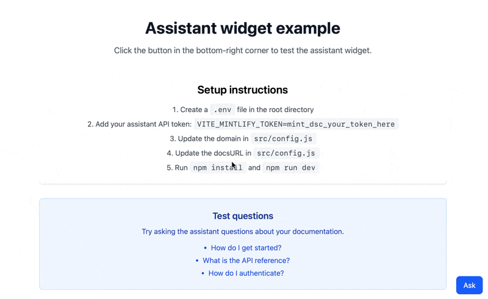

<div id="what-you-will-build">
  ## Lo que construirás
</div>

Un widget reutilizable que integra el [assistant](/es/assistant/index) directamente en tu aplicación. El widget ofrece:

* Un botón flotante que abre un panel de chat al hacer clic
* Respuestas en tiempo real transmitidas a partir de la información de tu documentación
* Visualización de mensajes con compatibilidad con Markdown

Los usuarios pueden usar el widget para obtener ayuda con tu producto sin salir de tu aplicación.

<Frame>
  
</Frame>

<div id="prerequisites">
  ## Requisitos previos
</div>

* El assistant habilitado para tu proyecto
* Tu nombre de dominio, que aparece al final de la URL de tu dashboard. Por ejemplo, si la URL de tu dashboard es `https://app.mintlify.com/org-name/domain-name`, tu nombre de dominio es `domain-name`
* Una [clave de API del assistant](https://app.mintlify.com/settings/organization/api-keys)
* Una aplicación de Next.js que use el App Router
* Conocimientos básicos de React

<div id="get-your-assistant-api-key">
  ### Obtén tu clave de API del assistant
</div>

1. Ve a la página de [API keys](https://app.mintlify.com/settings/organization/api-keys) en tu dashboard.
2. Haz clic en **Create Assistant API Key**.
3. Copia la clave de API del assistant (comienza con `mint_dsc_`) y guárdala de forma segura.

<Note>
  Tu clave de API del assistant controla el acceso a la cuota de tu assistant. Este tutorial mantiene la clave en el servidor mediante un proxy de backend, para que nunca llegue al bundle del cliente.
</Note>

<div id="build-the-widget">
  ## Crear el widget
</div>

El widget usa el hook `useChat` del [AI SDK](https://ai-sdk.dev) para llamar al [endpoint de mensajes del assistant](/es/api/assistant/create-assistant-message) a través de una ruta en tu aplicación.

<Steps>
<Step title="Instala las dependencias">

```bash
npm i ai@^6 @ai-sdk/react@^3 react-markdown
```

</Step>
<Step title="Guarda tu clave de API">

Guarda tu clave de API del assistant como una variable de entorno del servidor. No uses el prefijo `NEXT_PUBLIC_`, que incluye el valor en el código del cliente.

```bash .env.local
MINTLIFY_TOKEN=mint_dsc_your_token_here
```

Sustituye `mint_dsc_your_token_here` por tu clave de API del assistant.

</Step>
<Step title="Agrega una ruta de proxy">

Crea una ruta que añada tu clave de API a cada solicitud y la reenvíe a la API de Mintlify. La ruta devuelve la respuesta en streaming sin modificarla y transmite los encabezados del hilo.

```js app/api/assistant/route.js
const DOMAIN = 'your-domain';

export async function POST(request) {
  const upstream = await fetch(
    `https://api.mintlify.com/discovery/v2/assistant/${DOMAIN}/message`,
    {
      method: 'POST',
      headers: {
        'Content-Type': 'application/json',
        Authorization: `Bearer ${process.env.MINTLIFY_TOKEN}`,
      },
      body: await request.text(),
    }
  );

  const headers = new Headers();
  for (const name of ['content-type', 'x-thread-id', 'x-thread-key', 'x-message-id']) {
    const value = upstream.headers.get(name);
    if (value) headers.set(name, value);
  }

  return new Response(upstream.body, { status: upstream.status, headers });
}
```

Sustituye `your-domain` por tu nombre de dominio.

</Step>
<Step title="Crea el componente del widget">

```jsx components/AssistantWidget.jsx
'use client';

import { useState } from 'react';
import { useChat } from '@ai-sdk/react';
import { DefaultChatTransport } from 'ai';
import ReactMarkdown from 'react-markdown';

export function AssistantWidget() {
  const [isOpen, setIsOpen] = useState(false);
  const [input, setInput] = useState('');

  const { messages, sendMessage, status } = useChat({
    transport: new DefaultChatTransport({
      api: '/api/assistant',
      body: { fp: 'anonymous' },
    }),
  });

  const isLoading = status === 'submitted' || status === 'streaming';

  const handleSubmit = (e) => {
    e.preventDefault();
    if (!input.trim()) return;
    sendMessage({ text: input });
    setInput('');
  };

  return (
    <>
      <button
        onClick={() => setIsOpen(!isOpen)}
        style={{ position: 'fixed', bottom: 16, right: 16 }}
      >
        {isOpen ? 'Close' : 'Ask'}
      </button>

      {isOpen && (
        <div
          style={{
            position: 'fixed',
            bottom: 64,
            right: 16,
            width: 384,
            height: 500,
            display: 'flex',
            flexDirection: 'column',
            background: 'white',
            border: '1px solid #e5e7eb',
          }}
        >
          <div style={{ flex: 1, overflowY: 'auto', padding: 16 }}>
            {messages.map((message) => (
              <div key={message.id}>
                <strong>{message.role === 'user' ? 'You' : 'Assistant'}</strong>
                <ReactMarkdown>
                  {message.parts
                    .filter((part) => part.type === 'text')
                    .map((part) => part.text)
                    .join('')}
                </ReactMarkdown>
              </div>
            ))}
            {isLoading && <p>Loading...</p>}
          </div>

          <form onSubmit={handleSubmit} style={{ display: 'flex', gap: 8, padding: 16 }}>
            <input
              value={input}
              onChange={(e) => setInput(e.target.value)}
              placeholder="Ask a question..."
              style={{ flex: 1 }}
            />
            <button type="submit" disabled={isLoading || !input.trim()}>
              Send
            </button>
          </form>
        </div>
      )}
    </>
  );
}
```

El campo `fp` identifica al usuario. Usa `anonymous` o tu propio ID de usuario.

</Step>
<Step title="Agrega el widget a tu layout">

Renderiza el widget en tu layout raíz para que aparezca en todas las páginas.

```jsx app/layout.jsx
import { AssistantWidget } from '../components/AssistantWidget';

export default function RootLayout({ children }) {
  return (
    <html lang="en">
      <body>
        {children}
        <AssistantWidget />
      </body>
    </html>
  );
}
```

</Step>
<Step title="Inicia el servidor de desarrollo">

```bash
npm run dev
```

Abre tu aplicación en un navegador y haz clic en el botón **Ask** para abrir el widget del assistant.

</Step>
</Steps>

<div id="customization-ideas">
  ## Ideas para personalizar
</div>

<div id="source-citations">
  ### Citas de fuentes
</div>

El assistant busca en tu documentación antes de responder. Cada búsqueda aparece en el mensaje como una parte `tool-search`, y su array `output.results` enumera las páginas que encontró. Extráelas para mostrar las fuentes debajo de cada respuesta:

```jsx
const DOCS_URL = 'https://docs.example.com';

const extractSources = (parts) =>
  parts
    .filter((part) => part.type === 'tool-search' && part.state === 'output-available')
    .flatMap((part) => part.output?.results ?? [])
    .map((source) => ({
      url: `${DOCS_URL}/${source.path.replace(/^\//, '')}`,
      title: source.metadata?.title || source.path,
    }));

// En el renderizado de tus mensajes:
{messages.map((message) => {
  const sources = message.role === 'assistant' ? extractSources(message.parts) : [];
  return (
    <div key={message.id}>
      {/* contenido del mensaje */}
      {sources.length > 0 && (
        <div>
          <p>Sources:</p>
          {sources.map((source) => (
            <a key={source.url} href={source.url} target="_blank" rel="noopener noreferrer">
              {source.title}
            </a>
          ))}
        </div>
      )}
    </div>
  );
})}
```

Sustituye `https://docs.example.com` por la URL de tu sitio de documentación.

<div id="track-conversation-thread-ids">
  ### Seguimiento de hilos de conversación
</div>

Guarda los IDs y las claves de los hilos para mantener el historial de conversación entre sesiones.

Cuando un usuario crea un nuevo hilo de conversación, el servidor devuelve dos valores en los encabezados de la respuesta:

* `X-Thread-Id`: El identificador del hilo
* `X-Thread-Key`: Una clave secreta para el hilo (solo se devuelve una vez, cuando creas el hilo)

Debes capturar y conservar ambos valores en la primera respuesta. En cada mensaje posterior, incluye tanto `threadId` como `threadKey` en el cuerpo de la solicitud. Si envías un `threadId` sin el `threadKey` correspondiente, el servidor devuelve un error `404`.

<Warning>
  Debes guardar el encabezado `X-Thread-Key` de inmediato. El servidor solo lo devuelve cuando creas un hilo nuevo. No puedes recuperarlo más tarde.
</Warning>

El transporte lee su función `body` antes de cada solicitud, por lo que la siguiente solicitud incluye los valores guardados:

```jsx
const { messages, sendMessage, status } = useChat({
  transport: new DefaultChatTransport({
    api: '/api/assistant',
    body: () => ({
      fp: 'anonymous',
      threadId: localStorage.getItem('assistant-thread-id'),
      threadKey: localStorage.getItem('assistant-thread-key'),
    }),
    fetch: async (url, options) => {
      const response = await fetch(url, options);
      const threadId = response.headers.get('x-thread-id');
      const threadKey = response.headers.get('x-thread-key');
      if (threadId) localStorage.setItem('assistant-thread-id', threadId);
      if (threadKey) localStorage.setItem('assistant-thread-key', threadKey);
      return response;
    },
  }),
});
```

<div id="add-keyboard-shortcuts">
  ### Añadir un atajo de teclado
</div>

Permite que los usuarios abran y cierren el widget con un atajo de teclado:

```jsx
useEffect(() => {
  const handleKeyDown = (e) => {
    // Cmd/Ctrl + Shift + I para alternar el widget
    if ((e.metaKey || e.ctrlKey) && e.shiftKey && e.key.toLowerCase() === 'i') {
      e.preventDefault();
      setIsOpen((prev) => !prev);
    }
  };

  window.addEventListener('keydown', handleKeyDown);
  return () => window.removeEventListener('keydown', handleKeyDown);
}, []);
```
