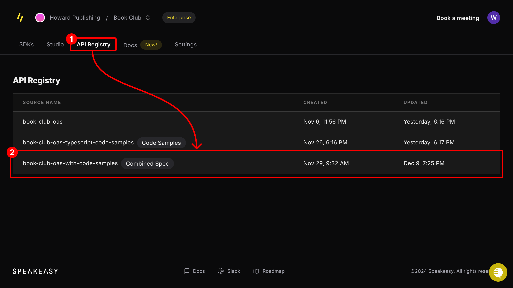

Chaque page d'endpoint affiche des exemples de code de requête à côté du playground. Par défaut, Mintlify les génère à partir de votre spécification OpenAPI dans les langages que vous choisissez. Si vos utilisateurs appellent votre API via un SDK ou une CLI, ajoutez vos propres exemples avec l'extension `x-codeSamples`, ou récupérez-les depuis Speakeasy.

<div id="choose-example-languages">
  ## Choisir les langages des exemples
</div>

Définissez `api.examples.languages` dans votre `docs.json` pour choisir les langages qui apparaissent dans les exemples générés. Les langages s'affichent dans l'ordre où vous les listez.

```json docs.json
{
  "api": {
    "examples": {
      "languages": ["curl", "python", "javascript"],
      "defaults": "required"
    }
  }
}
```

Définissez `defaults` sur `required` pour exclure les paramètres facultatifs des exemples générés. La valeur par défaut, `all`, les inclut.

<Accordion title="Tous les langages pris en charge">
| Nom affiché | Clé | Alias |
| --- | --- | --- |
| cURL | `bash` | `curl`, `sh`, `shell` |
| Python | `python` | `py` |
| JavaScript | `javascript` | `js` |
| Node.js | `node` | `nodejs`, `node.js` |
| PHP | `php` | |
| Go | `go` | `golang` |
| Java | `java` | |
| Ruby | `ruby` | `rb` |
| PowerShell | `powershell` | |
| Swift | `swift` | |
| C# | `csharp` | `c#` |
| .NET | `dotnet` | `.net`, `.NET`, `dot-net` |
| TypeScript | `typescript` | `ts` |
| C | `c` | |
| C++ | `c++` | `cpp` |
| Kotlin | `kotlin` | `kt` |
| Rust | `rust` | `rs` |
| Dart | `dart` | `flutter` |
</Accordion>

Pour n'afficher que les exemples que vous écrivez, définissez `api.examples.autogenerate` sur `false`. Les pages d'endpoint affichent alors uniquement les `x-codeSamples` de votre spécification, ou les composants `<RequestExample>` sur les pages MDX.

<div id="write-your-own-examples">
  ## Écrire vos propres exemples
</div>

Ajoutez la propriété `x-codeSamples` à n'importe quelle opération. Elle suit le schéma suivant.

<ParamField body="lang" type="string" required>
  Le langage de l'exemple de code.
</ParamField>

<ParamField body="label" type="string">
  Le libellé de l'exemple. Utile lorsque vous fournissez plusieurs exemples pour un même endpoint.
</ParamField>

<ParamField body="source" type="string" required>
  Le code source de l'exemple.
</ParamField>

L'exemple suivant montre des exemples de code pour une application de suivi de plantes qui dispose à la fois d'un outil CLI Bash et d'un SDK JavaScript.

```yaml
paths:
  /plants:
    get:
      # ...
      x-codeSamples:
        - lang: bash
          label: List all unwatered plants
          source: |
            planter list -u
        - lang: javascript
          label: List all unwatered plants
          source: |
            const planter = require('planter');
            planter.list({ unwatered: true });
        - lang: bash
          label: List all potted plants
          source: |
            planter list -p
        - lang: javascript
          label: List all potted plants
          source: |
            const planter = require('planter');
            planter.list({ potted: true });
```

<div id="generate-examples-with-speakeasy">
  ## Générer des exemples avec Speakeasy
</div>

Si vous générez vos SDK avec [Speakeasy](https://www.speakeasy.com), vous pouvez intégrer ses extraits autogénérés dans votre référence d'API au lieu de les maintenir manuellement. Les extraits apparaissent dans le [playground interactif](/fr/api-playground/overview) à côté de vos endpoints.

<Steps>
<Step title="Récupérez l'URL de la spécification combinée depuis le registre">

Accédez à votre [tableau de bord Speakeasy](https://app.speakeasy.com) et ouvrez l'onglet **API Registry**. Ouvrez l'entrée `*-with-code-samples` de votre API.

<Frame>

</Frame>

<Note>
  Si l'entrée n'est pas étiquetée **Combined Spec**, vérifiez que votre API dispose d'une [URL d'exemples de code automatiques](https://www.speakeasy.com/docs/code-samples/automated-code-sample-urls) configurée.
</Note>

Depuis la page de l'entrée du registre, copiez l'URL publique fournie.
</Step>
<Step title="Ajoutez l'URL de la spécification combinée à votre fichier `docs.json`">

Ajoutez l'URL de la spécification combinée à une ancre ou à un onglet dans l'objet `navigation` de votre fichier `docs.json`.

<CodeGroup>

```json title="Anchor"
{
  "navigation": {
    "anchors": [
      {
        "anchor": "API reference",
        "icon": "square-terminal",
        // !mark
        "openapi": "SPEAKEASY_COMBINED_SPEC_URL"
      }
    ]
  }
}
```

```json title="Tab"
{
  "navigation": {
    "tabs": [
      {
        "tab": "API reference",
        // !mark
        "openapi": "SPEAKEASY_COMBINED_SPEC_URL"
      }
    ]
  }
}
```
</CodeGroup>
</Step>
<Step title="Vérifiez l'intégration">

Après avoir redéployé votre documentation, ouvrez n'importe quel endpoint dans votre référence d'API et confirmez que les extraits par langage apparaissent dans le playground. L'ensemble des langages disponibles correspond aux cibles de SDK configurées dans votre projet Speakeasy.

Si les extraits n'apparaissent pas, vérifiez que :

- L'URL `openapi` dans `docs.json` pointe vers l'entrée de spécification combinée `*-with-code-samples`, et non vers le fichier OpenAPI source.
- L'URL de la spécification combinée est accessible publiquement depuis le navigateur.
- Votre projet Speakeasy dispose d'une [URL d'exemples de code automatisés](https://www.speakeasy.com/docs/code-samples/automated-code-sample-urls) configurée et d'au moins une cible de SDK activée.

</Step>
</Steps>
