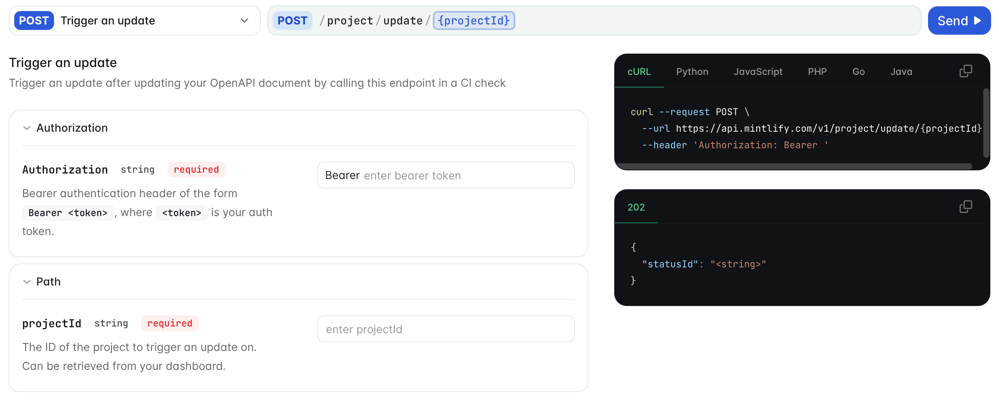
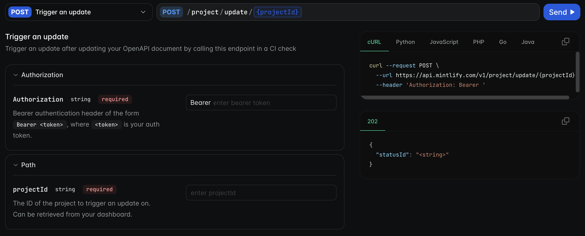

Générez des pages de référence pour votre API à partir de la spécification que vous maintenez déjà. Chaque endpoint obtient une page qui liste ses paramètres, affiche des exemples de requête et de réponse, et inclut un playground d'API interactif où les lecteurs peuvent envoyer de vraies requêtes sans quitter votre documentation. Lorsque votre spécification change, les pages se mettent à jour.

<Frame>
  
  
</Frame>

Pour voir une page générée, ouvrez [Trigger an update](/fr/api/update/trigger) dans la référence d'API de Mintlify. Pour appeler l'API de Mintlify plutôt que documenter la vôtre, consultez l'[introduction à la référence d'API](/fr/api/introduction).

  ## Ce que vos utilisateurs peuvent faire

- Envoyer des requêtes à votre API depuis le playground et voir les réponses, y compris les images, l'audio, la vidéo et les réponses en streaming.
- Copier des exemples de requête dans leur langage ou dans votre SDK.
- Remplir les corps de requête champ par champ ou [les modifier en JSON](#edit-request-bodies-as-json).
- [Accéder directement à un paramètre précis](#link-to-parameters).
- Télécharger votre spécification, si vous [activez l'option](/fr/api-playground/openapi-setup#let-visitors-download-your-spec).

  ## Choisir comment documenter votre API

| Votre API est décrite par | Utilisez | Génère |
| --- | --- | --- |
| Une spécification OpenAPI | [OpenAPI](/fr/api-playground/openapi-setup) | Des pages d'endpoints REST et de webhooks avec le playground. Recommandé pour les API HTTP. |
| Une spécification AsyncAPI | [AsyncAPI](/fr/api-playground/asyncapi-setup) | Des pages de canaux WebSocket avec un playground. |
| Un schéma GraphQL | [GraphQL](/fr/api-playground/graphql-setup) | Des pages de requêtes, de mutations et de types. |
| Une sortie TypeDoc, DocFX, Javadoc, Sphinx, phpDocumentor ou Go | [Référence SDK](/fr/api-playground/sdk-reference-setup) | Des pages de classes, de modules et de fonctions pour vos bibliothèques SDK. |
| Rien ou quelques endpoints | [Documenter des endpoints sans spécification](/fr/api-playground/mdx-setup) | Des pages d'endpoints que vous écrivez en MDX. |

Vous pouvez combiner les approches, par exemple une référence OpenAPI pour votre API REST et une référence SDK pour vos bibliothèques clientes.

  ## Bien démarrer avec OpenAPI

<CardGroup cols={2}>
  <Card title="Configurer OpenAPI" icon="file-braces" href="/fr/api-playground/openapi-setup">
    Ajoutez votre spécification, validez-la et gardez-la synchronisée avec votre API.
  </Card>
  <Card title="Configurer le playground" icon="play" href="/fr/api-playground/configure-playground">
    Définissez votre URL de base et l'authentification.
  </Card>
  <Card title="Organiser les endpoints" icon="list-tree" href="/fr/api-playground/organize-endpoints">
    Regroupez les endpoints, combinez des spécifications et masquez les endpoints internes.
  </Card>
  <Card title="URL et titres des endpoints" icon="link" href="/fr/api-playground/endpoint-urls">
    Contrôlez les URL des pages et gardez-les stables lorsque votre spécification change.
  </Card>
  <Card title="Personnaliser les pages d'endpoints" icon="pencil" href="/fr/api-playground/customize-endpoint-pages">
    Modifiez les titres et descriptions, ajoutez du contenu et créez des pages pour des endpoints individuels.
  </Card>
  <Card title="Exemples de code" icon="code" href="/fr/api-playground/code-examples">
    Choisissez les langages des exemples, ou ajoutez vos propres exemples de SDK.
  </Card>
</CardGroup>

Si vos pages d'API ne sont pas générées ou si le playground n'envoie pas de requêtes, consultez [Dépannage](/fr/api-playground/troubleshooting).

  ## Modifier les corps de requête en JSON

Si un endpoint accepte un corps de requête JSON (`application/json` ou un type de média `+json`), la section du corps du playground affiche un sélecteur **Form** et **JSON**. Les lecteurs utilisent **Form** pour remplir un champ à la fois, ou **JSON** pour modifier tout le corps dans un éditeur de code, par exemple pour coller la réponse d'un autre endpoint et changer quelques valeurs.

- Form et JSON modifient le même corps : les changements dans une vue apparaissent dans l'autre. La requête et les exemples de code générés correspondent toujours au corps.
- JSON conserve les propriétés absentes de votre schéma OpenAPI et les envoie avec la requête.
- Si le JSON n'est pas valide, le playground affiche la ligne, la colonne et la cause probable de la première erreur. Les lecteurs ne peuvent pas envoyer la requête tant que le JSON n'est pas valide.
- Le playground mémorise la vue choisie par le lecteur et l'utilise pour les autres endpoints.

Le sélecteur n'apparaît pas pour les autres types de corps de requête, comme `multipart/form-data` ou `application/x-www-form-urlencoded`.

  ## Créer des liens vers les paramètres

Chaque paramètre d'une page d'endpoint possède un lien d'ancrage. Survolez le nom d'un paramètre et cliquez sur l'icône de lien pour copier une URL vers ce paramètre, par exemple pour la partager dans une conversation de support. Le format de l'URL est `url-de-votre-doc/chemin-de-l-endpoint#nom-du-parametre`. Pour les paramètres imbriqués, l'ancre inclut le chemin du parent.
