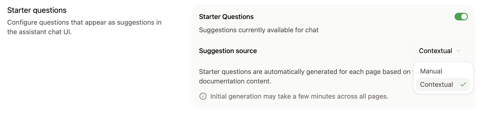
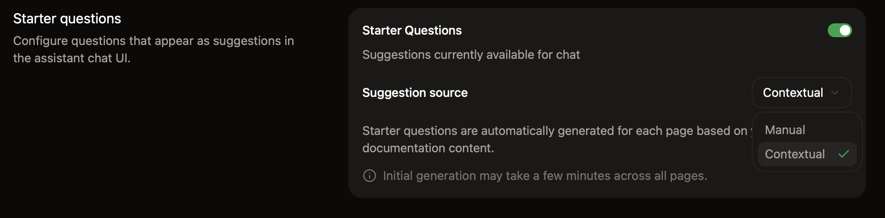

<Info>
  L'assistant nécessite un [forfait Pro ou Enterprise](https://mintlify.com/pricing?ref=assistant).
</Info>

Configurez l'assistant sur la page [Assistant](https://app.mintlify.com/products/assistant) de votre tableau de bord. Après l'avoir activé et avoir ajouté des questions de démarrage, choisissez où vont les questions auxquelles l'assistant ne peut pas répondre, puis testez-le.

  ## Activer ou désactiver l'assistant

Sur la page [Assistant](https://app.mintlify.com/products/assistant) de votre tableau de bord, cliquez sur le bouton de statut pour activer ou désactiver l'assistant sur votre site.

  ## Ajouter des questions de démarrage

Aidez vos utilisateurs à démarrer des conversations avec l'assistant en ajoutant des questions de démarrage.

L'assistant peut générer des questions spécifiques à la page en fonction de la page consultée par l'utilisateur, ou vous pouvez ajouter des questions persistantes disponibles sur toutes les pages.

Vous pouvez ajouter jusqu'à trois questions de démarrage. Cliquez sur **Demander à l'assistant** pour obtenir des questions recommandées basées sur votre documentation.

<Frame>
  
  
</Frame>

  ## Choisir où vont les questions sans réponse

Lorsque l'assistant ne peut pas répondre à une question, il peut orienter l'utilisateur vers votre équipe de support ou commerciale par e-mail, via un lien vers votre centre d'aide ou avec un ticket dans Plain ou Zendesk. Consultez [Orienter les questions vers votre équipe](/fr/assistant/support-routing).

  ## Protection contre les bots

Dans la section **Bot Protection**, activez le captcha invisible pour protéger votre assistant contre les abus automatisés. La protection contre les bots respecte la vie privée et est invisible pour la quasi-totalité des visiteurs.

Pour activer la protection contre les bots :

1. Accédez à la page [Paramètres de l'assistant](https://app.mintlify.com/products/assistant/settings) dans votre tableau de bord.
2. Dans la section **Bot Protection**, activez **Invisible Captcha**.

Les modifications prennent jusqu'à 10 minutes pour se propager.

<Note>
  Si vous utilisez des [en-têtes Content Security Policy](/fr/deploy/csp-configuration) personnalisés, vous devez inclure `hcaptcha.com` et `*.hcaptcha.com` dans votre liste autorisée.
</Note>

  ## Tester l'assistant

L'assistant est disponible dans votre prévisualisation locale lorsque vous vous connectez avec la CLI. Utilisez la prévisualisation locale pour tester les réponses et les instructions personnalisées dans `Assistant.md` pendant que vous rédigez.

1. Si ce n'est pas déjà fait, installez la CLI avec `npm i -g mint`.
2. Exécutez `mint login` pour vous authentifier.
3. Exécutez `mint dev` pour démarrer la prévisualisation locale.

L'assistant en prévisualisation locale utilise le même contenu indexé que votre site de documentation déployé.
