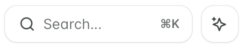
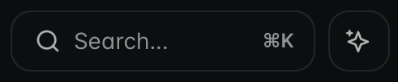
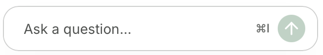
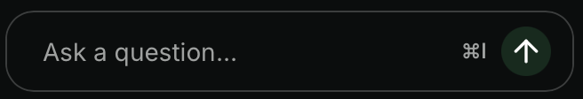
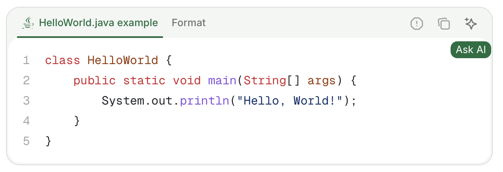
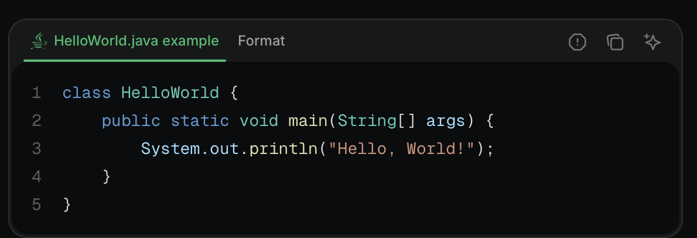

Les utilisateurs ouvrent l'assistant depuis son bouton, un raccourci clavier ou un lien que vous partagez. Vous pouvez renommer l'assistant, modifier l'apparence du bouton, le masquer ou désactiver l'assistant.

<div id="where-the-assistant-appears">
  ## Où apparaît l'assistant
</div>

L'assistant apparaît à deux endroits : sous forme de bouton à côté de la barre de recherche et sous forme de barre en bas de la page.

<Columns cols={2}>
  <Frame caption="Bouton de l'assistant à côté de la barre de recherche.">
    

</Frame>
<Frame caption="Bouton de l'assistant en bas de la page.">


</Frame>
</Columns>

Les utilisateurs peuvent aussi ouvrir le panneau de chat de l'assistant avec le raccourci clavier <kbd>Cmd</kbd> + <kbd>I</kbd> sur macOS et <kbd>Ctrl</kbd> + <kbd>I</kbd> sur Windows.

<div id="open-the-assistant-from-your-own-links">
  ## Ouvrir l'assistant depuis vos propres liens
</div>

Ouvrez l'assistant depuis n'importe quelle page de votre site de documentation en ajoutant le paramètre de requête `?assistant` à l'URL. Utilisez-le pour créer un lien direct vers l'assistant depuis du contenu externe comme des e-mails, des réponses de support, des bannières in-app ou des parcours d'intégration.

- `?assistant` : Ouvre le panneau de chat de l'assistant sans envoyer de message.
- `?assistant=<message>` : Ouvre le panneau de chat de l'assistant et envoie `<message>` comme premier message de l'utilisateur. Encodez la valeur en URL pour que les espaces et les caractères spéciaux soient préservés dans la requête.

```text Exemples
https://yourdocs.mintlify.site/quickstart?assistant
https://yourdocs.mintlify.site/quickstart?assistant=How%20do%20I%20get%20started%3F
```

Pour permettre aux utilisateurs d'ouvrir l'assistant avec la page actuelle comme contexte depuis le menu contextuel de la page, ajoutez l'option `"assistant"` à votre [menu contextuel](/fr/ai/contextual-menu).

<div id="add-context-to-a-question">
  ## Ajouter du contexte à une question
</div>

Les utilisateurs peuvent donner à l'assistant plus de contexte que leur seule question. L'assistant sait aussi sur quelle page se trouve l'utilisateur.

<div id="highlight-text">
  ### Surligner du texte
</div>

Surlignez du texte sur une page et cliquez sur le bouton contextuel **Add to assistant** pour ouvrir le panneau de chat de l'assistant et ajouter le texte surligné comme contexte. Vous pouvez ajouter plusieurs extraits de texte ou blocs de code au contexte de l'assistant.

<div id="code-blocks">
  ### Blocs de code
</div>

Cliquez sur le bouton **Demander à l'assistant** dans un bloc de code pour ouvrir le panneau de chat de l'assistant et ajouter le bloc de code comme contexte. Vous pouvez ajouter plusieurs blocs de code ou extraits de texte au contexte de l'assistant.

<Frame>


</Frame>

<div id="file-attachments">
  ### Pièces jointes
</div>

Joignez des fichiers aux messages de l'assistant pour fournir un contexte supplémentaire.

Types de fichiers pris en charge :
- **Images** : JPEG, PNG, GIF, WebP, SVG
- **Documents** : PDF
- **Fichiers de code et texte** : JavaScript (`.js`, `.jsx`, `.mjs`, `.cjs`), TypeScript (`.ts`, `.tsx`), Python, HTML, CSS, Markdown, MDX, JSON, YAML, XML, SQL, CSV, texte brut, scripts shell (`.sh`, `.bash`, `.env`), GraphQL, TOML, Go, Rust, Ruby, Java, Kotlin, Swift, C (`.c`, `.h`), C++ (`.cpp`, `.hpp`), C#, PHP, Lua, R, Scala

Limites :
- Taille maximale du fichier : 5 Mo par pièce jointe
- Nombre maximal de pièces jointes par message : 10

<div id="hide-or-restyle-the-assistant">
  ## Masquer ou modifier le style de l'assistant
</div>

Pour modifier l'apparence du bouton de l'assistant, ou le masquer sur l'ensemble de votre site, ciblez le sélecteur `[data-layout-item="assistant-entry"]` dans un fichier [CSS personnalisé](/fr/customize/custom-scripts#add-custom-css). Consultez [Scripts personnalisés](/fr/customize/custom-scripts#id-selectors) pour connaître les ID du bouton de l'assistant, du panneau de chat et du champ de saisie.

<div id="change-the-assistants-name-and-icon">
  ### Modifier le nom et l'icône de l'assistant
</div>

Pour afficher votre propre nom et votre propre icône sur le bouton de l'assistant à la place de **Ask Assistant** et de l'icône en forme d'étincelle, ajoutez ce CSS à un fichier [CSS personnalisé](/fr/customize/custom-scripts#add-custom-css). Remplacez `Ask Acme AI` par le libellé de votre bouton et `/images/acme-ai.svg` par le chemin d'une icône de votre projet.

Le CSS utilise uniquement le sélecteur `[data-layout-item="assistant-entry"]`, il s'applique donc au bouton sur ordinateur et sur mobile, dans tous les thèmes.

```css style.css
/* Hide the button's default icon and label */
[data-layout-item="assistant-entry"] > * {
  display: none;
}

/* Add your icon */
[data-layout-item="assistant-entry"]::before {
  content: "";
  display: inline-block;
  flex: none;
  width: 16px;
  height: 16px;
  vertical-align: middle;
  background: url("/images/acme-ai.svg") center / contain no-repeat;
}

/* Add your label */
[data-layout-item="assistant-entry"]::after {
  content: "Ask Acme AI";
  font-size: 0.875rem;
  white-space: nowrap;
}
```

Si votre thème n'affiche qu'une icône sur le bouton de l'assistant, supprimez la règle `::after`.

Ce CSS ne modifie que le bouton de l'assistant. Le panneau de chat, la barre en bas de la page, le bouton **Ask Assistant** des blocs de code, l'info-bulle du bouton et les libellés annoncés par les lecteurs d'écran indiquent toujours **Assistant**.

<div id="style-the-contact-form">
  ### Personnaliser le style du formulaire de contact
</div>

Le [formulaire de contact](/fr/assistant/support-routing#send-questions-by-email) qui s'affiche lorsque l'assistant oriente une question vers votre équipe possède des classes que vous pouvez cibler dans un fichier [CSS personnalisé](/fr/customize/custom-scripts#add-custom-css).

| Classe | Élément |
| :--- | :--- |
| `chat-assistant-contact-form` | Le formulaire |
| `chat-assistant-contact-form-title` | Titre du formulaire |
| `chat-assistant-contact-form-field` | Conteneur du libellé, du champ de saisie et de l'erreur de chaque champ |
| `chat-assistant-contact-form-label` | Libellé du champ |
| `chat-assistant-contact-form-required` | Marqueur de champ obligatoire (`*`) à côté d'un libellé |
| `chat-assistant-contact-form-input` | Champ de texte ou zone de message |
| `chat-assistant-contact-form-field-error` | Message d'erreur sous un champ |
| `chat-assistant-contact-form-error` | Message d'erreur lorsque l'envoi du formulaire échoue |
| `chat-assistant-contact-form-dismiss-button` | Bouton de fermeture ou **Cancel** |
| `chat-assistant-contact-form-submit-button` | Bouton d'envoi |
| `chat-assistant-contact-form-success` | Confirmation affichée après l'envoi du formulaire |

Chaque conteneur de champ possède un attribut `data-field` défini sur `firstName`, `lastName`, `company`, `email` ou `message`, ce qui vous permet de styliser un champ à la fois.

```css style.css
/* Hide the required markers */
.chat-assistant-contact-form-required {
  display: none;
}

/* Add a hint under the company label */
.chat-assistant-contact-form-field[data-field="company"] .chat-assistant-contact-form-label::after {
  content: " (your employer or project)";
  font-weight: 400;
}
```

Tous les champs sont obligatoires. Masquer le marqueur `*` ne rend pas un champ facultatif, et masquer un champ avec du CSS empêche les utilisateurs d'envoyer le formulaire.

<div id="turn-off-the-assistant">
  ## Désactiver l'assistant
</div>

Pour retirer l'assistant de votre site, [désactivez l'assistant](/fr/assistant/configure#enable-or-disable-the-assistant) dans votre tableau de bord.

<div id="troubleshooting">
  ## Dépannage
</div>

<Accordion title="La barre de chat de l'assistant n'est pas visible">
  Si l'interface de l'assistant n'est pas visible dans certains navigateurs, vous devrez peut-être signaler un faux positif à [EasyList](https://easylist.to). Les navigateurs qui utilisent la EasyList Cookies List, comme Brave et Comet, bloquent parfois l'assistant ou d'autres éléments de l'interface. La EasyList Cookies List inclut une règle spécifique au domaine qui masque les éléments fixes sur certains domaines pour bloquer les bannières de cookies. Cette règle affecte par inadvertance des composants d'interface légitimes.

  Signalez un faux positif à [EasyList](https://github.com/easylist/easylist) pour demander la suppression de la règle. Cela résout le problème pour tous les utilisateurs une fois la liste de filtres mise à jour.

</Accordion>

<Accordion title="Assistant bloqué sur un réseau d'entreprise, un VPN ou un pare-feu">
  Si l'assistant se charge sur des réseaux personnels mais échoue sur un réseau professionnel, un VPN ou un autre réseau restreint, le blocage se produit au niveau du réseau et non sur le site de documentation lui-même. Les proxys d'entreprise, les VPN et les pare-feu bloquent parfois les requêtes sortantes dont l'assistant a besoin, de sorte que le panneau de chat ne peut pas se connecter même si le reste du site se charge normalement.

  **Pour les lecteurs :** Demandez à votre équipe informatique d'autoriser les requêtes HTTPS sortantes vers les hôtes suivants depuis votre réseau. Si vous le pouvez, essayez l'assistant depuis un réseau personnel pour confirmer que le problème est spécifique au réseau.

  - `leaves.mintlify.com`—API de l'assistant
  - `hcaptcha.com` et `*.hcaptcha.com`—vérification CAPTCHA pour l'assistant

  **Pour les propriétaires de site :** Si un lecteur signale que l'assistant ne se charge pas sur son réseau d'entreprise ou son VPN, il s'agit presque toujours d'un blocage réseau sortant et non d'un problème avec votre documentation. Indiquez-lui les hôtes précédents et suggérez-lui de partager la liste avec son équipe informatique. Il s'agit d'une liste d'autorisation au niveau réseau qui s'applique à l'appareil ou au réseau du visiteur, et non de quelque chose que vous pouvez configurer depuis votre site. Si votre documentation est auto-hébergée derrière un proxy inverse qui écrase la CSP par défaut, consultez [Configuration de la CSP](/fr/deploy/csp-configuration) pour les domaines à autoriser.

</Accordion>

<Accordion title="Le message contient `[REDACTED_SECRET]`">
  L'assistant analyse chaque message à la recherche de valeurs qui ressemblent à des identifiants, comme des clés d'API, des jetons d'accès, des mots de passe dans des URL, des JSON Web Tokens et des clés privées. Il analyse aussi le texte des fichiers joints et tout contexte envoyé avec le message. Les images ne sont pas analysées. Mintlify remplace chaque valeur détectée par `[REDACTED_SECRET]` avant que le modèle de l'assistant ne voie le message ou que Mintlify n'enregistre la conversation.

  L'assistant ne reçoit jamais la valeur d'origine. Il ne vous demande pas de coller à nouveau la valeur. Si une réponse dépend de la valeur exacte, l'assistant vous indique que la valeur a été masquée. Pour obtenir de l'aide sur un identifiant, décrivez-le ou remplacez-le par un espace réservé comme `YOUR_API_KEY`.

</Accordion>
