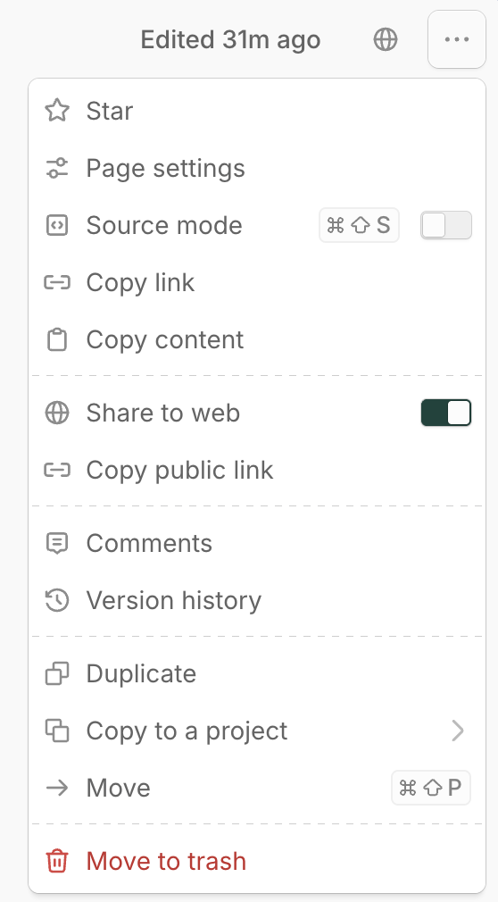
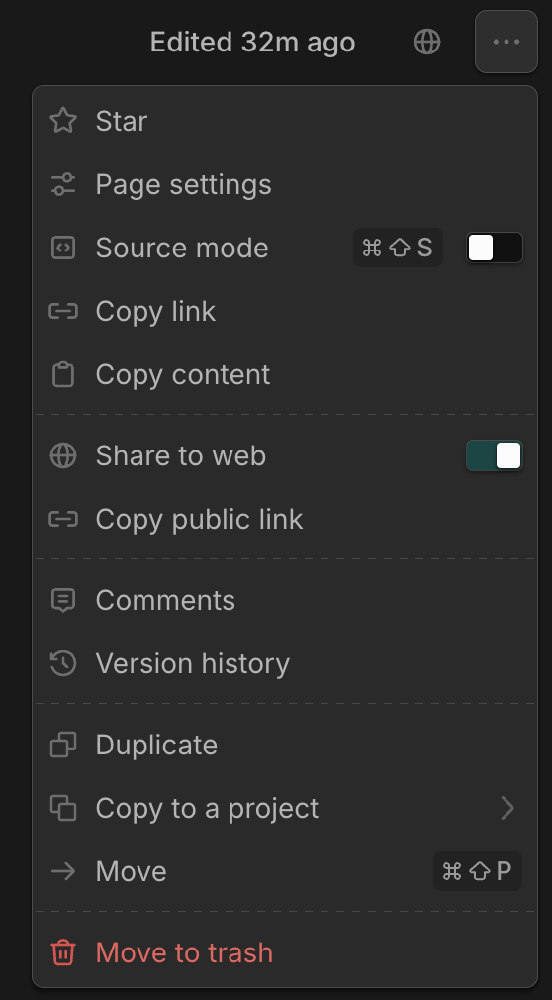

<Note>
  Les bases de connaissances sont en beta et susceptibles d'évoluer.
</Note>

Une base de connaissances est un type de projet dans Mintlify pour votre équipe et les agents avec lesquels elle travaille. Conservez au même endroit vos spécifications, runbooks, guides d'intégration et autres connaissances internes de l'équipe. Connectez votre base de connaissances à Claude, ChatGPT, Cursor et d'autres outils d'IA via MCP afin que les agents travaillent à partir des mêmes informations que votre équipe.

Une base de connaissances utilise le même [éditeur](/fr/editor/index) et le même [agent](/fr/editor/agent) que vos sites. Les mêmes workflows s'appliquent aux deux types de projets.

## Différences entre une base de connaissances et un site

Une base de connaissances est l'un des deux [types de projets](/fr/organize/projects#project-types). Comme une base de connaissances n'a pas de site publié, les fonctionnalités qui ne s'appliquent qu'à un site, comme la page **Publishes**, les domaines personnalisés, l'assistant, les exports, les analytics et les automatisations, ne sont pas disponibles pour une base de connaissances.

Pour utiliser [Autopilot](/fr/autopilot) dans une base de connaissances, [connectez d'abord votre propre dépôt](#where-your-pages-are-stored). Autopilot ne s'exécute pas sur les dépôts hébergés par Mintlify.

Vous organisez une base de connaissances uniquement avec des pages et des groups. Vous ne pouvez pas utiliser de tabs, anchors, versions, languages ni d'autres éléments de navigation.

{/* vale off */}

## Où vos pages sont stockées

{/* vale on */}

La barre latérale de l'éditeur d'une base de connaissances contient trois types de pages.

- **Navigation** : Les pages partagées par toute votre organisation. Mintlify stocke ces pages sous forme de fichiers MDX dans un dépôt Git et commit automatiquement vos modifications.
- **Personal** : Des [pages privées](/fr/editor/pages#private-pages) pour vos brouillons ou le contenu qui ne concerne que vous. Les pages privées ne sont pas stockées dans Git. Elles restent privées, sauf si vous les partagez avec des collègues. Pour partager une page privée, ouvrez son menu d'options, sélectionnez **Move**, puis choisissez **Navigation** ou un group qu'elle contient.
- **Shared with me** : Les pages que des collègues [vous ont partagées](/fr/editor/pages#share-a-private-page) directement.

Les nouvelles bases de connaissances utilisent un dépôt Git hébergé par Mintlify pour vous. Pour travailler sur votre base de connaissances en local avec vos propres outils, connectez un dépôt GitHub, GitLab, Bitbucket ou Azure Repos dans vos [paramètres Git](https://app.mintlify.com/settings/project/git-settings). Les commits que vous poussez vers le dépôt connecté mettent à jour votre base de connaissances.

Mintlify chiffre au repos le contenu de votre base de connaissances, avec une clé propre à votre base de connaissances.

## Comment les personnes et les agents contribuent

Votre équipe peut mettre à jour une base de connaissances où qu'elle travaille :

- **Éditeur** : Rédigez et organisez des pages dans votre navigateur ou dans l'[application de bureau](/fr/desktop), avec l'aide de l'[agent](/fr/editor/agent).
- **MCP** : Connectez Claude, ChatGPT, Cursor ou un autre outil d'IA au [MCP d'administration](/fr/ai/mintlify-mcp) pour lire, rechercher et modifier votre base de connaissances depuis une conversation.
- **Slack** : Posez à l'[agent Mintlify dans Slack](/fr/agent/slack) des questions auxquelles il répond à partir de votre base de connaissances, ou demandez-lui de mettre à jour des pages.
- **Git** : Clonez le dépôt de votre base de connaissances et modifiez les fichiers MDX avec n'importe quel éditeur ou agent de code.

## Partager une page sur le web

<Info>
  Les liens publics nécessitent une offre Pro ou Enterprise pour votre base de connaissances.
</Info>

Vous pouvez partager une page d'une base de connaissances avec des personnes extérieures à votre organisation grâce à un lien public. Toute personne disposant du lien peut consulter la page sans se connecter. Elle ne peut pas la modifier.

### Autoriser les liens publics

Les liens publics sont désactivés par défaut. Un administrateur doit les activer avant que quiconque puisse partager une page.

1. Accédez à vos paramètres [Security](https://app.mintlify.com/settings/organization/access).
2. Dans la section **Sharing**, activez **Allow public links**.

Si un administrateur désactive **Allow public links**, tous les liens publics cessent de fonctionner jusqu'à ce qu'un administrateur réactive le paramètre.

### Partager une page

Vous pouvez partager une page dans **Navigation** si vous avez le rôle d'éditeur ou d'administrateur. Vous pouvez partager une page privée si vous disposez d'un accès **Full Access** à celle-ci.

1. Ouvrez la page dans l'éditeur.
2. Ouvrez le menu d'options de la page <Icon icon="ellipsis" />.
3. Activez **Share to web**.
4. Cliquez sur **Copy public link**.

<Frame>
  
  
</Frame>

Lorsque vous partagez une page, un bouton en forme de globe <Icon icon="globe" /> apparaît dans la barre supérieure. Cliquez sur l'icône pour copier à nouveau le lien. La page publique affiche le contenu actuel de la page.

Chaque page publique dispose également d'une version Markdown pour les outils d'IA. Ajoutez `.md` à la fin du lien public pour l'afficher ou demandez le lien avec un en-tête `Accept: text/markdown`.

### Arrêter de partager une page

1. Ouvrez le menu d'options de la page <Icon icon="ellipsis" />.
2. Désactivez **Share to web**.
3. Cliquez sur **Stop sharing** pour confirmer.

Le lien cesse de fonctionner immédiatement. Si vous partagez à nouveau la page, Mintlify génère un nouveau lien.

## Pour commencer

<Card title="Configurer une base de connaissances" icon="rocket" href="/fr/base/setup" horizontal>
  Créez une base de connaissances, invitez votre équipe et connectez vos outils d'IA.
</Card>
