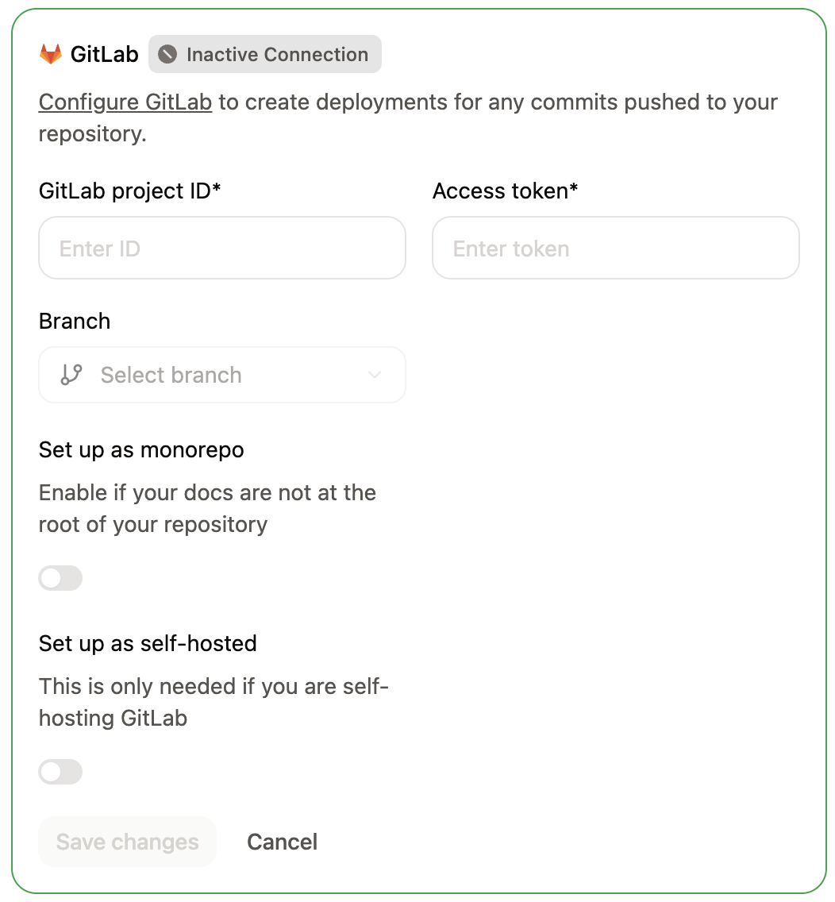
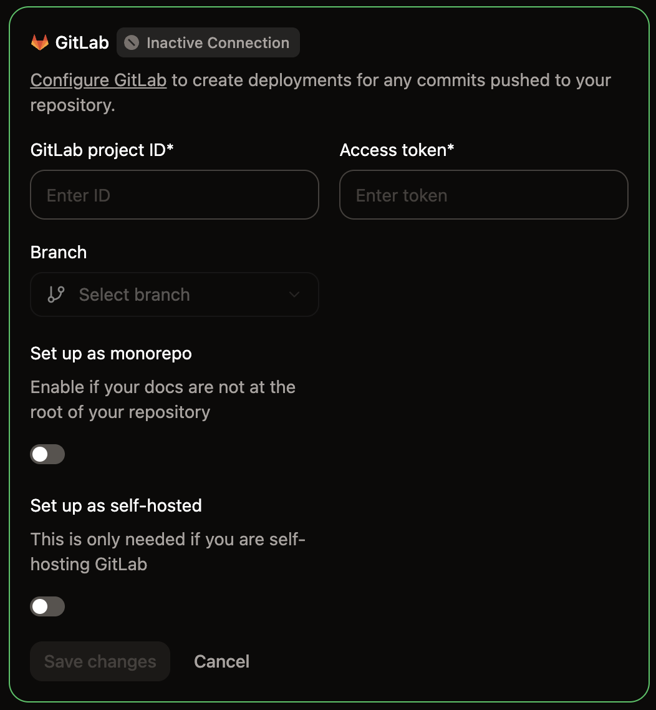

Mintlify utilise des jetons d'accès et des webhooks pour authentifier et synchroniser les changements entre GitLab et Mintlify.

- Mintlify utilise des jetons d'accès pour récupérer des informations depuis GitLab.
- GitLab utilise des webhooks pour avertir Mintlify lorsque vous effectuez des changements, ce qui permet des déploiements de prévisualisation pour les merge requests. Mintlify ajoute le webhook à votre projet lorsque vous le connectez.

  ## Configurer la connexion

Lorsque vous ouvrez [Git Settings](https://app.mintlify.com/settings/project/git-settings) pour la première fois, un assistant de configuration vous guide pour connecter votre référentiel GitLab.

<Steps>
  <Step title="Sélectionner GitLab comme fournisseur">
    Sur la page [Git Settings](https://app.mintlify.com/settings/project/git-settings), sélectionnez **Connect to GitLab** et cliquez sur **Continue**.
  </Step>
  <Step title="Télécharger votre contenu">
    <Tip>
      Si vous disposez déjà d'un référentiel GitLab contenant votre documentation, vous pouvez ignorer le téléchargement et cliquer directement sur **Continue setup**.
    </Tip>
    
    Si votre documentation est hébergée par Mintlify, téléchargez-la sous forme de fichier zip.
    * Créez un nouveau référentiel dans GitLab.
    * Extrayez le contenu du zip.
    * Poussez le contenu vers votre référentiel.

    Cliquez sur **Continue setup** pour continuer.
  </Step>
  <Step title="Trouver votre ID de projet">
    Dans votre projet GitLab, accédez à **Settings** > **General** et repérez votre **Project ID**.
  </Step>
  <Step title="Générer un jeton d'accès">
    Accédez à **Settings** > **Access Tokens** et sélectionnez **Add new token**.
    
    Configurez le jeton avec les paramètres suivants :
    - **Name** : Mintlify
    - **Role** : Maintainer
    - **Scopes** : `api` et `read_api`
    
    Cliquez sur **Create project access token** et copiez le jeton.

    Lorsque vous enregistrez un nouveau jeton, Mintlify le vérifie d'abord. Si le jeton n'a pas le scope `api` ou ne peut pas publier sur votre branche de déploiement, Mintlify le rejette avec le message « Ce jeton GitLab ne peut pas publier de modifications. Utilisez un jeton d'accès de projet avec le rôle Maintainer et le scope api. »

    <Note>
      Si les Project Access Tokens ne sont pas disponibles, vous pouvez utiliser un Personal Access Token. Notez que les Personal Access Tokens expirent et doivent être renouvelés.
    </Note>

  </Step>
  <Step title="Connecter votre référentiel">
    De retour dans l'assistant de configuration, remplissez les champs suivants :

    - **Project ID** : L'ID de projet depuis les paramètres de votre projet GitLab.
    - **Branch** : Sélectionnez la branche à partir de laquelle déployer votre documentation.
    - **Deployment token** : Le jeton d'accès que vous avez généré.
    - **Self-hosted GitLab instance** : Laissez désactivé pour `gitlab.com`. Pour une instance auto-hébergée, activez-le et saisissez l'URL de votre instance dans **GitLab instance URL**, par exemple `https://gitlab.example.com`. Votre instance doit être accessible publiquement pour que Mintlify puisse s'y connecter. L'URL doit utiliser `https://` sur le port par défaut 443 et ne peut pas inclure de nom d'utilisateur ni de mot de passe.

    Cliquez sur **Connect**.
    <Frame>
      
      
    </Frame>
  </Step>
</Steps>

  ## Mettre à jour une connexion existante

Pour modifier les paramètres de votre connexion GitLab après la configuration initiale, accédez à [Git Settings](https://app.mintlify.com/settings/project/git-settings) et mettez à jour votre ID de projet, jeton d'accès, branche ou URL d'instance directement.

  ## Revalider les paramètres Git

Si votre projet affiche un comportement inattendu, comme des options de branche manquantes ou une configuration obsolète, vous pouvez forcer Mintlify à actualiser votre source Git.

<Steps>
  <Step title="Accéder aux paramètres Git">
    Accédez aux [Git Settings](https://app.mintlify.com/settings/project/git-settings) dans votre Tableau de bord.
  </Step>
  <Step title="Revalider vos paramètres">
    Cliquez sur le badge vert **Active** dans le coin du cadre des paramètres GitLab pour revalider votre source Git.
  </Step>
</Steps>

  ## Créer le webhook

Les webhooks notifient Mintlify lorsque vous poussez des modifications afin que les déploiements se déclenchent automatiquement.

Lorsque vous enregistrez votre connexion GitLab, Mintlify utilise votre jeton d'accès pour ajouter le webhook à votre projet à votre place. Si le projet possède déjà un webhook Mintlify, Mintlify le laisse tel quel.

Si Mintlify ne peut pas ajouter le webhook, par exemple parce que le jeton n'a pas le rôle Maintainer, le dashboard ouvre la boîte de dialogue **Add the GitLab webhook**. La boîte de dialogue affiche l'URL du webhook et le jeton secret à copier, ainsi qu'un lien **Open GitLab webhooks** vers les paramètres des webhooks de votre projet.

Enregistrez de nouveau la connexion avec un jeton qui a le rôle Maintainer et le scope `api`, ou suivez ces étapes pour créer le webhook manuellement avec les valeurs de la boîte de dialogue.

<Steps>
  <Step title="Ajouter un nouveau webhook">
  1. Dans GitLab, accédez à **Settings** > **Webhooks**.
  2. Cliquez sur **Add new webhook**.
  </Step>
  <Step title="Configurer l'URL et le webhook">
    Nommez le webhook **Mintlify**.

    Dans le champ **URL**, saisissez le point de terminaison `https://leaves.mintlify.com/gitlab-webhook`.
  </Step>
  <Step title="Récupérer le jeton du webhook">
    Dans votre Tableau de bord Mintlify, cliquez sur **Show webhook token**. Copiez le jeton du webhook.
  </Step>
  <Step title="Coller le jeton du webhook">
    Dans GitLab, collez le jeton du webhook depuis votre Tableau de bord Mintlify dans le champ **Secret token**.
  </Step>
  <Step title="Sélectionner les événements">
    Sélectionnez les événements suivants pour déclencher le webhook :
    - **Push events** (All branches)
    - **Merge requests events**
  </Step>
  <Step title="Vérifier le webhook">
    Vous devriez voir les paramètres suivants après avoir configuré le webhook :
    
    - **Name** : Mintlify
    - **URL** : `https://leaves.mintlify.com/gitlab-webhook`
    - **Secret token** : le jeton du webhook depuis votre Tableau de bord Mintlify
    - **Events** : **Push events** (All branches) et **Merge requests events**

    Ajoutez le webhook.
  </Step>
  <Step title="Tester le webhook">
    Après avoir créé le webhook, cliquez sur le menu déroulant **Test**. Cliquez sur **Push events** pour envoyer un payload d'exemple. Si le test renvoie `Hook executed successfully: HTTP 200`, vous avez correctement configuré le webhook.

  </Step>
</Steps>

  ## Corriger les avertissements de connexion

Mintlify vérifie votre jeton d'accès et votre webhook lorsque vous ouvrez [Git Settings](https://app.mintlify.com/settings/project/git-settings). Si l'un d'eux cesse de fonctionner, Git Settings affiche un avertissement en haut de vos paramètres GitLab, et les pushes ne sont pas déployés tant que vous ne l'avez pas corrigé. Seuls les membres autorisés à modifier les paramètres Git voient l'avertissement.

| Avertissement | Comment le corriger |
| --- | --- |
| Votre jeton d'accès a expiré, quelqu'un l'a révoqué, GitLab ne l'accepte plus ou il ne peut plus ouvrir le projet | Créez un nouveau jeton avec le rôle Maintainer et le scope `api`, saisissez-le dans **Deployment token**, puis enregistrez. |
| Le webhook Mintlify est absent du projet | Cliquez sur **Set up webhook** pour ouvrir la boîte de dialogue **Add the GitLab webhook**, puis [créez le webhook](#create-the-webhook) dans GitLab avec les valeurs de la boîte de dialogue. |
| GitLab a désactivé le webhook Mintlify après des échecs de livraison | Cliquez sur **Open GitLab webhooks** et réactivez le webhook dans GitLab. |
| Les push events sont désactivés pour le webhook Mintlify | Cliquez sur **Open GitLab webhooks** et activez **Push events** pour le webhook dans GitLab. |

Les avertissements de webhook indiquent aussi quand Mintlify a reçu le dernier webhook de votre projet. Mintlify vérifie de nouveau la connexion après l'enregistrement de vos paramètres et lorsque vous revenez sur l'onglet du navigateur où Git Settings est ouvert, de sorte que l'avertissement disparaît dès que vous corrigez le problème.

  ## Statut du déploiement dans GitLab

Mintlify indique le statut de vos déploiements dans GitLab, afin que vous puissiez voir si un build a réussi sans ouvrir le dashboard.

Lorsque vous ouvrez une pull request vers votre branche de déploiement, Mintlify y publie un commentaire indiquant le statut de son [déploiement de prévisualisation](/fr/deploy/preview-deployments). Si la prévisualisation échoue, le commentaire indique la raison de l'échec.

Lorsque vous effectuez un push sur votre branche de déploiement, Mintlify ajoute un statut de commit **Mintlify Deployment (`<subdomain>`)** au commit envoyé. Le statut indique si le déploiement en production est en cours, a réussi ou a échoué, et renvoie vers votre site de documentation. Sa description explique le résultat, par exemple la raison de l'échec d'un déploiement.
