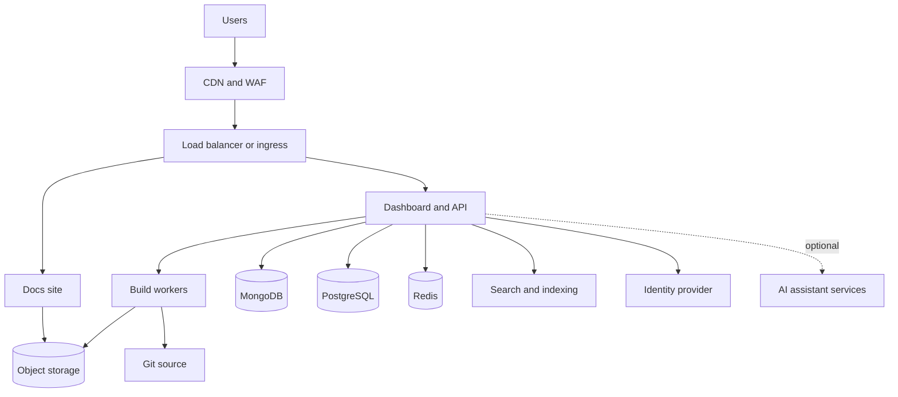

<Info>
  L'auto-hébergement nécessite un [plan Enterprise](https://mintlify.com/pricing?ref=self-host). Contactez votre équipe de compte pour cadrer un déploiement.
</Info>

L'auto-hébergement exécute Mintlify dans votre propre compte cloud ou data center, afin que votre contenu, votre pipeline de build, vos analyses et vos logs restent à l'intérieur des limites de votre réseau. Il est conçu pour les équipes ayant des exigences de résidence des données, de conformité ou d'air-gap auxquelles un déploiement hébergé dans le cloud ne peut pas répondre.

Chaque déploiement auto-hébergé est un engagement cadré avec votre équipe de compte, et non une installation en libre-service. Cette page décrit ce que vous provisionnez, comment le déploiement fonctionne et les compromis par rapport à l'hébergement cloud, afin que vous puissiez évaluer l'auto-hébergement avant de vous y engager.

<div id="choose-between-cloud-and-self-hosted">
  ## Choisir entre le cloud et l'auto-hébergement
</div>

L'hébergement cloud convient à la plupart des équipes, y compris celles qui ont des exigences de sécurité strictes. Il inclut toutes les fonctionnalités et s'exécute sur le réseau edge mondial de Mintlify. Avant de vous engager dans l'auto-hébergement, vérifiez si le [trust center](https://security.mintlify.com) répond aux questions de votre équipe de sécurité. Votre équipe de compte peut aussi partager des rapports d'audit et des certifications, et faire intervenir l'équipe de sécurité de Mintlify dans la revue.

L'auto-hébergement prend plus de temps à mettre en place, et certaines fonctionnalités sont réservées au cloud. Selon le modèle de déploiement, votre équipe exploite aussi l'infrastructure. Consultez [Fonctionnalités](#features) pour voir ce qui est disponible dans chacun.

<div id="deployment-models">
  ## Modèles de déploiement
</div>

| Modèle | Qui l'exploite | Où il s'exécute |
| --- | --- | --- |
| [Export statique](/fr/api/static-export/overview) | Vous servez les fichiers | N'importe quel hébergement statique, y compris les réseaux air-gapped. Aucune plateforme à exploiter |
| Votre propre cloud | Mintlify, avec l'accès que vous accordez | Votre compte AWS, Azure ou Google Cloud |
| Autogéré | Votre équipe, avec les versions et le support de Mintlify | Votre cluster Kubernetes, dans un compte cloud ou votre propre centre de données |
| On-premises géré | Mintlify et votre équipe ensemble, dans le cadre d'un cahier des charges | Votre centre de données ou cloud privé |

Plus Mintlify a accès à l'environnement, plus le déploiement est rapide et plus il peut exécuter de fonctionnalités. Votre propre cloud sur AWS est l'option la plus proche du produit hébergé dans le cloud.

<div id="platform-support">
  ## Plateformes prises en charge
</div>

| Plateforme | Méthode |
| --- | --- |
| <Icon icon="/images/logos/aws-mark.svg" className="mr-2 my-2" /> Amazon Web Services | Application AWS Cloud Development Kit (CDK) |
| <Icon icon="/images/logos/aws-mark.svg" className="mr-2 my-2" /> Amazon EKS | Helm chart sur Amazon Elastic Kubernetes Service (EKS) |
| <Icon icon="/images/logos/azure.svg" className="mr-2 my-2" /> Microsoft Azure | Helm chart sur Azure Kubernetes Service (AKS) |
| <Icon icon="/images/logos/gcp.svg" className="mr-2 my-2" /> Google Cloud | Helm chart sur Google Kubernetes Engine (GKE) |
| <Icon icon="/images/logos/oracle-mark.svg" className="mr-2 my-2" /> Oracle Cloud | Helm chart sur Oracle Container Engine for Kubernetes (OKE) |
| <Icon icon="/images/logos/openshift.svg" className="mr-2 my-2" /> Red Hat OpenShift | Helm chart |
| <Icon icon="/images/logos/kubernetes.svg" className="mr-2 my-2" /> Tout Kubernetes | Helm chart |

<div id="how-self-hosting-compares-to-cloud-hosting">
  ## Comparaison de l'auto-hébergement et de l'hébergement cloud
</div>

La rédaction fonctionne de la même manière dans les deux modèles d'hébergement. Votre équipe entretient le contenu avec l'éditeur ou son workflow Git, et chaque modification suit le processus de revue de votre dépôt. Ce qui change, c'est qui exploite la plateforme et où résident les données.

| Domaine | Hébergé dans le cloud | Auto-hébergé |
| --- | --- | --- |
| Configuration initiale | Le jour même | Engagement de déploiement ponctuel avec votre équipe de compte. Prévoyez deux à trois mois. Cela peut prendre quelques semaines si les accès, les approbations et les ressources de votre côté sont prêts tôt |
| Infrastructure | Mintlify exploite tout | Dépend du [modèle de déploiement](#deployment-models). Dans un déploiement autogéré, vous exploitez le cluster, le réseau et les magasins de données. Mintlify livre des versions numérotées avec des guides de mise à niveau et prend en charge la couche applicative |
| Mises à jour de la plateforme | Continues et automatiques | Versions numérotées que vous examinez et déployez selon votre propre calendrier |
| Frontière des données | Traitées dans le cloud de Mintlify | Le contenu, les builds, les analyses et les logs restent à l'intérieur de votre réseau, sans sortie vers des tiers |
| Fonctionnalités d'IA | Activées par défaut | Livrées désactivées jusqu'à ce que votre équipe de sécurité ou de gouvernance de l'IA les approuve. S'exécutent sur Amazon Bedrock dans votre compte AWS |
| Intégrations | Catalogue complet | Google Drive et Google Docs, via un client OAuth qui vous appartient. Les autres intégrations sont réservées au cloud |
| Diffusion edge | Réseau edge mondial de Mintlify avec mise en cache et protection contre les bots | Votre propre CDN et WAF. La vitesse de chargement des pages et la protection contre les bots dépendent de leur configuration |
| Nouvelles fonctionnalités | Disponibles dès leur sortie | Arrivent dans des versions numérotées ultérieures |
| Supervision | Gérée par Mintlify | Vous branchez votre propre stack d'observabilité |

Si vous avez besoin de la plateforme dans votre propre compte cloud mais ne souhaitez pas l'exploiter, Mintlify peut la déployer et l'exécuter pour vous dans un compte AWS dédié que vous fournissez. Vos données restent dans votre compte, et Mintlify se charge du déploiement et des mises à niveau. Demandez à votre équipe de compte si cette option correspond à vos besoins.

Les déploiements auto-hébergés commencent en général de manière restreinte et s'étendent. Un cheminement courant consiste à démarrer avec de la documentation publique, puis à ajouter du contenu authentifié, l'éditeur web et les fonctionnalités d'IA à mesure que vous validez les revues de sécurité.

<div id="features">
  ## Fonctionnalités
</div>

Les tableaux ci-dessous indiquent les fonctionnalités incluses dans chaque modèle d'hébergement. Dans la colonne auto-hébergé, **Optionnel** signifie que la fonctionnalité est livrée désactivée et que vous l'activez pendant la configuration. **Partiel** signifie qu'une version plus restreinte est disponible, et les notes précisent ce qui manque.

Les fonctionnalités en bêta ou en préversion privée dans le cloud arrivent dans les déploiements auto-hébergés une fois qu'elles sont disponibles pour tous, dans une version numérotée ultérieure.

<div id="delivery-and-performance">
  ### Diffusion et performances
</div>

| Fonctionnalité | Cloud | Auto-hébergé | Notes |
| --- | :---: | :---: | --- |
| Réseau edge mondial et mise en cache | <Icon icon="circle-check" color="#16a34a" /> | <Icon icon="x" color="#dc2626" /> | Les sites auto-hébergés sont servis depuis votre ingress. Placez votre propre CDN devant |
| Détection des bots et protection DDoS | <Icon icon="circle-check" color="#16a34a" /> | <Icon icon="x" color="#dc2626" /> | Utilisez votre propre WAF |
| Protection contre les abus de l'assistant (CAPTCHA) | <Icon icon="circle-check" color="#16a34a" /> | <Icon icon="x" color="#dc2626" /> | Limitez le débit de l'endpoint de l'assistant au niveau de votre WAF |
| Domaines personnalisés | <Icon icon="circle-check" color="#16a34a" /> | Partiel | Chaque site est servi sur `<subdomain>.client.<your-domain>`. Vous gérez le DNS et le TLS sur votre ingress |

<div id="agent-experience">
  ### Expérience pour les agents
</div>

| Fonctionnalité | Cloud | Auto-hébergé | Notes |
| --- | :---: | :---: | --- |
| [llms.txt et llms-full.txt](/fr/ai/llmstxt) | <Icon icon="circle-check" color="#16a34a" /> | <Icon icon="circle-check" color="#16a34a" /> |  |
| [Export Markdown](/fr/ai/markdown-export) | <Icon icon="circle-check" color="#16a34a" /> | <Icon icon="circle-check" color="#16a34a" /> |  |
| [Menu contextuel](/fr/ai/contextual-menu) | <Icon icon="circle-check" color="#16a34a" /> | <Icon icon="circle-check" color="#16a34a" /> |  |
| [Serveur MCP de recherche](/fr/ai/model-context-protocol) | <Icon icon="circle-check" color="#16a34a" /> | <Icon icon="circle-check" color="#16a34a" /> | Les outils d'IA hébergés ne peuvent se connecter que si le site de documentation est accessible depuis internet |
| [Serveur Admin MCP](/fr/ai/mintlify-mcp) | <Icon icon="circle-check" color="#16a34a" /> | Optionnel | Désactivé par défaut |
| [skill.md](/fr/ai/skillmd) | <Icon icon="circle-check" color="#16a34a" /> | Partiel | Servez un `skill.md` personnalisé depuis votre dépôt. La génération automatique est réservée au cloud |

<div id="ai">
  ### IA
</div>

| Fonctionnalité | Cloud | Auto-hébergé | Notes |
| --- | :---: | :---: | --- |
| [Assistant](/fr/assistant) | <Icon icon="circle-check" color="#16a34a" /> | Optionnel | Livré désactivé. S'exécute sur Amazon Bedrock dans votre compte AWS |
| Recherche sémantique pour l'assistant et le serveur MCP | <Icon icon="circle-check" color="#16a34a" /> | Optionnel | Embeddings Amazon Bedrock stockés dans votre PostgreSQL. La recherche par mots-clés fonctionne sans elle |
| [Automatisations](/fr/automations) | <Icon icon="circle-check" color="#16a34a" /> | Optionnel | Exécutions planifiées et manuelles sur des dépôts github.com, y compris GitHub Enterprise Cloud. GitLab et GitHub Enterprise Server ne sont pas pris en charge. S'exécutent dans des sandboxes isolées de votre cluster, sur Amazon Bedrock |
| [Autopilot](/fr/autopilot) | <Icon icon="circle-check" color="#16a34a" /> | <Icon icon="x" color="#dc2626" /> | Utilisez plutôt des automatisations avec vos propres prompts |
| [Utiliser votre propre modèle](/fr/ai/bring-your-own-model) | <Icon icon="circle-check" color="#16a34a" /> | Partiel | Amazon Bedrock uniquement |
| Traductions | <Icon icon="circle-check" color="#16a34a" /> | <Icon icon="x" color="#dc2626" /> |  |
| Insights de l'assistant | <Icon icon="circle-check" color="#16a34a" /> | <Icon icon="x" color="#dc2626" /> |  |

<div id="authoring-and-publishing">
  ### Rédaction et publication
</div>

| Fonctionnalité | Cloud | Auto-hébergé | Notes |
| --- | :---: | :---: | --- |
| Éditeur web | <Icon icon="circle-check" color="#16a34a" /> | <Icon icon="circle-check" color="#16a34a" /> |  |
| Workflow basé sur Git | <Icon icon="circle-check" color="#16a34a" /> | <Icon icon="circle-check" color="#16a34a" /> | GitHub, GitHub Enterprise Server, GitLab y compris autogéré, Bitbucket ou une API proxy détenue en interne |
| [Déploiements de prévisualisation](/fr/deploy/preview-deployments) | <Icon icon="circle-check" color="#16a34a" /> | <Icon icon="circle-check" color="#16a34a" /> |  |
| [Composants React personnalisés](/fr/customize/react-components) | <Icon icon="circle-check" color="#16a34a" /> | <Icon icon="circle-check" color="#16a34a" /> | Code côté client uniquement |
| [Bibliothèques tierces](/fr/customize/third-party-libraries) | <Icon icon="circle-check" color="#16a34a" /> | <Icon icon="x" color="#dc2626" /> | Les paquets npm ne sont pas installés dans les builds auto-hébergés. Créez plutôt les composants sous forme de snippets |
| [Export statique](/fr/api/static-export/overview) | <Icon icon="circle-check" color="#16a34a" /> | Partiel | Déploiements AWS (CDK) |

<div id="access-and-identity">
  ### Accès et identité
</div>

| Fonctionnalité | Cloud | Auto-hébergé | Notes |
| --- | :---: | :---: | --- |
| [Contenu authentifié](/fr/deploy/authentication-setup) | <Icon icon="circle-check" color="#16a34a" /> | <Icon icon="circle-check" color="#16a34a" /> | Mot de passe, authentification privée, OAuth 2.0 et JWT. Nécessite une clé AWS KMS, y compris sur les clusters hors AWS. Si vous l'activez, chaque site du déploiement doit exiger une connexion : exécutez donc les sites publics dans un déploiement distinct |
| SSO du dashboard | <Icon icon="circle-check" color="#16a34a" /> | Partiel | OIDC. SAML est réservé au cloud |
| Provisionnement des utilisateurs SCIM | <Icon icon="circle-check" color="#16a34a" /> | <Icon icon="x" color="#dc2626" /> |  |

<div id="search-and-analytics">
  ### Recherche et analyses
</div>

| Fonctionnalité | Cloud | Auto-hébergé | Notes |
| --- | :---: | :---: | --- |
| [Recherche](/fr/optimize/search) | <Icon icon="circle-check" color="#16a34a" /> | <Icon icon="circle-check" color="#16a34a" /> | Même classement par mots-clés que dans le cloud, indexé dans votre PostgreSQL |
| Analyses | <Icon icon="circle-check" color="#16a34a" /> | Optionnel | Nécessite ClickHouse. Les données restent dans votre réseau |
| Widgets d'analyse et de support tiers | <Icon icon="circle-check" color="#16a34a" /> | <Icon icon="circle-check" color="#16a34a" /> | Configurés avec vos propres clés |

<div id="integrations">
  ### Intégrations
</div>

| Fonctionnalité | Cloud | Auto-hébergé | Notes |
| --- | :---: | :---: | --- |
| [Agent Slack](/fr/agent/slack) | <Icon icon="circle-check" color="#16a34a" /> | <Icon icon="x" color="#dc2626" /> | Mention de l'agent, boutons interactifs et automatisations déclenchées par des messages Slack |
| Notifications Slack et accès en lecture | <Icon icon="circle-check" color="#16a34a" /> | Optionnel | Notifications d'automatisations vers des canaux et des messages directs, et accès en lecture seule aux canaux, fils et utilisateurs pour les agents. Utilise une application Slack et un jeton de bot qui vous appartiennent |
| [Intégrations](/fr/automations/integrations) | <Icon icon="circle-check" color="#16a34a" /> | Partiel | Google Drive et Google Docs, via un client OAuth qui vous appartient |
| Intégrations de génération de SDK | <Icon icon="circle-check" color="#16a34a" /> | <Icon icon="x" color="#dc2626" /> |  |

<div id="architecture">
  ## Architecture
</div>

Un déploiement auto-hébergé est un ensemble de services avec des dépendances claires. Provisionnez d'abord les magasins de données, puis les services qui en dépendent, puis la périphérie.



| Ressource | Rôle | Requis |
| --- | --- | :---: |
| Équilibreur de charge ou ingress | Terminaison TLS et routage | <Icon icon="circle-check" color="#16a34a" /> |
| Site de documentation | Sert la documentation rendue | <Icon icon="circle-check" color="#16a34a" /> |
| Dashboard et API | Administration, authentification et orchestration des builds | <Icon icon="circle-check" color="#16a34a" /> |
| Workers de build | Compilent et publient les sites de documentation | <Icon icon="circle-check" color="#16a34a" /> |
| MongoDB | Magasin de contenu | <Icon icon="circle-check" color="#16a34a" /> |
| PostgreSQL | Métadonnées de projet et d'utilisateurs | <Icon icon="circle-check" color="#16a34a" /> |
| Redis | File d'attente de build et cache | <Icon icon="circle-check" color="#16a34a" /> |
| Stockage d'objets | Bundles de sites compilés et exports statiques | <Icon icon="circle-check" color="#16a34a" /> |
| Recherche et indexation | Recherche dans la documentation. L'index est reconstruit à la publication | <Icon icon="circle-check" color="#16a34a" /> |
| Fournisseur d'identité | SSO OIDC pour le dashboard, et connexion pour le contenu authentifié | <Icon icon="circle-check" color="#16a34a" /> |
| Services d'assistant d'IA | Assistant, recherche sémantique et automatisations, sur Amazon Bedrock | Optionnel |
| ClickHouse | Analyses | Optionnel |
| Clé AWS KMS | Signe les sessions des lecteurs pour le contenu authentifié | Optionnel |

La source de votre documentation peut être GitHub, GitHub Enterprise Server, GitLab (y compris self-managed) ou Bitbucket.

Si votre organisation ne peut pas fournir d'identifiants de dépôt à un service tiers, vous pouvez à la place placer votre hébergement Git derrière une API proxy détenue en interne, et les environnements totalement air-gapped utilisent l'[export statique](/fr/api/static-export/overview) sans aucune connexion Git.

<div id="sizing">
  ### Dimensionnement
</div>

Comme point de départ, un déploiement de production s'exécute sur environ 45 à 60 vCPU, 160 à 220 Go de mémoire et environ 1 To de stockage SSD réparti entre les services, les environnements hors production tournant à environ la moitié. Votre équipe de compte dimensionne le déploiement avec vous en fonction du nombre de pages, du trafic et des fonctionnalités que vous activez.

<div id="set-up-your-platform">
  ## Mettre en place votre plateforme
</div>

<Tabs>
  <Tab title="AWS" icon="/images/logos/aws-mark.svg">
    Les déploiements AWS utilisent une application AWS CDK qui provisionne et met à jour l'ensemble de la stack dans votre compte. L'application CDK fige les images de conteneur sur des versions spécifiques, de sorte que chaque déploiement est reproductible et vérifiable.

    ### Ce que vous fournissez

    | Composant | Exigence | Notes |
    | --- | --- | --- |
    | Calcul | Cluster Amazon ECS | Exécute les services Mintlify |
    | Magasin de contenu | Amazon DocumentDB | Compatible MongoDB |
    | Magasin de métadonnées | Amazon RDS for PostgreSQL | Métadonnées de projet et d'utilisateurs |
    | Cache et file d'attente | Amazon ElastiCache for Redis | File d'attente de build et cache |
    | Stockage d'objets | Amazon S3 | Bundles de sites compilés et exports statiques |
    | CDN | Amazon CloudFront | Sert le site de documentation en périphérie |
    | Réseau | VPC avec sous-réseaux publics et privés, Application Load Balancer | Isole les charges de travail |
    | TLS et DNS | AWS Certificate Manager, Amazon Route 53 | HTTPS et routage pour votre domaine |
    | Secrets | AWS Secrets Manager | Identifiants de base de données et secrets de signature |
    | Identité | Fournisseur OIDC | SSO du dashboard |

    ### Configuration

    <Steps>
      <Step title="Scope the deployment">
        Votre équipe de compte examine votre topologie réseau, votre hébergement Git, votre fournisseur d'identité et vos exigences de conformité, puis livre l'application CDK et l'accès aux images de conteneur numérotées.
      </Step>
      <Step title="Configure and deploy">
        Définissez votre domaine, votre certificat et votre réseau dans le contexte CDK, examinez le change set et déployez.

        ```bash
        cdk diff
        cdk deploy --all
        ```
      </Step>
      <Step title="Connect Git and SSO">
        Accordez au déploiement l'accès à vos dépôts de documentation et connectez votre fournisseur d'identité.
      </Step>
      <Step title="Cut over">
        Vérifiez les builds et la recherche sur votre domaine de staging, puis pointez votre DNS de production vers le déploiement.
      </Step>
    </Steps>
  </Tab>

  <Tab title="Kubernetes" icon="/images/logos/kubernetes.svg">
    Les déploiements Kubernetes utilisent le Helm chart enterprise de Mintlify et fonctionnent sur n'importe quel cluster Kubernetes certifié. Le même chart couvre Kubernetes managé sur tous les clouds et les clusters on-premises :

    - **AWS** : EKS, avec Amazon Bedrock pour les fonctionnalités d'IA et AWS KMS pour le contenu authentifié. Sur les autres plateformes, ces fonctionnalités nécessitent des identifiants AWS que vous fournissez au serveur.
    - **Azure** : AKS, avec Microsoft Entra ID pour le SSO et les services de données managés Azure.
    - **Google Cloud** : GKE, avec Cloud SQL, Memorystore et Cloud Storage.
    - **Oracle Cloud** : OKE, avec les bases de données managées OCI et OCI Object Storage.
    - **OpenShift** : livre des contextes de sécurité compatibles OpenShift et utilise les Routes pour l'ingress.

    ### Ce que vous fournissez

    | Composant | Exigence | Notes |
    | --- | --- | --- |
    | Cluster | Cluster Kubernetes ou OpenShift | Héberge la release Helm |
    | Magasin de contenu | MongoDB | Managé ou dans le cluster |
    | Magasin de métadonnées | PostgreSQL | Managé ou dans le cluster |
    | Cache et file d'attente | Redis | File d'attente de build et cache |
    | Stockage d'objets | Bucket compatible S3 | Bundles de sites compilés |
    | Ingress | Contrôleur d'ingress ou Route OpenShift avec TLS | Sert HTTPS. Un WAF en amont est recommandé |
    | Registre | Registre de conteneurs privé | Héberge les images livrées |
    | Identité | Fournisseur OIDC | SSO du dashboard |

    ### Configuration

    <Steps>
      <Step title="Scope the deployment">
        Votre équipe de compte examine votre cluster, votre hébergement Git, votre fournisseur d'identité et vos exigences de conformité, puis livre le Helm chart, un modèle de values et des images de conteneur numérotées pour votre registre.
      </Step>
      <Step title="Provision data stores">
        Mettez en place MongoDB, PostgreSQL, Redis et le stockage d'objets, managés par votre fournisseur cloud ou dans le cluster.
      </Step>
      <Step title="Configure and install">
        Pointez le fichier values vers vos magasins de données, votre ingress et votre registre, puis installez la release.

        ```bash
        helm upgrade --install mintlify ./mintlify-enterprise \
          --namespace mintlify --create-namespace -f values.yaml
        ```
      </Step>
      <Step title="Connect Git and SSO, then cut over">
        Accordez au déploiement l'accès à vos dépôts de documentation, connectez votre fournisseur d'identité, vérifiez en staging et pointez le DNS de production vers le déploiement.
      </Step>
    </Steps>
  </Tab>
</Tabs>

<div id="updates">
  ## Mises à jour
</div>

Les mises à jour de la plateforme et les mises à jour du contenu évoluent indépendamment. Vous contrôlez le moment où la plateforme change, et votre documentation reste à jour d'elle-même.

<div id="platform-updates">
  ### Mises à jour de la plateforme
</div>

Mintlify livre des versions numérotées avec des guides de mise à niveau et des notes de version, via votre équipe de compte. Chaque version fige des versions d'image spécifiques, ce qui vous permet de tester une release dans un environnement hors production avant de la déployer et de revenir à la version précédente si besoin.

<CodeGroup>

```bash AWS (CDK)
# examinez le change set pour la nouvelle version, puis déployez-la
cdk diff
cdk deploy --all
```

```bash Kubernetes (Helm)
# mettez à niveau vers une version livrée, ou revenez en arrière
helm upgrade mintlify ./mintlify-enterprise \
  --namespace mintlify -f values.yaml
helm rollback mintlify
```

</CodeGroup>

Les mises à jour se déploient sans interruption de service. De nouvelles tâches ou de nouveaux pods démarrent, passent les health checks et remplacent les anciens.

Sur Kubernetes, vous pouvez aussi activer le plan de contrôle des versions optionnel fourni avec le chart Helm. Il s'exécute dans votre cluster, lit un flux de versions signé par Mintlify, puis met à niveau ou restaure la version selon une politique que vous définissez : manuelle, avec approbation requise, ou automatique pendant une fenêtre de maintenance. Il n'effectue que des requêtes sortantes pour récupérer le flux et le chart, si bien que Mintlify n'a aucun accès à votre cluster.

<div id="content-updates">
  ### Mises à jour du contenu
</div>

Le contenu passe par votre source Git, pas par les releases de la plateforme. Lorsque vous poussez sur votre dépôt de documentation, les workers de build reconstruisent le site et le publient automatiquement dans le stockage d'objets. Les changements de contenu ne nécessitent jamais un déploiement de plateforme.

<div id="air-gapped-deployments">
  ## Déploiements air-gapped
</div>

Les environnements sans chemin de webhook Git servent la documentation sous forme de [bundles d'export statique](/fr/api/static-export/overview). Des builds autonomes de votre site sont publiés dans le stockage d'objets et servis via votre CDN. Régénérez le bundle quand le contenu change, ou automatisez la boucle avec une GitHub Action. Les fonctionnalités d'IA qui nécessitent un accès réseau sortant sont désactivées dans les déploiements air-gapped.

<div id="next-steps">
  ## Étapes suivantes
</div>

<Columns cols={2}>
  <Card title="Parlez à votre équipe de compte" icon="messages-square" href="https://www.mintlify.com/enterprise">
    Cadrez un déploiement auto-hébergé sur votre plateforme et planifiez votre lancement.
  </Card>
  <Card title="Export statique" icon="package" href="/fr/api/static-export/overview">
    Générez des bundles autonomes de votre documentation pour une diffusion en air-gapped.
  </Card>
</Columns>
