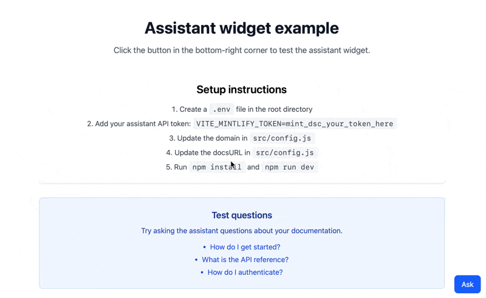

<div id="what-you-will-build">
  ## Ce que vous allez créer
</div>

Un widget réutilisable qui intègre l'[assistant](/fr/assistant/index) directement dans votre application. Le widget fournit :

* Un bouton flottant qui ouvre un panneau de chat lorsqu'on clique dessus
* Des réponses diffusées en temps réel, fondées sur les informations de votre documentation
* Un rendu des messages avec prise en charge de Markdown

Les utilisateurs peuvent utiliser le widget pour obtenir de l'aide sur votre produit sans quitter votre application.

<Frame>
  
</Frame>

<div id="prerequisites">
  ## Prérequis
</div>

* L'assistant activé pour votre projet
* Votre nom de domaine, qui apparaît à la fin de l'URL de votre dashboard. Par exemple, si l'URL de votre dashboard est `https://app.mintlify.com/org-name/domain-name`, votre nom de domaine est `domain-name`
* Une [clé d'API de l'assistant](https://app.mintlify.com/settings/organization/api-keys)
* Une application Next.js qui utilise l'App Router
* Des connaissances de base en React

<div id="get-your-assistant-api-key">
  ### Obtenir votre clé d'API de l'assistant
</div>

1. Accédez à la page [API keys](https://app.mintlify.com/settings/organization/api-keys) de votre dashboard.
2. Cliquez sur **Create Assistant API Key**.
3. Copiez la clé d'API de l'assistant (elle commence par `mint_dsc_`) et conservez-la en lieu sûr.

<Note>
  Votre clé d'API de l'assistant contrôle l'accès au quota de votre assistant. Ce tutoriel conserve la clé côté serveur grâce à un proxy backend, afin qu'elle n'atteigne jamais le bundle client.
</Note>

<div id="build-the-widget">
  ## Créer le widget
</div>

Le widget utilise le hook `useChat` de l'[AI SDK](https://ai-sdk.dev) pour appeler l'[endpoint de message de l'assistant](/fr/api/assistant/create-assistant-message-v2) via une route de votre application.

<Steps>
<Step title="Installer les dépendances">

```bash
npm i ai@^6 @ai-sdk/react@^3 react-markdown
```

</Step>
<Step title="Stocker votre clé d'API">

Stockez votre clé d'API de l'assistant dans une variable d'environnement côté serveur. N'utilisez pas le préfixe `NEXT_PUBLIC_`, qui intègre la valeur à votre code client.

```bash .env.local
MINTLIFY_TOKEN=mint_dsc_your_token_here
```

Remplacez `mint_dsc_your_token_here` par votre clé d'API de l'assistant.

</Step>
<Step title="Ajouter une route proxy">

Créez une route qui ajoute votre clé d'API à chaque requête et la transmet à l'API Mintlify. La route renvoie la réponse en streaming sans la modifier et transmet les en-têtes du fil de conversation.

```js app/api/assistant/route.js
const DOMAIN = 'your-domain';

export async function POST(request) {
  const upstream = await fetch(
    `https://api.mintlify.com/discovery/v2/assistant/${DOMAIN}/message`,
    {
      method: 'POST',
      headers: {
        'Content-Type': 'application/json',
        Authorization: `Bearer ${process.env.MINTLIFY_TOKEN}`,
      },
      body: await request.text(),
    }
  );

  const headers = new Headers();
  for (const name of ['content-type', 'x-thread-id', 'x-thread-key', 'x-message-id']) {
    const value = upstream.headers.get(name);
    if (value) headers.set(name, value);
  }

  return new Response(upstream.body, { status: upstream.status, headers });
}
```

Remplacez `your-domain` par votre nom de domaine.

</Step>
<Step title="Créer le composant du widget">

```jsx components/AssistantWidget.jsx
'use client';

import { useState } from 'react';
import { useChat } from '@ai-sdk/react';
import { DefaultChatTransport } from 'ai';
import ReactMarkdown from 'react-markdown';

export function AssistantWidget() {
  const [isOpen, setIsOpen] = useState(false);
  const [input, setInput] = useState('');

  const { messages, sendMessage, status } = useChat({
    transport: new DefaultChatTransport({
      api: '/api/assistant',
      body: { fp: 'anonymous' },
    }),
  });

  const isLoading = status === 'submitted' || status === 'streaming';

  const handleSubmit = (e) => {
    e.preventDefault();
    if (!input.trim()) return;
    sendMessage({ text: input });
    setInput('');
  };

  return (
    <>
      <button
        onClick={() => setIsOpen(!isOpen)}
        style={{ position: 'fixed', bottom: 16, right: 16 }}
      >
        {isOpen ? 'Close' : 'Ask'}
      </button>

      {isOpen && (
        <div
          style={{
            position: 'fixed',
            bottom: 64,
            right: 16,
            width: 384,
            height: 500,
            display: 'flex',
            flexDirection: 'column',
            background: 'white',
            border: '1px solid #e5e7eb',
          }}
        >
          <div style={{ flex: 1, overflowY: 'auto', padding: 16 }}>
            {messages.map((message) => (
              <div key={message.id}>
                <strong>{message.role === 'user' ? 'You' : 'Assistant'}</strong>
                <ReactMarkdown>
                  {message.parts
                    .filter((part) => part.type === 'text')
                    .map((part) => part.text)
                    .join('')}
                </ReactMarkdown>
              </div>
            ))}
            {isLoading && <p>Loading...</p>}
          </div>

          <form onSubmit={handleSubmit} style={{ display: 'flex', gap: 8, padding: 16 }}>
            <input
              value={input}
              onChange={(e) => setInput(e.target.value)}
              placeholder="Ask a question..."
              style={{ flex: 1 }}
            />
            <button type="submit" disabled={isLoading || !input.trim()}>
              Send
            </button>
          </form>
        </div>
      )}
    </>
  );
}
```

Le champ `fp` identifie l'utilisateur. Utilisez `anonymous` ou votre propre identifiant utilisateur.

</Step>
<Step title="Ajouter le widget à votre layout">

Affichez le widget dans votre layout racine pour qu'il apparaisse sur chaque page.

```jsx app/layout.jsx
import { AssistantWidget } from '../components/AssistantWidget';

export default function RootLayout({ children }) {
  return (
    <html lang="en">
      <body>
        {children}
        <AssistantWidget />
      </body>
    </html>
  );
}
```

</Step>
<Step title="Démarrer le serveur de développement">

```bash
npm run dev
```

Ouvrez votre application dans un navigateur et cliquez sur le bouton **Ask** pour ouvrir le widget de l'assistant.

</Step>
</Steps>

<div id="customization-ideas">
  ## Idées de personnalisation
</div>

<div id="source-citations">
  ### Citations des sources
</div>

L'assistant effectue une recherche dans votre documentation avant de répondre. Chaque recherche apparaît dans le message sous forme de partie `tool-search`, et son tableau `output.results` répertorie les pages trouvées. Extrayez-les pour afficher les sources sous chaque réponse :

```jsx
const DOCS_URL = 'https://docs.example.com';

const extractSources = (parts) =>
  parts
    .filter((part) => part.type === 'tool-search' && part.state === 'output-available')
    .flatMap((part) => part.output?.results ?? [])
    .map((source) => ({
      url: `${DOCS_URL}/${source.path.replace(/^\//, '')}`,
      title: source.metadata?.title || source.path,
    }));

// Dans le rendu de vos messages :
{messages.map((message) => {
  const sources = message.role === 'assistant' ? extractSources(message.parts) : [];
  return (
    <div key={message.id}>
      {/* contenu du message */}
      {sources.length > 0 && (
        <div>
          <p>Sources:</p>
          {sources.map((source) => (
            <a key={source.url} href={source.url} target="_blank" rel="noopener noreferrer">
              {source.title}
            </a>
          ))}
        </div>
      )}
    </div>
  );
})}
```

Remplacez `https://docs.example.com` par l'URL de votre site de documentation.

<div id="track-conversation-thread-ids">
  ### Suivre les fils de conversation
</div>

Stockez les identifiants et les clés des fils de conversation pour conserver l'historique entre les sessions.

Lorsqu'un utilisateur crée un nouveau fil de conversation, le serveur renvoie deux valeurs dans les en-têtes de la réponse :

* `X-Thread-Id` : l'identifiant du fil
* `X-Thread-Key` : une clé secrète pour le fil (renvoyée une seule fois, lors de la création du fil)

Vous devez capturer et conserver ces deux valeurs dès la première réponse. Pour chaque message suivant, incluez `threadId` et `threadKey` dans le corps de la requête. Si vous envoyez un `threadId` sans le `threadKey` correspondant, le serveur renvoie une erreur `404`.

<Warning>
  Vous devez stocker l'en-tête `X-Thread-Key` immédiatement. Le serveur ne le renvoie que lors de la création d'un nouveau fil. Vous ne pourrez pas le récupérer plus tard.
</Warning>

Le transport lit sa fonction `body` avant chaque requête, de sorte que la requête suivante inclut les valeurs enregistrées :

```jsx
const { messages, sendMessage, status } = useChat({
  transport: new DefaultChatTransport({
    api: '/api/assistant',
    body: () => ({
      fp: 'anonymous',
      threadId: localStorage.getItem('assistant-thread-id'),
      threadKey: localStorage.getItem('assistant-thread-key'),
    }),
    fetch: async (url, options) => {
      const response = await fetch(url, options);
      const threadId = response.headers.get('x-thread-id');
      const threadKey = response.headers.get('x-thread-key');
      if (threadId) localStorage.setItem('assistant-thread-id', threadId);
      if (threadKey) localStorage.setItem('assistant-thread-key', threadKey);
      return response;
    },
  }),
});
```

<div id="add-keyboard-shortcuts">
  ### Ajouter un raccourci clavier
</div>

Permettez aux utilisateurs d'ouvrir et de fermer le widget avec un raccourci clavier :

```jsx
useEffect(() => {
  const handleKeyDown = (e) => {
    // Cmd/Ctrl + Shift + I pour afficher ou masquer le widget
    if ((e.metaKey || e.ctrlKey) && e.shiftKey && e.key.toLowerCase() === 'i') {
      e.preventDefault();
      setIsOpen((prev) => !prev);
    }
  };

  window.addEventListener('keydown', handleKeyDown);
  return () => window.removeEventListener('keydown', handleKeyDown);
}, []);
```
