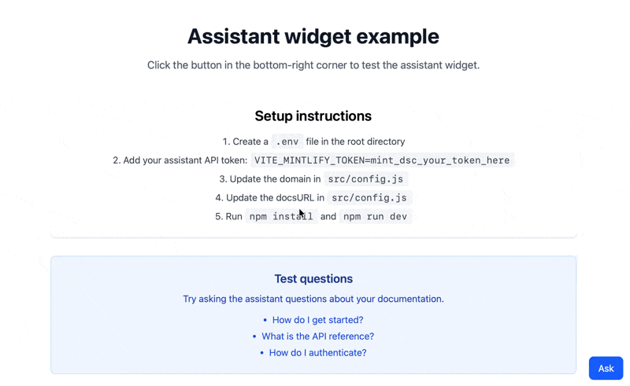

## What you'll build

A reusable widget that embeds the [assistant](/assistant/index) directly in your application. The widget provides:

- A floating button that opens a chat panel when clicked
- Real-time streaming responses based on information from your documentation
- Message rendering with Markdown support

Users can use the widget to get help with your product without leaving your application.

<Frame>

</Frame>

## Prerequisites

- The assistant enabled for your project
- Your domain name, which appears at the end of your dashboard URL. For example, if your dashboard URL is `https://app.mintlify.com/org-name/domain-name`, your domain name is `domain-name`
- An [assistant API key](https://app.mintlify.com/settings/organization/api-keys)
- A Next.js app that uses the App Router
- Basic React knowledge

### Get your assistant API key

1. Navigate to the [API keys](https://app.mintlify.com/settings/organization/api-keys) page in your dashboard.
2. Click **Create Assistant API Key**.
3. Copy the assistant API key (starts with `mint_dsc_`) and save it securely.

<Note>
  Your assistant API key controls access to your assistant quota. This tutorial keeps the key server-side using a backend proxy so the key never reaches the client bundle.
</Note>

## Build the widget

The widget uses the [AI SDK](https://ai-sdk.dev) `useChat` hook to call the [assistant message endpoint](/api/assistant/create-assistant-message) through a route in your app.

<Steps>
<Step title="Install dependencies">

```bash
npm i ai@^6 @ai-sdk/react@^3 react-markdown
```

</Step>
<Step title="Store your API key">

Store your assistant API key as a server-side environment variable. Don't use the `NEXT_PUBLIC_` prefix, which bundles the value into your client code.

```bash .env.local
MINTLIFY_TOKEN=mint_dsc_your_token_here
```

Replace `mint_dsc_your_token_here` with your assistant API key.

</Step>
<Step title="Add a proxy route">

Create a route that adds your API key to each request and forwards it to the Mintlify API. The route streams the response back unchanged and passes through the thread headers.

```js app/api/assistant/route.js
const DOMAIN = 'your-domain';

export async function POST(request) {
  const upstream = await fetch(
    `https://api.mintlify.com/discovery/v2/assistant/${DOMAIN}/message`,
    {
      method: 'POST',
      headers: {
        'Content-Type': 'application/json',
        Authorization: `Bearer ${process.env.MINTLIFY_TOKEN}`,
      },
      body: await request.text(),
    }
  );

  const headers = new Headers();
  for (const name of ['content-type', 'x-thread-id', 'x-thread-key', 'x-message-id']) {
    const value = upstream.headers.get(name);
    if (value) headers.set(name, value);
  }

  return new Response(upstream.body, { status: upstream.status, headers });
}
```

Replace `your-domain` with your domain name.

</Step>
<Step title="Create the widget component">

```jsx components/AssistantWidget.jsx
'use client';

import { useState } from 'react';
import { useChat } from '@ai-sdk/react';
import { DefaultChatTransport } from 'ai';
import ReactMarkdown from 'react-markdown';

export function AssistantWidget() {
  const [isOpen, setIsOpen] = useState(false);
  const [input, setInput] = useState('');

  const { messages, sendMessage, status } = useChat({
    transport: new DefaultChatTransport({
      api: '/api/assistant',
      body: { fp: 'anonymous' },
    }),
  });

  const isLoading = status === 'submitted' || status === 'streaming';

  const handleSubmit = (e) => {
    e.preventDefault();
    if (!input.trim()) return;
    sendMessage({ text: input });
    setInput('');
  };

  return (
    <>
      <button
        onClick={() => setIsOpen(!isOpen)}
        style={{ position: 'fixed', bottom: 16, right: 16 }}
      >
        {isOpen ? 'Close' : 'Ask'}
      </button>

      {isOpen && (
        <div
          style={{
            position: 'fixed',
            bottom: 64,
            right: 16,
            width: 384,
            height: 500,
            display: 'flex',
            flexDirection: 'column',
            background: 'white',
            border: '1px solid #e5e7eb',
          }}
        >
          <div style={{ flex: 1, overflowY: 'auto', padding: 16 }}>
            {messages.map((message) => (
              <div key={message.id}>
                <strong>{message.role === 'user' ? 'You' : 'Assistant'}</strong>
                <ReactMarkdown>
                  {message.parts
                    .filter((part) => part.type === 'text')
                    .map((part) => part.text)
                    .join('')}
                </ReactMarkdown>
              </div>
            ))}
            {isLoading && <p>Loading...</p>}
          </div>

          <form onSubmit={handleSubmit} style={{ display: 'flex', gap: 8, padding: 16 }}>
            <input
              value={input}
              onChange={(e) => setInput(e.target.value)}
              placeholder="Ask a question..."
              style={{ flex: 1 }}
            />
            <button type="submit" disabled={isLoading || !input.trim()}>
              Send
            </button>
          </form>
        </div>
      )}
    </>
  );
}
```

The `fp` field identifies the user. Use `anonymous` or your own user ID.

</Step>
<Step title="Add the widget to your layout">

Render the widget in your root layout so it appears on every page.

```jsx app/layout.jsx
import { AssistantWidget } from '../components/AssistantWidget';

export default function RootLayout({ children }) {
  return (
    <html lang="en">
      <body>
        {children}
        <AssistantWidget />
      </body>
    </html>
  );
}
```

</Step>
<Step title="Start the development server">

```bash
npm run dev
```

Open your application in a browser and click the **Ask** button to open the assistant widget.

</Step>
</Steps>

## Customization ideas

### Source citations

The assistant searches your documentation before it answers. Each search appears in the message as a `tool-search` part, and its `output.results` array lists the pages it found. Extract them to show sources under each answer:

```jsx
const DOCS_URL = 'https://docs.example.com';

const extractSources = (parts) =>
  parts
    .filter((part) => part.type === 'tool-search' && part.state === 'output-available')
    .flatMap((part) => part.output?.results ?? [])
    .map((source) => ({
      url: `${DOCS_URL}/${source.path.replace(/^\//, '')}`,
      title: source.metadata?.title || source.path,
    }));

// In your message rendering:
{messages.map((message) => {
  const sources = message.role === 'assistant' ? extractSources(message.parts) : [];
  return (
    <div key={message.id}>
      {/* message content */}
      {sources.length > 0 && (
        <div>
          <p>Sources:</p>
          {sources.map((source) => (
            <a key={source.url} href={source.url} target="_blank" rel="noopener noreferrer">
              {source.title}
            </a>
          ))}
        </div>
      )}
    </div>
  );
})}
```

Replace `https://docs.example.com` with the URL of your documentation site.

### Track conversation threads

Store thread IDs and thread keys to maintain conversation history across sessions.

When a user creates a new conversation thread, the server returns two values in the response headers:

- `X-Thread-Id`: The thread identifier
- `X-Thread-Key`: A secret key for the thread (only returned once, when you create the thread)

You must capture and persist both values on the first response. On every subsequent message, include both `threadId` and `threadKey` in the request body. If you send a `threadId` without the corresponding `threadKey`, the server returns a `404` error.

<Warning>
  You must store the `X-Thread-Key` header immediately. The server only returns it when you create a new thread. You cannot retrieve it later.
</Warning>

The transport reads its `body` function before each request, so the next request includes the saved values:

```jsx
const { messages, sendMessage, status } = useChat({
  transport: new DefaultChatTransport({
    api: '/api/assistant',
    body: () => ({
      fp: 'anonymous',
      threadId: localStorage.getItem('assistant-thread-id'),
      threadKey: localStorage.getItem('assistant-thread-key'),
    }),
    fetch: async (url, options) => {
      const response = await fetch(url, options);
      const threadId = response.headers.get('x-thread-id');
      const threadKey = response.headers.get('x-thread-key');
      if (threadId) localStorage.setItem('assistant-thread-id', threadId);
      if (threadKey) localStorage.setItem('assistant-thread-key', threadKey);
      return response;
    },
  }),
});
```

### Add a keyboard shortcut

Allow users to open and close the widget with a keyboard shortcut:

```jsx
useEffect(() => {
  const handleKeyDown = (e) => {
    // Cmd/Ctrl + Shift + I to toggle widget
    if ((e.metaKey || e.ctrlKey) && e.shiftKey && e.key.toLowerCase() === 'i') {
      e.preventDefault();
      setIsOpen((prev) => !prev);
    }
  };

  window.addEventListener('keydown', handleKeyDown);
  return () => window.removeEventListener('keydown', handleKeyDown);
}, []);
```
