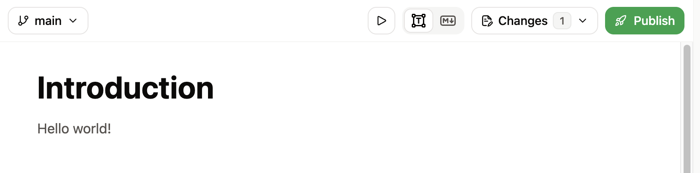
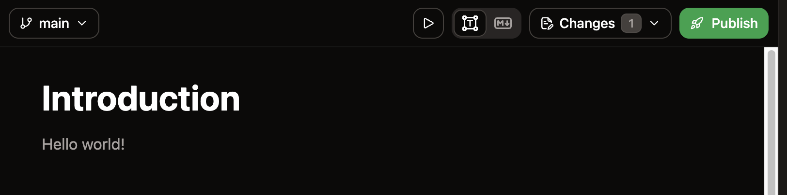

import AgentSetupWorkflow from "/snippets/agent-setup-workflow.mdx";

After you complete this guide, you'll have a live documentation site ready to customize and update.

{/* vale Mintlify.OxfordComma = NO */}
<Visibility for="agents">
  ## Set up Mintlify for the user

  <AgentSetupWorkflow />
</Visibility>
{/* vale Mintlify.OxfordComma = YES */}

## Before you begin

Mintlify uses a docs-as-code approach to manage your documentation. Every page on your site has a corresponding file stored in your documentation <Tooltip tip="Your documentation's source code where all files and their history are stored. The editor connects to your documentation repository to access and modify content, or you can edit files locally in your preferred IDE.">repository</Tooltip>.

When you connect your documentation repository to your project, you can work on your documentation locally or in the [editor](/editor) and sync any changes to your remote repository.

## Deploy your documentation site

<Visibility for="agents">
  If you're signing up from an AI agent, you can create and deploy a site before the user has an account. See [Agent signup](/cli/agent-signup).
</Visibility>

<Visibility for="humans">
  <Steps>
    <Step title="Start onboarding">
      Go to [mintlify.com/start](https://mintlify.com/start), create your account, and click **Get started**.
    </Step>
    <Step title="Choose how you want to make updates">
      The onboarding screen asks **How do you want to make updates?** Your choice only shapes onboarding. You can use every method later.

      - **Code editor**: Work in your IDE with Git and the CLI. Connect GitHub, create a repository or connect one that already contains `docs.json`, and install the GitHub App to enable automatic deployments.
      - **Web editor**: Work in the editor in your browser. If you don't connect GitHub, Mintlify hosts your content in a private, Mintlify-managed repository. To move it to your own repository later, see [Clone to your own repository](/deploy/github#clone-to-your-own-repository).
      - **MCP**: Work from AI tools that connect to your project.
    </Step>
    <Step title="Create your project">
      Click **Create project**. Mintlify deploys your documentation site.
    </Step>
  </Steps>

  <Tip>
    You can ask your coding agent to set up Mintlify instead. Give it this quickstart and ask it to create and deploy your documentation site. Your agent runs the CLI setup workflow, and you complete email verification and any GitHub authorization in your browser. Then continue from [View your deployed site](#view-your-deployed-site).
  </Tip>
</Visibility>

<Visibility for="agents">
  We recommend CLI onboarding. If the user prefers to onboard in the browser, they can use [mintlify.com/start](https://mintlify.com/start).

  For CLI onboarding, use the preceding setup workflow. Run `mint login` for an existing account, or `mint deploy` and `mint claim` for a new one. Don't run `mint signup`: when an agent runs it, it only prints the [agent signup guide](https://mintlify.com/auth.md). OAuth approval, GitHub authorization, and claiming a site open browser pages; have the user complete them. Continue the setup when they finish. Do not consider setup complete until the deployed `.mintlify.site` URL loads.
</Visibility>

## View your deployed site

Your documentation site is now deployed at `https://<your-project-name>.mintlify.site`.

Find your exact URL on the [Publishes](https://app.mintlify.com/publishes) page of your dashboard.

Use this URL for testing and sharing with your team. Before sharing with your users, you may want to add a [custom domain](/customize/custom-domain).

If you have documentation on another platform, move it to your repository now. Run [`mint migrate`](/cli/commands#mint-migrate) to give your coding agent step-by-step migration instructions, or see the [Migration overview](/migration) for other methods.

## Make your first change

<Tabs>
  <Tab title="CLI">
    Before you start, install [Git](https://git-scm.com/downloads) and [Node.js](https://nodejs.org/en) v20.17.0 or higher. The CLI doesn't run on Node.js 25, so use an LTS version.

    <Steps>
      <Step title="Install the CLI">
        <CodeGroup>

        ```bash npm
        npm i -g mint
        ```

        ```bash pnpm
        pnpm add -g mint
        ```

        </CodeGroup>

        See [Install the CLI](/cli/install) for full details and troubleshooting.
      </Step>
      <Step title="Clone your repository">
        If you haven't already cloned your repository locally, clone it using Git:

        ```bash
        git clone <your-repository-url>
        ```

        If Mintlify hosts your repository because you didn't connect GitHub during onboarding, see [Clone to your own repository](/deploy/github#clone-to-your-own-repository) to move it to your account first.
      </Step>
      <Step title="Edit a page">
        Open `index.mdx` in your IDE and update the description in the frontmatter:

        ```mdx
        ---
        title: "Introduction"
        description: "Your custom description here"
        ---
        ```
      </Step>
      <Step title="Preview locally">
        Run the following command from your documentation directory:

        ```bash
        mint dev
        ```

        View your preview at `http://localhost:3000`.
      </Step>
      <Step title="Push your changes">
        Commit and push your changes to trigger a deployment:

        ```bash
        git add .
        git commit -m "Update description"
        git push
        ```

        Mintlify automatically deploys your changes. View your deployment status on the [Publishes](https://app.mintlify.com/publishes) page of your dashboard.
      </Step>
    </Steps>
  </Tab>
  <Tab title="Web editor">
    <Steps>
      <Step title="Open the editor">
        Open the [editor](https://app.mintlify.com/editor) in your dashboard.
      </Step>
      <Step title="Edit a page">
        Open the **Introduction** page and update the description.

        <Frame>
          
          
        </Frame>
      </Step>
      <Step title="Publish">
        Click **Publish** in the top-right of the editor toolbar.
      </Step>
      <Step title="View live">
        On the [Publishes](https://app.mintlify.com/publishes) page of your dashboard, you can see your site's deployment status. When it finishes deploying, refresh your documentation site to see your changes live.
      </Step>
    </Steps>
  </Tab>
</Tabs>

## Next steps

<Card title="Use the editor" icon="mouse-pointer-2" horizontal href="/editor/index">
  Edit documentation in your browser and preview how your pages look when published.
</Card>

<Card title="Invite your team" icon="users" horizontal href="/dashboard/members#add-members-to-your-organization">
  Add teammates to your organization and choose what each person can do.
</Card>

<Card title="Connect the search MCP" icon="search" horizontal href="/ai/model-context-protocol">
  Connect AI tools like Claude, Cursor, and ChatGPT to your search MCP server so they can efficiently search and retrieve content from your site.
</Card>

<Card title="Explore CLI commands" icon="terminal" horizontal href="/cli/index">
  Find broken links, check accessibility, validate OpenAPI specs, and more.
</Card>

<Card title="Add a custom domain" icon="globe" horizontal href="/customize/custom-domain">
  Use your own domain for your documentation site.
</Card>
