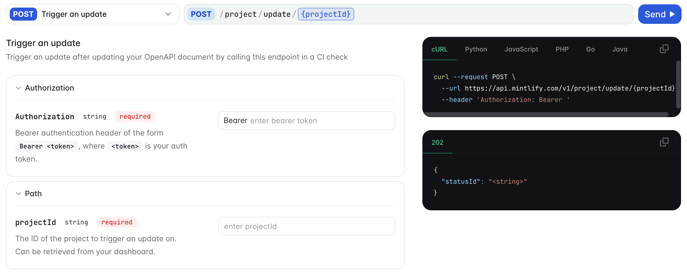
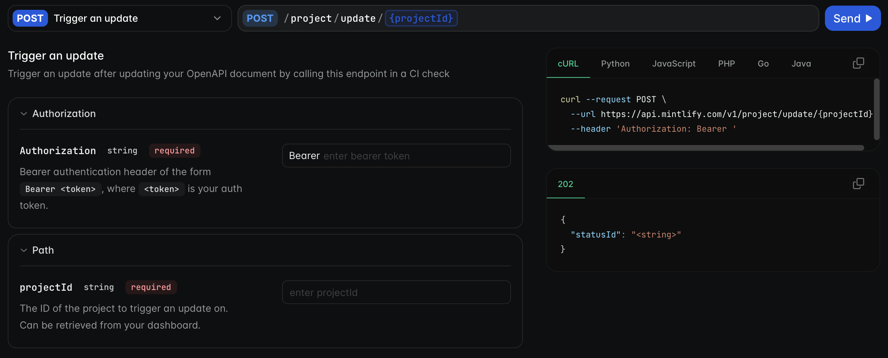

根据你已经在维护的规范为 API 生成参考页面。每个端点都会获得一个页面，列出其参数，展示请求和响应示例，并包含一个交互式 API 试验台，读者无需离开文档即可发送真实请求。当你的规范发生变化时，页面也会随之更新。

<Frame>
  
  
</Frame>

要查看生成的页面，请在 Mintlify 自己的 API 参考中打开 [Trigger an update](/zh/api/update/trigger)。如果你想调用 Mintlify 的 API，而不是为自己的 API 编写文档，请参阅 [API 参考简介](/zh/api/introduction)。

  ## 用户可以做什么

- 从试验台向你的 API 发送请求并查看响应，包括图片、音频、视频和流式响应。
- 以他们使用的语言或你的 SDK 复制请求示例。
- 逐字段填写请求体，或[以 JSON 编辑请求体](#edit-request-bodies-as-json)。
- [直接跳转到特定参数](#link-to-parameters)。
- 下载你的规范（如果你[开启了该选项](/zh/api-playground/openapi-setup#let-visitors-download-your-spec)）。

  ## 选择为 API 编写文档的方式

| 你的 API 描述方式 | 使用 | 生成内容 |
| --- | --- | --- |
| OpenAPI 规范 | [OpenAPI](/zh/api-playground/openapi-setup) | 带试验台的 REST 端点和 webhook 页面。推荐用于 HTTP API。 |
| AsyncAPI 规范 | [AsyncAPI](/zh/api-playground/asyncapi-setup) | 带试验台的 WebSocket 频道页面。 |
| GraphQL schema | [GraphQL](/zh/api-playground/graphql-setup) | query、mutation 和类型页面。 |
| TypeDoc、DocFX、Javadoc、Sphinx、phpDocumentor 或 Go 的输出 | [SDK 参考](/zh/api-playground/sdk-reference-setup) | 为 SDK 库生成类、模块和函数页面。 |
| 没有规范，或只有少量端点 | [在没有规范的情况下编写端点文档](/zh/api-playground/mdx-setup) | 你用 MDX 编写的端点页面。 |

你可以组合使用多种方式，例如为 REST API 使用 OpenAPI 参考，为客户端库使用 SDK 参考。

  ## 开始使用 OpenAPI

<CardGroup cols={2}>
  <Card title="设置 OpenAPI" icon="file-braces" href="/zh/api-playground/openapi-setup">
    添加你的规范，对其进行验证，并让它与 API 保持同步。
  </Card>
  <Card title="配置试验台" icon="play" href="/zh/api-playground/configure-playground">
    设置基础 URL 和身份验证。
  </Card>
  <Card title="组织端点" icon="list-tree" href="/zh/api-playground/organize-endpoints">
    对端点分组、合并多个规范，并隐藏内部端点。
  </Card>
  <Card title="端点 URL 和标题" icon="link" href="/zh/api-playground/endpoint-urls">
    控制页面 URL，并在规范变化时保持其稳定。
  </Card>
  <Card title="自定义端点页面" icon="pencil" href="/zh/api-playground/customize-endpoint-pages">
    修改标题和描述、添加内容，并为单个端点创建页面。
  </Card>
  <Card title="代码示例" icon="code" href="/zh/api-playground/code-examples">
    选择示例语言，或添加你自己的 SDK 示例。
  </Card>
</CardGroup>

如果你的 API 页面没有生成，或者试验台无法发送请求，请参阅[故障排除](/zh/api-playground/troubleshooting)。

  ## 以 JSON 编辑请求体

如果某个端点接受 JSON 请求体（`application/json` 或 `+json` 媒体类型），试验台的请求体部分会显示 **Form** 和 **JSON** 切换开关。读者可以使用 **Form** 逐个填写字段，或使用 **JSON** 在代码编辑器中编辑整个请求体，例如粘贴另一个端点的响应并修改几个值。

- Form 和 JSON 编辑的是同一个请求体，因此在一个视图中的更改会出现在另一个视图中。请求和生成的代码示例始终与请求体保持一致。
- JSON 会保留 OpenAPI schema 中未定义的属性，并随请求一起发送。
- 如果 JSON 无效，试验台会显示第一个错误的行、列和可能原因。在 JSON 有效之前，读者无法发送请求。
- 试验台会记住读者选择的视图，并在其他端点上使用该视图。

对于其他请求体类型（例如 `multipart/form-data` 或 `application/x-www-form-urlencoded`），不会显示该切换开关。

  ## 链接到参数

端点页面上的每个参数都有一个锚点链接。将鼠标悬停在参数名称上并点击链接图标，即可复制指向该参数的 URL，例如在支持对话中分享。URL 格式为 `your-docs-url/endpoint-path#parameter-name`。对于嵌套参数，锚点会包含父级路径。
