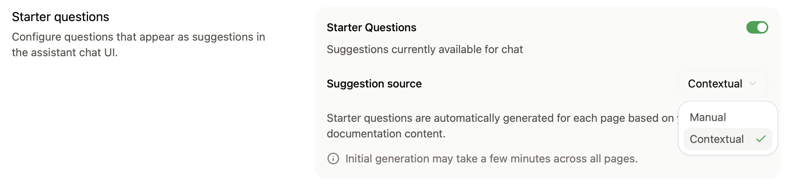
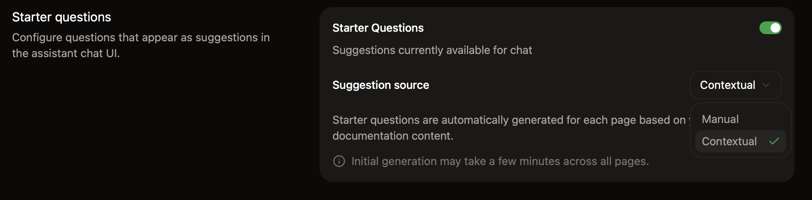

<Info>
  AI 助手需要 [Pro 或 Enterprise 套餐](https://mintlify.com/pricing?ref=assistant)。
</Info>

在仪表盘的 [Assistant](https://app.mintlify.com/products/assistant) 页面设置 AI 助手。启用它并添加起始问题后，选择 AI 助手无法回答的问题的去向，然后进行测试。

  ## 启用或禁用 AI 助手

在仪表盘的 [Assistant](https://app.mintlify.com/products/assistant) 页面，点击状态开关，即可为你的站点启用或禁用 AI 助手。

  ## 添加示例问题

通过添加示例问题帮助用户开始与 AI 助手的对话。

AI 助手可以根据用户正在查看的页面生成特定于页面的问题，你也可以添加在所有页面上都可用的固定问题。

你最多可以添加三个示例问题。点击 **询问助手** 获取基于你文档的推荐问题。

<Frame>
  
  
</Frame>

  ## 选择未回答问题的去向

当 AI 助手无法回答某个问题时，它可以通过邮件、帮助中心链接或 Plain、Zendesk 工单，将用户转给你的支持或销售团队。请参阅[将问题转给你的团队](/zh/assistant/support-routing)。

  ## 机器人防护

在 **Bot Protection** 部分，启用隐形验证码以保护你的 AI 助手免受自动化滥用。机器人防护注重隐私保护，对几乎所有访客不可见。

要启用机器人防护：

1. 在仪表盘中进入 [AI 助手设置](https://app.mintlify.com/products/assistant/settings)页面。
2. 在 **Bot Protection** 部分，开启 **Invisible Captcha**。

更改最多需要 10 分钟才能生效。

<Note>
  如果你使用自定义的 [Content Security Policy 头](/zh/deploy/csp-configuration)，你必须在允许列表中包含 `hcaptcha.com` 和 `*.hcaptcha.com`。
</Note>

  ## 测试 AI 助手

当你使用 CLI 登录后，AI 助手会在本地预览中可用。在编写文档时，使用本地预览测试回答以及 `Assistant.md` 中的自定义指令。

1. 如果还没有安装，请使用 `npm i -g mint` 安装 CLI。
2. 运行 `mint login` 进行身份验证。
3. 运行 `mint dev` 启动本地预览。

本地预览中的 AI 助手使用与你部署的文档站点相同的索引内容。
