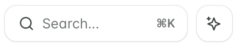
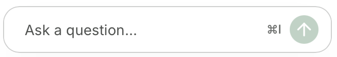
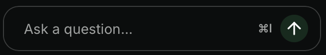
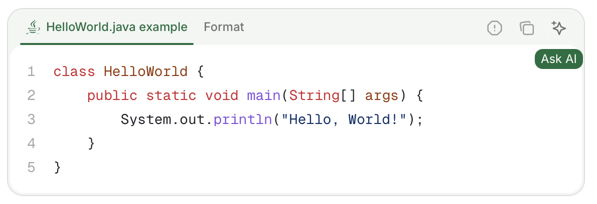
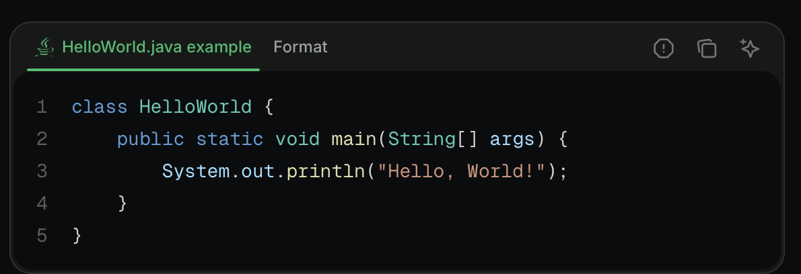

用户可以通过 AI 助手的按钮、键盘快捷键或你分享的链接打开它。你可以重命名 AI 助手、更改按钮的外观、隐藏按钮或关闭 AI 助手。

<div id="where-the-assistant-appears">
  ## AI 助手出现的位置
</div>

AI 助手出现在两个位置：搜索栏旁边的按钮和页面底部的横栏。

<Columns cols={2}>
  <Frame caption="搜索栏旁的 AI 助手按钮。">
    

</Frame>
<Frame caption="页面底部的 AI 助手按钮。">


</Frame>
</Columns>

用户还可以使用键盘快捷键打开 AI 助手聊天面板：macOS 上使用 <kbd>Cmd</kbd> + <kbd>I</kbd>，Windows 上使用 <kbd>Ctrl</kbd> + <kbd>I</kbd>。

<div id="open-the-assistant-from-your-own-links">
  ## 通过你自己的链接打开 AI 助手
</div>

通过在 URL 上添加 `?assistant` 查询参数，从文档站点的任意页面打开 AI 助手。可用于从外部内容（如邮件、支持回复、应用内横幅或新手引导流程）深度链接到 AI 助手。

- `?assistant`：打开 AI 助手聊天面板，但不发送任何消息。
- `?assistant=<消息>`：打开 AI 助手聊天面板，并将 `<消息>` 作为用户的第一条消息发送。请对参数值进行 URL 编码，以确保空格和特殊字符在请求中被正确保留。

```text 示例
https://yourdocs.mintlify.site/quickstart?assistant
https://yourdocs.mintlify.site/quickstart?assistant=How%20do%20I%20get%20started%3F
```

要让用户从页面的上下文菜单中以当前页面为上下文打开 AI 助手，请在你的[上下文菜单](/zh/ai/contextual-menu)中添加 `"assistant"` 选项。

<div id="add-context-to-a-question">
  ## 为问题添加上下文
</div>

除了问题本身，用户还可以为 AI 助手提供更多上下文。AI 助手也知道用户当前所在的页面。

<div id="highlight-text">
  ### 选中文本
</div>

在页面上选中文本，然后点击弹出的 **Add to assistant** 按钮，即可打开 AI 助手聊天面板并将选中的文本添加为上下文。你可以向 AI 助手的上下文中添加多个文本片段或代码块。

<div id="code-blocks">
  ### 代码块
</div>

点击代码块中的 **询问助手** 按钮，打开 AI 助手聊天面板并将代码块添加为上下文。你可以向 AI 助手的上下文中添加多个代码块或文本片段。

<Frame>


</Frame>

<div id="file-attachments">
  ### 文件附件
</div>

向 AI 助手消息附加文件以提供额外的上下文。

支持的文件类型：
- **图片**：JPEG、PNG、GIF、WebP、SVG
- **文档**：PDF
- **代码和文本文件**：JavaScript (`.js`、`.jsx`、`.mjs`、`.cjs`)、TypeScript (`.ts`、`.tsx`)、Python、HTML、CSS、Markdown、MDX、JSON、YAML、XML、SQL、CSV、纯文本、Shell 脚本 (`.sh`、`.bash`、`.env`)、GraphQL、TOML、Go、Rust、Ruby、Java、Kotlin、Swift、C (`.c`、`.h`)、C++ (`.cpp`、`.hpp`)、C#、PHP、Lua、R、Scala

限制：
- 最大文件大小：每个附件 5 MB
- 每条消息最大附件数：10

<div id="hide-or-restyle-the-assistant">
  ## 隐藏或调整 AI 助手样式
</div>

要更改 AI 助手按钮的外观，或在整个站点上隐藏它，请在[自定义 CSS](/zh/customize/custom-scripts#add-custom-css) 文件中定位 `[data-layout-item="assistant-entry"]` 选择器。有关 AI 助手按钮、聊天面板和文本输入框的 ID，请参阅[自定义脚本](/zh/customize/custom-scripts#id-selectors)。

<div id="change-the-assistants-name-and-icon">
  ### 更改 AI 助手的名称和图标
</div>

要在 AI 助手按钮上显示你自己的名称和图标，而不是 **Ask Assistant** 和闪光图标，请将以下 CSS 添加到[自定义 CSS](/zh/customize/custom-scripts#add-custom-css) 文件中。将 `Ask Acme AI` 替换为你的按钮标签，并将 `/images/acme-ai.svg` 替换为项目中图标的路径。

该 CSS 仅使用 `[data-layout-item="assistant-entry"]` 选择器，因此在所有主题中都适用于桌面端和移动端的按钮。

```css style.css
/* Hide the button's default icon and label */
[data-layout-item="assistant-entry"] > * {
  display: none;
}

/* Add your icon */
[data-layout-item="assistant-entry"]::before {
  content: "";
  display: inline-block;
  flex: none;
  width: 16px;
  height: 16px;
  vertical-align: middle;
  background: url("/images/acme-ai.svg") center / contain no-repeat;
}

/* Add your label */
[data-layout-item="assistant-entry"]::after {
  content: "Ask Acme AI";
  font-size: 0.875rem;
  white-space: nowrap;
}
```

如果你的主题在 AI 助手按钮上只显示图标，请删除 `::after` 规则。

此 CSS 仅更改 AI 助手按钮。聊天面板、页面底部的栏、代码块上的 **Ask Assistant** 按钮、按钮的工具提示以及屏幕阅读器播报的标签仍为 **Assistant**。

<div id="style-the-contact-form">
  ### 设置联系表单样式
</div>

当 AI 助手将问题转接给你的团队时出现的[联系表单](/zh/assistant/support-routing#send-questions-by-email)带有一些类名，你可以在[自定义 CSS](/zh/customize/custom-scripts#add-custom-css) 文件中以它们为目标设置样式。

| 类名 | 元素 |
| :--- | :--- |
| `chat-assistant-contact-form` | 表单 |
| `chat-assistant-contact-form-title` | 表单标题 |
| `chat-assistant-contact-form-field` | 包裹每个字段的标签、输入框和错误信息的容器 |
| `chat-assistant-contact-form-label` | 字段标签 |
| `chat-assistant-contact-form-required` | 标签旁的必填标记（`*`） |
| `chat-assistant-contact-form-input` | 文本输入框或消息框 |
| `chat-assistant-contact-form-field-error` | 字段下方的错误信息 |
| `chat-assistant-contact-form-error` | 表单发送失败时的错误信息 |
| `chat-assistant-contact-form-dismiss-button` | 关闭或 **Cancel** 按钮 |
| `chat-assistant-contact-form-submit-button` | 提交按钮 |
| `chat-assistant-contact-form-success` | 表单发送后显示的确认信息 |

每个字段容器都有一个 `data-field` 属性，其值为 `firstName`、`lastName`、`company`、`email` 或 `message`，因此你可以单独为某个字段设置样式。

```css style.css
/* Hide the required markers */
.chat-assistant-contact-form-required {
  display: none;
}

/* Add a hint under the company label */
.chat-assistant-contact-form-field[data-field="company"] .chat-assistant-contact-form-label::after {
  content: " (your employer or project)";
  font-weight: 400;
}
```

所有字段均为必填。隐藏 `*` 标记不会让字段变为可选，而使用 CSS 隐藏字段会导致用户无法提交表单。

<div id="turn-off-the-assistant">
  ## 关闭 AI 助手
</div>

要从你的站点移除 AI 助手，请在仪表盘中[禁用 AI 助手](/zh/assistant/configure#enable-or-disable-the-assistant)。

<div id="troubleshooting">
  ## 故障排除
</div>

<Accordion title="AI 助手聊天栏不可见">
  如果 AI 助手界面在某些浏览器中不可见，你可能需要向 [EasyList](https://easylist.to) 提交误报报告。使用 EasyList Cookies List 的浏览器（如 Brave 和 Comet）有时会屏蔽 AI 助手或其他界面元素。EasyList Cookies List 包含特定域名的规则，用于隐藏某些域名上的固定元素以屏蔽 Cookie 横幅。此规则会无意中影响合法的界面组件。

  向 [EasyList](https://github.com/easylist/easylist) 提交误报报告以请求移除该规则。一旦过滤列表更新，这将为所有用户解决此问题。

</Accordion>

<Accordion title="AI 助手在公司网络、VPN 或防火墙下被阻止">
  如果 AI 助手在个人网络上可以加载，但在工作网络、VPN 或其他受限网络下无法加载，则该阻止发生在网络层面，而不是文档站点本身。企业代理、VPN 和防火墙有时会阻止 AI 助手需要发起的出站请求，因此即使站点的其他部分能够正常加载，聊天面板也无法连接。

  **对读者：** 请你的 IT 团队允许从你的网络向以下主机发起出站 HTTPS 请求。如果可以，请尝试从个人网络使用 AI 助手，以确认问题是网络特定的。

  - `leaves.mintlify.com`—AI 助手 API
  - `hcaptcha.com` 和 `*.hcaptcha.com`—AI 助手的 CAPTCHA 验证

  **对站点所有者：** 如果读者报告 AI 助手在其公司网络或 VPN 下无法加载，几乎总是出站网络阻止的问题，而不是你的文档存在问题。请将上述主机告知他们，并建议他们把该列表分享给其 IT 团队。这是应用于访问者设备或网络的网络层允许列表，无法通过你的站点进行配置。如果你在覆盖默认 CSP 的反向代理后自托管，请参阅 [CSP 配置](/zh/deploy/csp-configuration)，了解需要允许的域名。

</Accordion>

<Accordion title="消息中包含 `[REDACTED_SECRET]`">
  AI 助手会扫描每条消息，查找看起来像凭据的值，例如 API 密钥、访问令牌、URL 中的密码、JSON Web Token 和私钥。它还会扫描附件文件中的文本以及随消息发送的任何上下文。图片不会被扫描。在 AI 助手模型看到消息或 Mintlify 存储对话之前，Mintlify 会将检测到的每个值替换为 `[REDACTED_SECRET]`。

  AI 助手永远不会收到原始值，也不会要求你再次粘贴该值。如果回答依赖于确切的值，AI 助手会告诉你该值已被隐去。如需获取有关某个凭据的帮助，请描述它，或将其替换为 `YOUR_API_KEY` 之类的占位符。

</Accordion>
