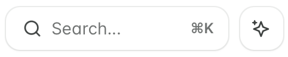
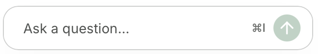
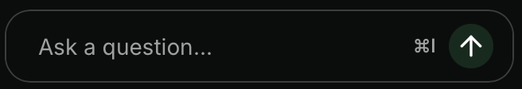
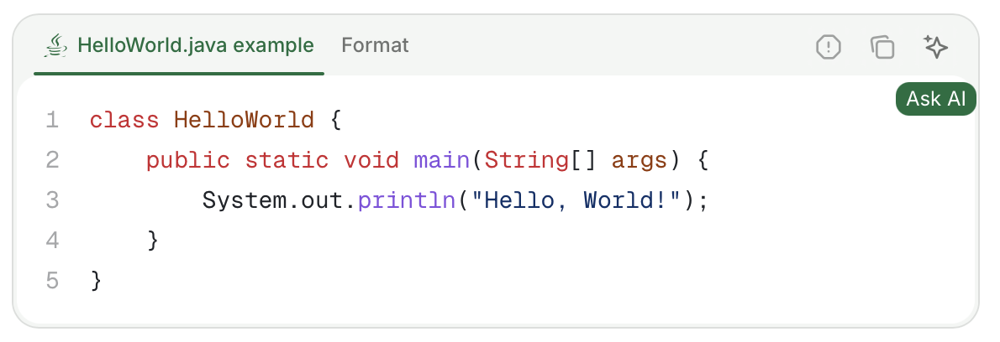
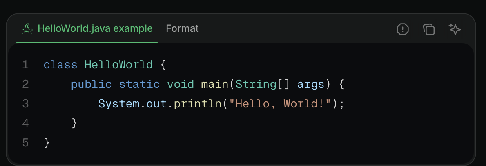

用户可以通过 AI 助手的按钮、键盘快捷键或你分享的链接打开它。你可以更改按钮的外观、隐藏按钮或关闭 AI 助手。

<div id="where-the-assistant-appears">
  ## AI 助手出现的位置
</div>

AI 助手出现在两个位置：搜索栏旁边的按钮和页面底部的横栏。

<Columns cols={2}>
  <Frame caption="搜索栏旁的 AI 助手按钮。">
    

</Frame>
<Frame caption="页面底部的 AI 助手按钮。">


</Frame>
</Columns>

用户还可以使用键盘快捷键打开 AI 助手聊天面板：macOS 上使用 <kbd>Cmd</kbd> + <kbd>I</kbd>，Windows 上使用 <kbd>Ctrl</kbd> + <kbd>I</kbd>。

<div id="open-the-assistant-from-your-own-links">
  ## 通过你自己的链接打开 AI 助手
</div>

通过在 URL 上添加 `?assistant` 查询参数，从文档站点的任意页面打开 AI 助手。可用于从外部内容（如邮件、支持回复、应用内横幅或新手引导流程）深度链接到 AI 助手。

- `?assistant`：打开 AI 助手聊天面板，但不发送任何消息。
- `?assistant=<消息>`：打开 AI 助手聊天面板，并将 `<消息>` 作为用户的第一条消息发送。请对参数值进行 URL 编码，以确保空格和特殊字符在请求中被正确保留。

```text 示例
https://yourdocs.mintlify.site/quickstart?assistant
https://yourdocs.mintlify.site/quickstart?assistant=How%20do%20I%20get%20started%3F
```

要让用户从页面的上下文菜单中以当前页面为上下文打开 AI 助手，请在你的[上下文菜单](/zh/ai/contextual-menu)中添加 `"assistant"` 选项。

<div id="add-context-to-a-question">
  ## 为问题添加上下文
</div>

除了问题本身，用户还可以为 AI 助手提供更多上下文。AI 助手也知道用户当前所在的页面。

<div id="highlight-text">
  ### 选中文本
</div>

在页面上选中文本，然后点击弹出的 **Add to assistant** 按钮，即可打开 AI 助手聊天面板并将选中的文本添加为上下文。你可以向 AI 助手的上下文中添加多个文本片段或代码块。

<div id="code-blocks">
  ### 代码块
</div>

点击代码块中的 **询问助手** 按钮，打开 AI 助手聊天面板并将代码块添加为上下文。你可以向 AI 助手的上下文中添加多个代码块或文本片段。

<Frame>


</Frame>

<div id="file-attachments">
  ### 文件附件
</div>

向 AI 助手消息附加文件以提供额外的上下文。

支持的文件类型：
- **图片**：JPEG、PNG、GIF、WebP、SVG
- **文档**：PDF
- **代码和文本文件**：JavaScript (`.js`、`.jsx`、`.mjs`、`.cjs`)、TypeScript (`.ts`、`.tsx`)、Python、HTML、CSS、Markdown、MDX、JSON、YAML、XML、SQL、CSV、纯文本、Shell 脚本 (`.sh`、`.bash`、`.env`)、GraphQL、TOML、Go、Rust、Ruby、Java、Kotlin、Swift、C (`.c`、`.h`)、C++ (`.cpp`、`.hpp`)、C#、PHP、Lua、R、Scala

限制：
- 最大文件大小：每个附件 5 MB
- 每条消息最大附件数：10

<div id="hide-or-restyle-the-assistant">
  ## 隐藏或调整 AI 助手样式
</div>

要更改 AI 助手按钮的外观，或在整个站点上隐藏它，请在[自定义 CSS](/zh/customize/custom-scripts#add-custom-css) 文件中定位 `[data-layout-item="assistant-entry"]` 选择器。有关 AI 助手按钮、聊天面板和文本输入框的 ID，请参阅[自定义脚本](/zh/customize/custom-scripts#id-selectors)。

<div id="turn-off-the-assistant">
  ## 关闭 AI 助手
</div>

要从你的站点移除 AI 助手，请在仪表盘中[禁用 AI 助手](/zh/assistant/configure#enable-or-disable-the-assistant)。

<div id="troubleshooting">
  ## 故障排除
</div>

<Accordion title="AI 助手聊天栏不可见">
  如果 AI 助手界面在某些浏览器中不可见，你可能需要向 [EasyList](https://easylist.to) 提交误报报告。使用 EasyList Cookies List 的浏览器（如 Brave 和 Comet）有时会屏蔽 AI 助手或其他界面元素。EasyList Cookies List 包含特定域名的规则，用于隐藏某些域名上的固定元素以屏蔽 Cookie 横幅。此规则会无意中影响合法的界面组件。

  向 [EasyList](https://github.com/easylist/easylist) 提交误报报告以请求移除该规则。一旦过滤列表更新，这将为所有用户解决此问题。

</Accordion>

<Accordion title="AI 助手在公司网络、VPN 或防火墙下被阻止">
  如果 AI 助手在个人网络上可以加载，但在工作网络、VPN 或其他受限网络下无法加载，则该阻止发生在网络层面，而不是文档站点本身。企业代理、VPN 和防火墙有时会阻止 AI 助手需要发起的出站请求，因此即使站点的其他部分能够正常加载，聊天面板也无法连接。

  **对读者：** 请你的 IT 团队允许从你的网络向以下主机发起出站 HTTPS 请求。如果可以，请尝试从个人网络使用 AI 助手，以确认问题是网络特定的。

  - `leaves.mintlify.com`—AI 助手 API
  - `hcaptcha.com` 和 `*.hcaptcha.com`—AI 助手的 CAPTCHA 验证

  **对站点所有者：** 如果读者报告 AI 助手在其公司网络或 VPN 下无法加载，几乎总是出站网络阻止的问题，而不是你的文档存在问题。请将上述主机告知他们，并建议他们把该列表分享给其 IT 团队。这是应用于访问者设备或网络的网络层允许列表，无法通过你的站点进行配置。如果你在覆盖默认 CSP 的反向代理后自托管，请参阅 [CSP 配置](/zh/deploy/csp-configuration)，了解需要允许的域名。

</Accordion>

<Accordion title="消息中包含 `[REDACTED_SECRET]`">
  AI 助手会扫描每条消息，查找看起来像凭据的值，例如 API 密钥、访问令牌、URL 中的密码、JSON Web Token 和私钥。它还会扫描附件文件中的文本以及随消息发送的任何上下文。图片不会被扫描。在 AI 助手模型看到消息或 Mintlify 存储对话之前，Mintlify 会将检测到的每个值替换为 `[REDACTED_SECRET]`。

  AI 助手永远不会收到原始值，也不会要求你再次粘贴该值。如果回答依赖于确切的值，AI 助手会告诉你该值已被隐去。如需获取有关某个凭据的帮助，请描述它，或将其替换为 `YOUR_API_KEY` 之类的占位符。

</Accordion>
