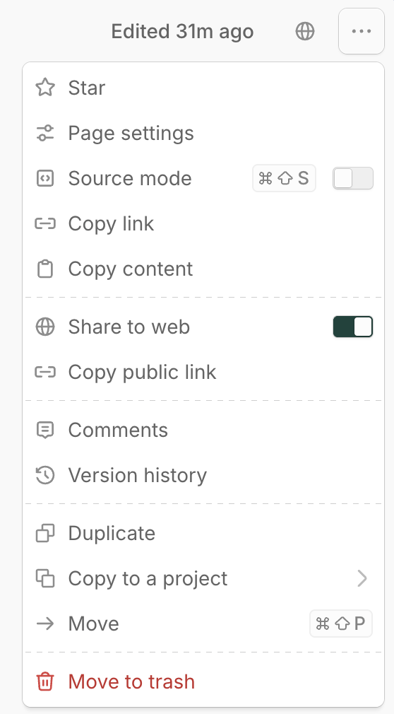
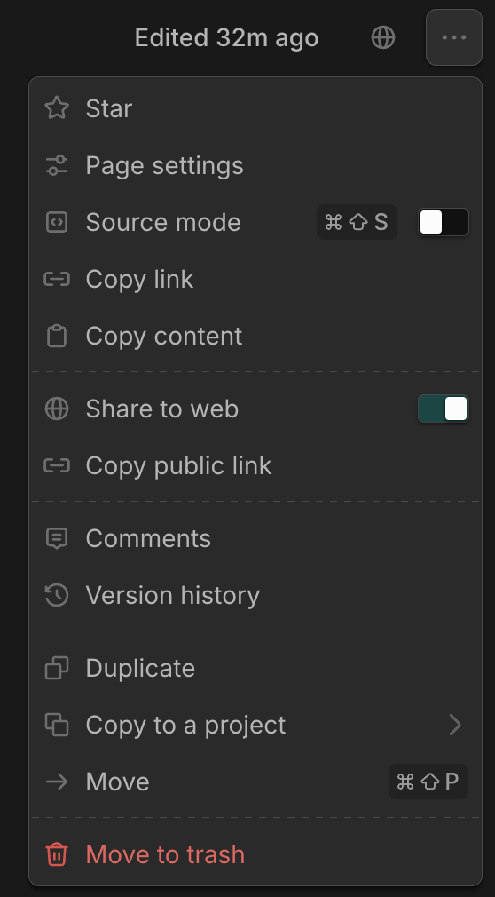

<Note>
  知识库目前处于 beta 阶段，可能会发生变化。
</Note>

知识库是 Mintlify 中面向你的团队及其协作智能体的一种项目类型。将规范、运维手册、入职指南和其他内部团队知识集中保存在一处。通过 MCP 将你的知识库连接到 Claude、ChatGPT、Cursor 和其他 AI 工具，让智能体与你的团队使用相同的信息开展工作。

知识库使用与站点相同的[编辑器](/zh/editor/index)和[智能体](/zh/editor/agent)。相同的工作流程适用于这两种项目类型。

## 知识库与站点有何不同

知识库是两种[项目类型](/zh/organize/projects#project-types)之一。由于知识库没有已发布的站点，仅适用于站点的功能（例如 **Publishes** 页面、自定义域名、助手、导出、分析和自动化）在知识库中不可用。

若要在知识库中使用 [Autopilot](/zh/autopilot)，请先[连接你自己的仓库](#where-your-pages-are-stored)。Autopilot 不会在 Mintlify 托管的仓库上运行。

你只能使用页面和分组来组织知识库。你无法使用 tabs、anchors、versions、languages 或其他导航元素。

{/* vale off */}

## 页面的存储位置

{/* vale on */}

知识库中的编辑器侧边栏包含三种类型的页面。

- **Navigation**：整个组织共享的页面。Mintlify 将这些页面作为 MDX 文件存储在 Git 仓库中，并自动提交你的编辑。
- **Personal**：用于存放草稿或仅供你自己使用的内容的[私有页面](/zh/editor/pages#private-pages)。私有页面不存储在 Git 中。除非你与同事共享，否则它们只对你可见。如果你想共享私有页面，请打开其选项菜单，选择 **Move**，然后选择 **Navigation** 或其中的某个分组。
- **Shared with me**：同事直接[与你共享](/zh/editor/pages#share-a-private-page)的页面。

新的知识库使用由 Mintlify 为你托管的 Git 仓库。若要使用你自己的工具在本地处理知识库，请在 [Git 设置](https://app.mintlify.com/settings/project/git-settings)中连接 GitHub、GitLab、Bitbucket 或 Azure Repos 仓库。你推送到已连接仓库的提交会更新你的知识库。

Mintlify 会使用你的知识库专属的密钥，对知识库中的内容进行静态加密。

## 人员和智能体如何参与贡献

你的团队可以在任何工作场所更新知识库：

- **Editor**：在浏览器或[桌面应用](/zh/desktop)中编写和组织页面，并获得[智能体](/zh/editor/agent)的帮助。
- **MCP**：将 Claude、ChatGPT、Cursor 或其他 AI 工具连接到 [admin MCP](/zh/ai/mintlify-mcp)，即可在对话中阅读、搜索和编辑你的知识库。
- **Slack**：向 [Slack 中的 Mintlify 智能体](/zh/agent/slack)提问，它会根据你的知识库作答，你也可以让它更新页面。
- **Git**：克隆知识库的仓库，并使用任意编辑器或编码智能体编辑 MDX 文件。

## 将页面分享到网络

<Info>
  公开链接需要你的知识库使用 Pro 或 Enterprise 套餐。
</Info>

你可以通过公开链接与组织外部的人员分享知识库页面。任何拥有该链接的人无需登录即可查看页面，但无法编辑。

### 允许公开链接

公开链接默认处于关闭状态。管理员必须先开启该设置，其他人才能分享页面。

1. 前往你的 [Security](https://app.mintlify.com/settings/organization/access) 设置。
2. 在 **Sharing** 部分中，开启 **Allow public links**。

如果管理员关闭 **Allow public links**，所有公开链接都会失效，直到管理员重新开启该设置。

### 分享页面

如果你拥有编辑者或管理员角色，可以分享 **Navigation** 中的页面。如果你对私有页面拥有 **Full Access** 权限，可以分享该私有页面。

1. 在编辑器中打开该页面。
2. 打开 <Icon icon="ellipsis" /> 页面选项菜单。
3. 开启 **Share to web**。
4. 点击 **Copy public link**。

<Frame>
  
  
</Frame>

当你分享页面时，顶部栏会显示一个 <Icon icon="globe" /> 地球按钮。点击该图标即可再次复制链接。公开页面显示该页面的当前内容。

每个公开页面还提供一个供 AI 工具使用的 Markdown 版本。在公开链接末尾添加 `.md` 即可查看，或在请求该链接时附带 `Accept: text/markdown` 请求头。

### 停止分享页面

1. 打开 <Icon icon="ellipsis" /> 页面选项菜单。
2. 关闭 **Share to web**。
3. 点击 **Stop sharing** 进行确认。

链接会立即失效。如果你再次分享该页面，Mintlify 会生成一个新链接。

## 开始使用

<Card title="设置知识库" icon="rocket" href="/zh/base/setup" horizontal>
  创建知识库、邀请你的团队，并连接你的 AI 工具。
</Card>
