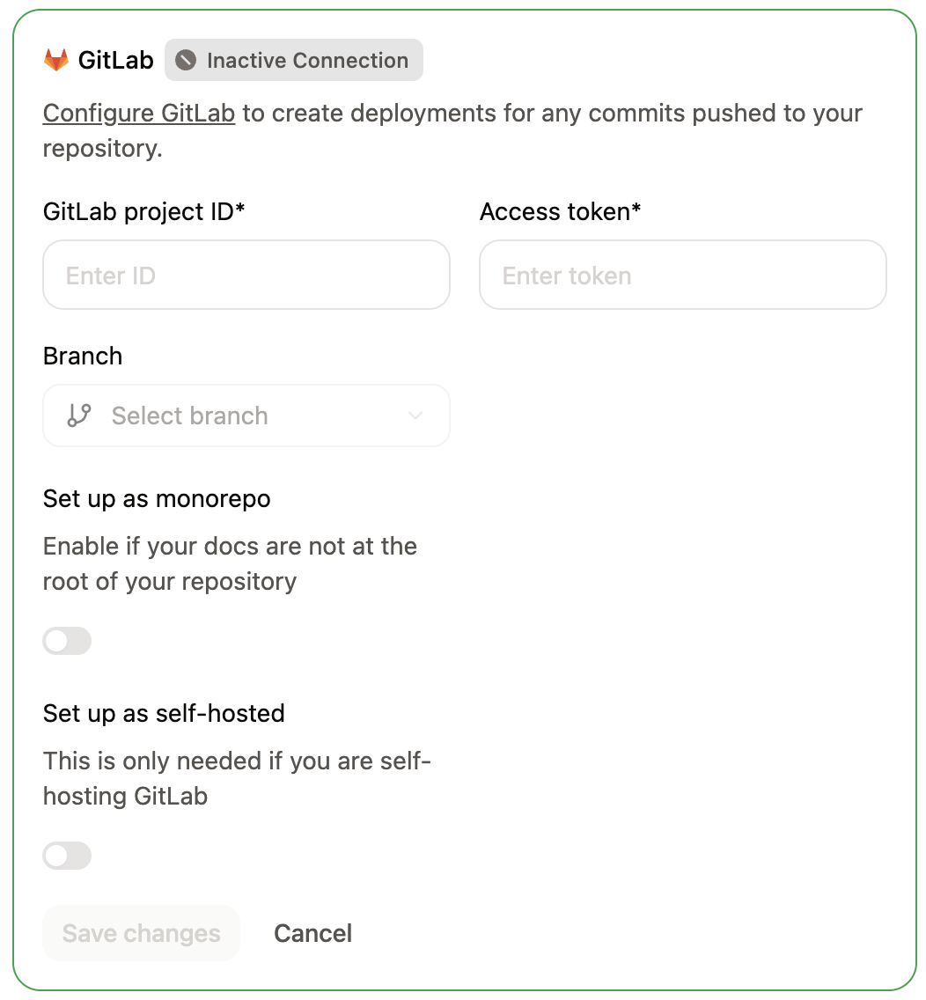
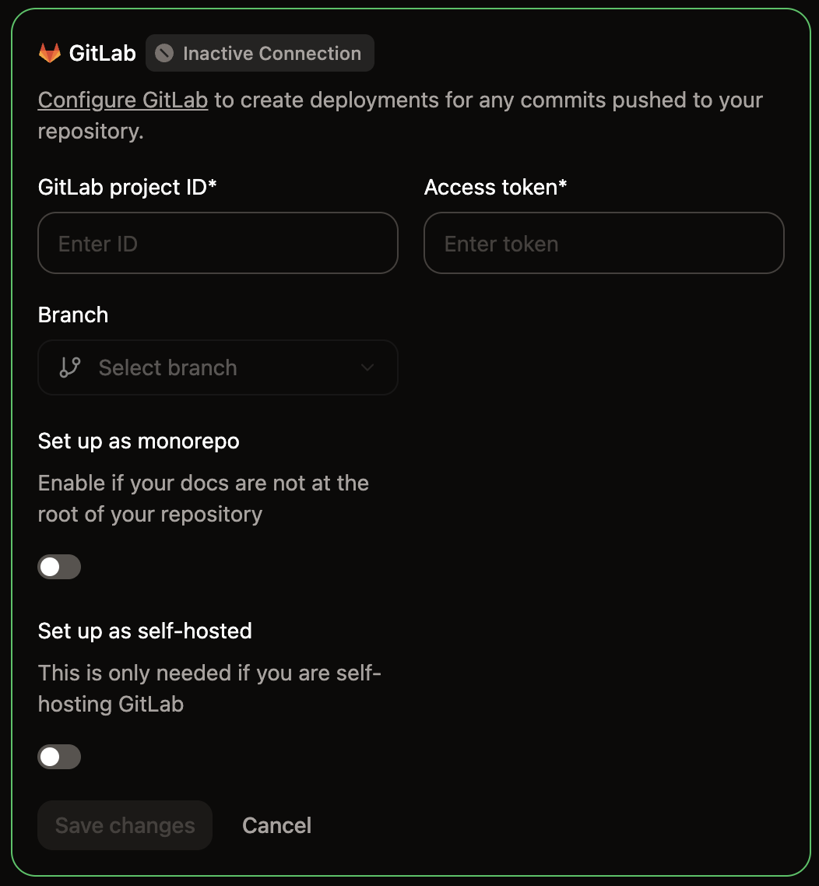

Mintlify 使用访问令牌和 webhook 在 GitLab 与 Mintlify 之间进行身份验证并同步变更。

- Mintlify 使用访问令牌从 GitLab 拉取信息。
- GitLab 使用 webhook 在你进行变更时通知 Mintlify，从而为合并请求启用预览部署。连接项目时，Mintlify 会将 webhook 添加到你的项目中。

  ## 设置连接

当你首次打开 [Git Settings](https://app.mintlify.com/settings/project/git-settings) 时，设置向导将引导你完成 GitLab 存储库的连接。

<Steps>
  <Step title="选择 GitLab 作为提供商">
    在 [Git Settings](https://app.mintlify.com/settings/project/git-settings) 页面，选择 **Connect to GitLab** 并点击 **Continue**。
  </Step>
  <Step title="下载你的内容">
    <Tip>
      如果你已经有一个包含文档的 GitLab 存储库，可以跳过下载，直接点击 **Continue setup**。
    </Tip>
    
    如果你的文档由 Mintlify 托管，请将其下载为 zip 文件。
    * 在 GitLab 中创建一个新存储库。
    * 解压 zip 文件内容。
    * 将内容推送到你的存储库。

    点击 **Continue setup** 继续。
  </Step>
  <Step title="查找项目 ID">
    在你的 GitLab 项目中，依次进入 **Settings** > **General**，找到 **Project ID**。
  </Step>
  <Step title="生成访问令牌">
    前往 **Settings** > **Access Tokens**，选择 **Add new token**。
    
    按以下设置配置令牌：
    - **Name**：Mintlify
    - **Role**：Maintainer
    - **Scopes**：`api` 和 `read_api`
    
    点击 **Create project access token** 并复制该令牌。

    保存新令牌时，Mintlify 会先检查该令牌。如果令牌没有 `api` scope，或无法发布到你的部署分支，Mintlify 会拒绝该令牌，并显示消息“此 GitLab 令牌无法发布更改。请使用具有 Maintainer 角色和 api scope 的项目访问令牌。”

    <Note>
      如果无法使用 Project Access Tokens，可改用 Personal Access Token。请注意，Personal Access Token 会过期，需要定期更新。
    </Note>
  </Step>
  <Step title="连接你的存储库">
    回到设置向导，填写以下字段：

    - **Project ID**：来自 GitLab 项目设置的项目 ID。
    - **Branch**：选择用于部署文档的分支。
    - **Deployment token**：你生成的访问令牌。
    - **Self-hosted GitLab instance**：如果使用 `gitlab.com`，请保持关闭。对于自托管实例，请将其打开，并在 **GitLab instance URL** 中输入你的实例 URL，例如 `https://gitlab.example.com`。你的实例必须可公开访问，以便 Mintlify 能够连接。URL 必须使用 `https://` 和默认端口 443，且不能包含用户名或密码。

    点击 **Connect**。
    <Frame>
      
      
    </Frame>
  </Step>
</Steps>

  ## 更新现有连接

要在初始设置后修改你的 GitLab 连接设置，请前往 [Git Settings](https://app.mintlify.com/settings/project/git-settings) 直接更新项目 ID、访问令牌、分支或实例 URL。

  ## 重新验证 Git 设置

如果你的项目出现异常情况（例如缺少分支选项或配置过时），可以强制 Mintlify 刷新你的 Git 源。

<Steps>
  <Step title="前往 Git Settings">
    前往控制台中的 [Git Settings](https://app.mintlify.com/settings/project/git-settings)。
  </Step>
  <Step title="重新验证设置">
    点击 GitLab 设置卡片右上角的绿色 **Active** 徽章以重新验证你的 Git 源。
  </Step>
</Steps>

  ## 创建 webhook

Webhook 会在你推送更改时通知 Mintlify，以便自动触发部署。

保存 GitLab 连接时，Mintlify 会使用你的访问令牌自动将 webhook 添加到你的项目中。如果项目中已有 Mintlify webhook，Mintlify 会保持其原样。

如果 Mintlify 无法添加 webhook（例如令牌没有 Maintainer 角色），控制台会打开 **Add the GitLab webhook** 对话框。该对话框会显示可供复制的 webhook URL 和密钥令牌，以及指向项目 webhook 设置的 **Open GitLab webhooks** 链接。

你可以使用具有 Maintainer 角色和 `api` scope 的令牌再次保存连接，也可以按照以下步骤，使用对话框中的值手动创建 webhook。

<Steps>
  <Step title="添加新 webhook">
  1. 在 GitLab 中，依次前往 **Settings** > **Webhooks**。
  2. 点击 **Add new webhook**。
  </Step>
  <Step title="设置 URL 和 webhook">
    将该 webhook 命名为 **Mintlify**。

    在 **URL** 字段中，输入端点 `https://leaves.mintlify.com/gitlab-webhook`。
  </Step>
  <Step title="获取 webhook 令牌">
    在 Mintlify 控制台中，点击 **Show webhook token**，然后复制该 webhook 令牌。
  </Step>
  <Step title="粘贴 webhook 令牌">
    在 GitLab 中，将来自 Mintlify 控制台的 webhook 令牌粘贴到 **Secret token** 字段中。
  </Step>
  <Step title="选择事件">
    选择以下事件来触发该 webhook：
    - **Push events**（All branches）
    - **Merge requests events**
  </Step>
  <Step title="验证 webhook">
    配置 webhook 后，你应该看到以下设置：
    
    - **Name**：Mintlify
    - **URL**：`https://leaves.mintlify.com/gitlab-webhook`
    - **Secret token**：来自 Mintlify 控制台的 webhook 令牌
    - **Events**：**Push events**（All branches）和 **Merge requests events**

    添加该 webhook。
  </Step>
  <Step title="测试 webhook">
    创建 webhook 之后，点击 **Test** 下拉菜单。点击 **Push events** 以发送示例负载。如果测试返回 `Hook executed successfully: HTTP 200`，则说明你已正确配置 webhook。

  </Step>
</Steps>

  ## GitLab 中的部署状态

Mintlify 会在 GitLab 中报告部署状态，让你无需打开 dashboard 即可查看构建是否成功。

当你针对部署分支打开 pull request 时，Mintlify 会在其中发表评论，说明其[预览部署](/zh/deploy/preview-deployments)的状态。如果预览失败，评论中会包含失败原因。

当你推送到部署分支时，Mintlify 会为推送的提交添加 **Mintlify Deployment (`<subdomain>`)** 提交状态。该状态会显示生产部署是正在运行、已成功还是已失败，并链接到你的文档站点。其描述会说明结果，例如部署失败的原因。
