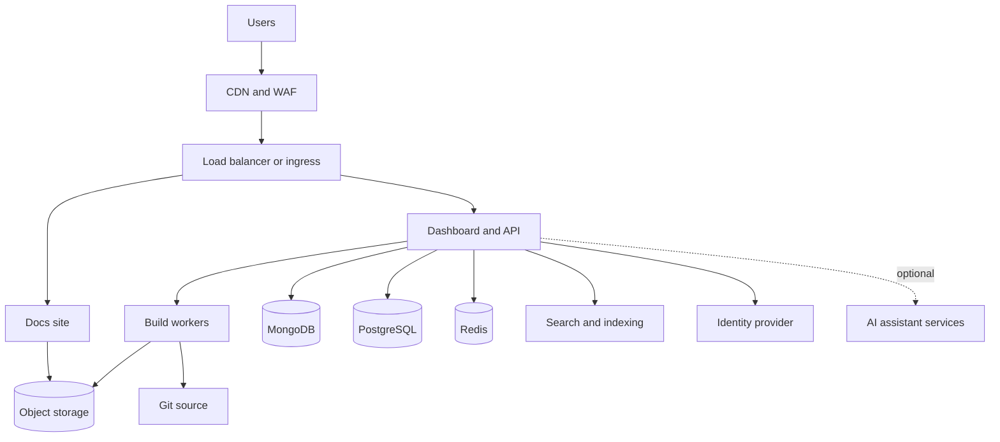

<Info>
  自托管需要 [Enterprise 套餐](https://mintlify.com/pricing?ref=self-host)。请联系你的客户团队来规划部署。
</Info>

自托管将 Mintlify 运行在你自己的云账户或数据中心中，因此你的内容、构建流水线、分析数据和日志都会保留在你的网络边界内。它面向那些有数据驻留、合规或气隙（air-gap）需求，而云托管部署无法满足的团队。

每次自托管部署都是与你的客户团队共同确定范围的合作项目，而不是自助安装。本页描述你需要配置的内容、部署的运行方式以及与云托管相比的取舍，帮助你在决定采用自托管之前进行评估。

<div id="choose-between-cloud-and-self-hosted">
  ## 在云托管与自托管之间选择
</div>

云托管适合大多数团队，包括有严格安全要求的团队。它包含所有功能，并运行在 Mintlify 的全球边缘网络上。在决定自托管之前，请先查看[信任中心](https://security.mintlify.com)是否能解答你的安全团队的问题。你的客户团队还可以分享审计报告和认证，并可以让 Mintlify 的安全团队参与评审。

自托管的设置时间更长，并且部分功能仅在云端提供。根据部署模式，你的团队还需要运行基础设施。请参阅[功能](#features)了解每种方式提供的功能。

<div id="deployment-models">
  ## 部署模式
</div>

| 模式 | 由谁运行 | 运行位置 |
| --- | --- | --- |
| [静态导出](/zh/api/static-export/overview) | 由你提供文件服务 | 任何静态托管，包括隔离网络。无需运行平台 |
| 自带云 | Mintlify，使用你授予的访问权限 | 你在 AWS、Azure 或 Google Cloud 上的账户 |
| 自行管理 | 你的团队，由 Mintlify 提供版本发布和支持 | 你的 Kubernetes 集群，位于云账户或你自己的数据中心 |
| 托管式本地部署 | Mintlify 与你的团队根据工作说明书共同运行 | 你的数据中心或私有云 |

Mintlify 对环境的访问权限越多，部署就越快，可运行的功能也越多。在 AWS 上自带云是最接近云托管产品的方式。

<div id="platform-support">
  ## 支持的平台
</div>

| 平台 | 方式 |
| --- | --- |
| <Icon icon="/images/logos/aws-mark.svg" className="mr-2 my-2" /> Amazon Web Services | AWS Cloud Development Kit (CDK) 应用 |
| <Icon icon="/images/logos/aws-mark.svg" className="mr-2 my-2" /> Amazon EKS | 在 Amazon Elastic Kubernetes Service (EKS) 上使用 Helm chart |
| <Icon icon="/images/logos/azure.svg" className="mr-2 my-2" /> Microsoft Azure | 在 Azure Kubernetes Service (AKS) 上使用 Helm chart |
| <Icon icon="/images/logos/gcp.svg" className="mr-2 my-2" /> Google Cloud | 在 Google Kubernetes Engine (GKE) 上使用 Helm chart |
| <Icon icon="/images/logos/oracle-mark.svg" className="mr-2 my-2" /> Oracle Cloud | 在 Oracle Container Engine for Kubernetes (OKE) 上使用 Helm chart |
| <Icon icon="/images/logos/openshift.svg" className="mr-2 my-2" /> Red Hat OpenShift | Helm chart |
| <Icon icon="/images/logos/kubernetes.svg" className="mr-2 my-2" /> 任意 Kubernetes | Helm chart |

<div id="how-self-hosting-compares-to-cloud-hosting">
  ## 自托管与云托管的对比
</div>

在两种托管模式下，内容创作的方式是相同的。你的团队通过编辑器或其 Git 工作流维护内容，每次变更都会经过你仓库的评审流程。变化的是由谁来运行平台，以及数据存放在哪里。

| 方面 | 云托管 | 自托管 |
| --- | --- | --- |
| 初始设置 | 当天即可 | 与你的客户团队进行一次性部署协作。请预留两到三个月。如果你这边的访问权限、审批和资源能及早就绪，可能只需几周 |
| 基础设施 | 由 Mintlify 运行全部内容 | 取决于[部署模式](#deployment-models)。在自行管理的部署中，由你运行集群、网络和数据存储。Mintlify 提供带升级指南的版本化发布，并为应用层提供支持 |
| 平台更新 | 持续、自动 | 由你审阅并按自己的节奏部署的版本化发布 |
| 数据边界 | 在 Mintlify 云端处理 | 内容、构建、分析和日志都保留在你的网络内，没有向第三方的外发流量 |
| AI 功能 | 默认开启 | 交付时默认禁用，直到你的安全或 AI 治理团队批准后才启用。在你的 AWS 账户中的 Amazon Bedrock 上运行 |
| 集成 | 完整目录 | Google Drive 和 Google Docs，通过你自己拥有的 OAuth 客户端。其他集成仅在云端提供 |
| 边缘分发 | Mintlify 的全球边缘网络，提供缓存和机器人防护 | 你自己的 CDN 和 WAF。页面加载速度和机器人防护取决于你的配置方式 |
| 新功能 | 发布即可用 | 在后续的版本化发布中提供 |
| 监控 | 由 Mintlify 管理 | 由你接入自己的可观测性技术栈 |

如果你需要在自己的云账户中运行该平台，但不想自行运维，Mintlify 可以在你提供的专用 AWS 账户中为你部署和运行它。你的数据保留在你的账户中，由 Mintlify 负责部署和升级。请咨询你的客户团队，确认这种方式是否符合你的要求。

自托管部署通常从较小的范围开始，然后逐步扩展。常见的路径是先从公共文档入手，随着安全评审的完成，再逐步添加认证内容、Web 编辑器和 AI 功能。

<div id="features">
  ## 功能
</div>

下表列出了每种托管模式包含的功能。在自托管一列中，**可选**表示该功能交付时默认关闭，你可以在设置过程中开启。**部分**表示提供功能范围较窄的版本，备注说明缺少的部分。

在云端处于 beta 或私有预览阶段的功能，会在正式发布后通过后续的版本化发布进入自托管部署。

<div id="delivery-and-performance">
  ### 分发与性能
</div>

| 功能 | 云 | 自托管 | 备注 |
| --- | :---: | :---: | --- |
| 全球边缘网络和缓存 | <Icon icon="circle-check" color="#16a34a" /> | <Icon icon="x" color="#dc2626" /> | 自托管站点从你的 ingress 提供服务。请在前面部署你自己的 CDN |
| 机器人检测和 DDoS 防护 | <Icon icon="circle-check" color="#16a34a" /> | <Icon icon="x" color="#dc2626" /> | 使用你自己的 WAF |
| 助手滥用防护（CAPTCHA） | <Icon icon="circle-check" color="#16a34a" /> | <Icon icon="x" color="#dc2626" /> | 在你的 WAF 上对助手端点进行限流 |
| 自定义域名 | <Icon icon="circle-check" color="#16a34a" /> | 部分 | 每个站点在 `<subdomain>.client.<your-domain>` 上提供服务。由你在 ingress 上管理 DNS 和 TLS |

<div id="agent-experience">
  ### 智能体体验
</div>

| 功能 | 云 | 自托管 | 备注 |
| --- | :---: | :---: | --- |
| [llms.txt 和 llms-full.txt](/zh/ai/llmstxt) | <Icon icon="circle-check" color="#16a34a" /> | <Icon icon="circle-check" color="#16a34a" /> |  |
| [Markdown 导出](/zh/ai/markdown-export) | <Icon icon="circle-check" color="#16a34a" /> | <Icon icon="circle-check" color="#16a34a" /> |  |
| [上下文菜单](/zh/ai/contextual-menu) | <Icon icon="circle-check" color="#16a34a" /> | <Icon icon="circle-check" color="#16a34a" /> |  |
| [搜索 MCP 服务器](/zh/ai/model-context-protocol) | <Icon icon="circle-check" color="#16a34a" /> | <Icon icon="circle-check" color="#16a34a" /> | 只有当文档站点可从互联网访问时，托管的 AI 工具才能连接 |
| [管理员 MCP 服务器](/zh/ai/mintlify-mcp) | <Icon icon="circle-check" color="#16a34a" /> | 可选 | 默认关闭 |
| [skill.md](/zh/ai/skillmd) | <Icon icon="circle-check" color="#16a34a" /> | 部分 | 从你的仓库提供自定义 `skill.md`。自动生成仅在云端提供 |

<div id="ai">
  ### AI
</div>

| 功能 | 云 | 自托管 | 备注 |
| --- | :---: | :---: | --- |
| [助手](/zh/assistant) | <Icon icon="circle-check" color="#16a34a" /> | 可选 | 交付时默认禁用。在你的 AWS 账户中的 Amazon Bedrock 上运行 |
| 助手和 MCP 服务器的语义搜索 | <Icon icon="circle-check" color="#16a34a" /> | 可选 | Amazon Bedrock 嵌入存储在你的 PostgreSQL 中。没有它时关键词搜索仍可使用 |
| [自动化](/zh/automations) | <Icon icon="circle-check" color="#16a34a" /> | 可选 | 针对 github.com 上的仓库（包括 GitHub Enterprise Cloud）进行定时和手动运行。不支持 GitLab 和 GitHub Enterprise Server。在你集群中的隔离沙箱内运行，使用 Amazon Bedrock |
| [Autopilot](/zh/autopilot) | <Icon icon="circle-check" color="#16a34a" /> | <Icon icon="x" color="#dc2626" /> | 请改用带有你自己提示词的自动化 |
| [自带模型](/zh/ai/bring-your-own-model) | <Icon icon="circle-check" color="#16a34a" /> | 部分 | 仅限 Amazon Bedrock |
| 翻译 | <Icon icon="circle-check" color="#16a34a" /> | <Icon icon="x" color="#dc2626" /> |  |
| 助手洞察 | <Icon icon="circle-check" color="#16a34a" /> | <Icon icon="x" color="#dc2626" /> |  |

<div id="authoring-and-publishing">
  ### 创作与发布
</div>

| 功能 | 云 | 自托管 | 备注 |
| --- | :---: | :---: | --- |
| Web 编辑器 | <Icon icon="circle-check" color="#16a34a" /> | <Icon icon="circle-check" color="#16a34a" /> |  |
| 基于 Git 的工作流 | <Icon icon="circle-check" color="#16a34a" /> | <Icon icon="circle-check" color="#16a34a" /> | GitHub、GitHub Enterprise Server、GitLab（包括自管理版本）、Bitbucket，或内部自有的代理 API |
| [预览部署](/zh/deploy/preview-deployments) | <Icon icon="circle-check" color="#16a34a" /> | <Icon icon="circle-check" color="#16a34a" /> |  |
| [自定义 React 组件](/zh/customize/react-components) | <Icon icon="circle-check" color="#16a34a" /> | <Icon icon="circle-check" color="#16a34a" /> | 仅限客户端代码 |
| [第三方库](/zh/customize/third-party-libraries) | <Icon icon="circle-check" color="#16a34a" /> | <Icon icon="x" color="#dc2626" /> | 自托管构建不会安装 npm 包。请改为将组件构建为 snippets |
| [静态导出](/zh/api/static-export/overview) | <Icon icon="circle-check" color="#16a34a" /> | 部分 | AWS（CDK）部署 |

<div id="access-and-identity">
  ### 访问与身份
</div>

| 功能 | 云 | 自托管 | 备注 |
| --- | :---: | :---: | --- |
| [认证内容](/zh/deploy/authentication-setup) | <Icon icon="circle-check" color="#16a34a" /> | <Icon icon="circle-check" color="#16a34a" /> | 密码、私有认证、OAuth 2.0 和 JWT。需要 AWS KMS 密钥，在 AWS 之外的集群上也是如此。如果开启，部署中的每个站点都必须要求登录，因此请在单独的部署中运行公开站点 |
| 控制台 SSO | <Icon icon="circle-check" color="#16a34a" /> | 部分 | OIDC。SAML 仅在云端提供 |
| SCIM 用户预配 | <Icon icon="circle-check" color="#16a34a" /> | <Icon icon="x" color="#dc2626" /> |  |

<div id="search-and-analytics">
  ### 搜索与分析
</div>

| 功能 | 云 | 自托管 | 备注 |
| --- | :---: | :---: | --- |
| [搜索](/zh/optimize/search) | <Icon icon="circle-check" color="#16a34a" /> | <Icon icon="circle-check" color="#16a34a" /> | 与云端相同的关键词排序，索引存储在你的 PostgreSQL 中 |
| 分析 | <Icon icon="circle-check" color="#16a34a" /> | 可选 | 需要 ClickHouse。数据保留在你的网络内 |
| 第三方分析和支持小组件 | <Icon icon="circle-check" color="#16a34a" /> | <Icon icon="circle-check" color="#16a34a" /> | 使用你自己的密钥配置 |

<div id="integrations">
  ### 集成
</div>

| 功能 | 云 | 自托管 | 备注 |
| --- | :---: | :---: | --- |
| [Slack 智能体](/zh/agent/slack) | <Icon icon="circle-check" color="#16a34a" /> | <Icon icon="x" color="#dc2626" /> | 提及智能体、交互式按钮，以及由 Slack 消息触发的自动化 |
| Slack 通知和读取权限 | <Icon icon="circle-check" color="#16a34a" /> | 可选 | 向频道和私信发送自动化通知，并为智能体提供对频道、话题和用户的只读访问。使用你自己拥有的 Slack 应用和 bot token |
| [集成](/zh/automations/integrations) | <Icon icon="circle-check" color="#16a34a" /> | 部分 | Google Drive 和 Google Docs，通过你自己拥有的 OAuth 客户端 |
| SDK 生成集成 | <Icon icon="circle-check" color="#16a34a" /> | <Icon icon="x" color="#dc2626" /> |  |

<div id="architecture">
  ## 架构
</div>

自托管部署是一组具有清晰依赖关系的服务。先配置数据存储，再配置依赖它们的服务，最后配置边缘。



| 资源 | 用途 | 必需 |
| --- | --- | :---: |
| 负载均衡器或 ingress | TLS 终止和路由 | <Icon icon="circle-check" color="#16a34a" /> |
| 文档站点 | 提供渲染后的文档 | <Icon icon="circle-check" color="#16a34a" /> |
| 控制台和 API | 管理、认证和构建编排 | <Icon icon="circle-check" color="#16a34a" /> |
| 构建 worker | 构建并发布文档站点 | <Icon icon="circle-check" color="#16a34a" /> |
| MongoDB | 内容存储 | <Icon icon="circle-check" color="#16a34a" /> |
| PostgreSQL | 项目和用户元数据 | <Icon icon="circle-check" color="#16a34a" /> |
| Redis | 构建队列和缓存 | <Icon icon="circle-check" color="#16a34a" /> |
| 对象存储 | 构建产物和静态导出 | <Icon icon="circle-check" color="#16a34a" /> |
| 搜索和索引 | 文档搜索。发布时重建索引 | <Icon icon="circle-check" color="#16a34a" /> |
| 身份提供方 | 用于控制台的 OIDC SSO，以及认证内容的登录 | <Icon icon="circle-check" color="#16a34a" /> |
| AI 助手服务 | 助手、语义搜索和自动化，运行在 Amazon Bedrock 上 | 可选 |
| ClickHouse | 分析 | 可选 |
| AWS KMS 密钥 | 为认证内容签署读者会话 | 可选 |

你的文档源可以是 GitHub、GitHub Enterprise Server、GitLab（包括自管版）或 Bitbucket。

如果你的组织无法向第三方服务授予仓库凭据，也可以在 Git 托管前放置一个内部拥有的代理 API；而完全气隙的环境则使用[静态导出](/zh/api/static-export/overview)，无需任何 Git 连接。

<div id="sizing">
  ### 规格评估
</div>

作为起点，一个生产环境部署大约需要 45 到 60 个 vCPU、160 到 220 GB 内存，以及各服务合计约 1 TB 的固态存储，非生产环境大约为生产环境的一半。你的客户团队会根据页面数量、流量和你启用的功能与你共同确定部署规格。

<div id="set-up-your-platform">
  ## 搭建你的平台
</div>

<Tabs>
  <Tab title="AWS" icon="/images/logos/aws-mark.svg">
    AWS 部署使用 AWS CDK 应用，在你的账户中配置并更新整个技术栈。CDK 应用将容器镜像固定到特定版本，因此每次部署都是可复现且可评审的。

    ### 你需要提供的资源

    | 组件 | 要求 | 说明 |
    | --- | --- | --- |
    | 计算 | Amazon ECS 集群 | 运行 Mintlify 服务 |
    | 内容存储 | Amazon DocumentDB | 与 MongoDB 兼容 |
    | 元数据存储 | Amazon RDS for PostgreSQL | 项目和用户元数据 |
    | 缓存和队列 | Amazon ElastiCache for Redis | 构建队列和缓存 |
    | 对象存储 | Amazon S3 | 构建产物和静态导出 |
    | CDN | Amazon CloudFront | 在边缘提供文档站点 |
    | 网络 | 带公共和私有子网的 VPC，Application Load Balancer | 隔离工作负载 |
    | TLS 和 DNS | AWS Certificate Manager、Amazon Route 53 | 为你的域名提供 HTTPS 和路由 |
    | 密钥 | AWS Secrets Manager | 数据库凭据和签名密钥 |
    | 身份 | OIDC 提供方 | 控制台 SSO |

    ### 配置步骤

    <Steps>
      <Step title="Scope the deployment">
        你的客户团队会审阅你的网络拓扑、Git 托管、身份提供方和合规要求，然后交付 CDK 应用以及版本化容器镜像的访问权限。
      </Step>
      <Step title="Configure and deploy">
        在 CDK 上下文中设置你的域名、证书和网络，审阅 change set 并进行部署。

        ```bash
        cdk diff
        cdk deploy --all
        ```
      </Step>
      <Step title="Connect Git and SSO">
        授予部署访问你文档仓库的权限，并接入你的身份提供方。
      </Step>
      <Step title="Cut over">
        在预发环境域名上验证构建和搜索，然后将生产 DNS 指向该部署。
      </Step>
    </Steps>
  </Tab>

  <Tab title="Kubernetes" icon="/images/logos/kubernetes.svg">
    Kubernetes 部署使用 Mintlify 的企业版 Helm chart，可运行在任何经过认证的 Kubernetes 集群上。同一个 chart 同时覆盖各家云上的托管 Kubernetes 和本地集群：

    - **AWS**：EKS，使用 Amazon Bedrock 提供 AI 功能，使用 AWS KMS 提供认证内容。在其他平台上，这些功能需要你提供给服务器的 AWS 凭证。
    - **Azure**：AKS，使用 Microsoft Entra ID 进行 SSO，并使用 Azure 托管数据服务。
    - **Google Cloud**：GKE，使用 Cloud SQL、Memorystore 和 Cloud Storage。
    - **Oracle Cloud**：OKE，使用 OCI 托管数据库和 OCI Object Storage。
    - **OpenShift**：附带兼容 OpenShift 的安全上下文，并使用 Routes 作为 ingress。

    ### 你需要提供的资源

    | 组件 | 要求 | 说明 |
    | --- | --- | --- |
    | 集群 | Kubernetes 或 OpenShift 集群 | 承载 Helm release |
    | 内容存储 | MongoDB | 托管或集群内运行 |
    | 元数据存储 | PostgreSQL | 托管或集群内运行 |
    | 缓存和队列 | Redis | 构建队列和缓存 |
    | 对象存储 | S3 兼容的 bucket | 构建产物 |
    | Ingress | 支持 TLS 的 ingress 控制器或 OpenShift Route | 提供 HTTPS。建议在前面加一个 WAF |
    | 镜像仓库 | 私有容器镜像仓库 | 存放交付的镜像 |
    | 身份 | OIDC 提供方 | 控制台 SSO |

    ### 配置步骤

    <Steps>
      <Step title="Scope the deployment">
        你的客户团队会审阅你的集群、Git 托管、身份提供方和合规要求，然后交付 Helm chart、values 模板以及供你镜像仓库使用的版本化容器镜像。
      </Step>
      <Step title="Provision data stores">
        搭建 MongoDB、PostgreSQL、Redis 和对象存储，可由你的云厂商托管或运行在集群内。
      </Step>
      <Step title="Configure and install">
        将 values 文件指向你的数据存储、ingress 和镜像仓库，然后安装 release。

        ```bash
        helm upgrade --install mintlify ./mintlify-enterprise \
          --namespace mintlify --create-namespace -f values.yaml
        ```
      </Step>
      <Step title="Connect Git and SSO, then cut over">
        授予部署访问你文档仓库的权限，接入你的身份提供方，在预发环境验证后，将生产 DNS 指向该部署。
      </Step>
    </Steps>
  </Tab>
</Tabs>

<div id="updates">
  ## 更新
</div>

平台更新和内容更新是相互独立的。你控制平台何时变更，而你的文档也会独立地保持最新。

<div id="platform-updates">
  ### 平台更新
</div>

Mintlify 通过你的客户团队交付带有升级指南和发布说明的版本化发布。每个版本都固定特定的镜像版本，因此你可以先在非生产环境中测试某个 release，然后再进行部署，如有需要还可以回滚到上一个版本。

<CodeGroup>

```bash AWS (CDK)
# 审阅新版本的 change set，然后进行部署
cdk diff
cdk deploy --all
```

```bash Kubernetes (Helm)
# 升级到已交付的版本，或进行回滚
helm upgrade mintlify ./mintlify-enterprise \
  --namespace mintlify -f values.yaml
helm rollback mintlify
```

</CodeGroup>

更新过程零停机。新的任务或 pod 会启动、通过健康检查，然后替换掉旧的实例。

在 Kubernetes 上，你还可以启用 Helm chart 附带的可选发布控制平面。它在你的集群中运行，读取由 Mintlify 签名的发布源，并按照你设定的策略升级或回滚发布：手动、需要审批，或在维护窗口内自动进行。它只会为获取发布源和 chart 发起出站请求，因此 Mintlify 无法访问你的集群。

<div id="content-updates">
  ### 内容更新
</div>

内容通过你的 Git 源流转，而不是通过平台发布进行。当你向文档仓库推送提交时，构建 worker 会重新构建站点并自动发布到对象存储。内容变更从不需要平台部署。

<div id="air-gapped-deployments">
  ## 气隙部署
</div>

没有 Git webhook 通路的环境将文档作为[静态导出 bundle](/zh/api/static-export/overview) 进行分发。你站点的自包含构建被发布到对象存储，并通过你的 CDN 提供服务。内容变更时重新生成 bundle，或者使用 GitHub Action 自动化整个流程。在气隙部署中，需要外部网络访问的 AI 功能会被禁用。

<div id="next-steps">
  ## 后续步骤
</div>

<Columns cols={2}>
  <Card title="联系你的客户团队" icon="messages-square" href="https://www.mintlify.com/enterprise">
    在你的平台上规划自托管部署，并制定上线计划。
  </Card>
  <Card title="静态导出" icon="package" href="/zh/api/static-export/overview">
    生成文档的自包含 bundle，以在气隙环境中提供服务。
  </Card>
</Columns>
