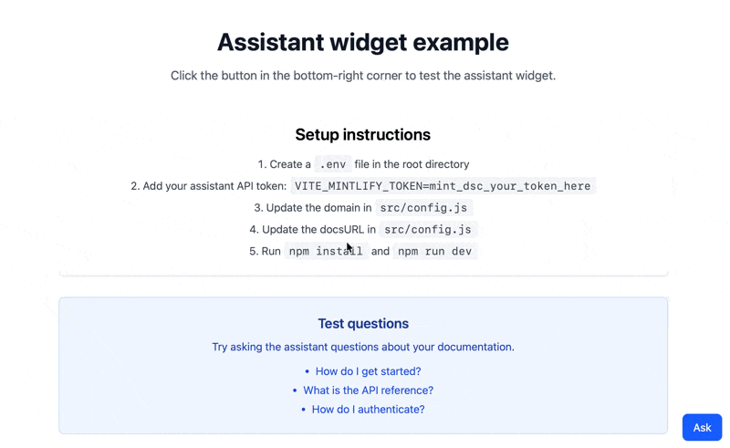

<div id="what-you-will-build">
  ## 你将构建的内容
</div>

一个可复用的小组件，可将 [AI 助手](/zh/assistant/index) 直接嵌入到你的应用中。该小组件提供：

* 一个悬浮按钮，点击后打开聊天面板
* 基于文档信息的实时流式响应
* 支持 Markdown 的消息渲染

用户可以使用该小组件获取产品帮助，而无需离开你的应用。

<Frame>
  
</Frame>

<div id="prerequisites">
  ## 前提条件
</div>

* 已为你的项目启用 AI 助手
* 你的域名，它显示在控制台 URL 的末尾。例如，如果你的控制台 URL 是 `https://app.mintlify.com/org-name/domain-name`，则你的域名是 `domain-name`
* 一个 [AI 助手 API 密钥](https://app.mintlify.com/settings/organization/api-keys)
* 一个使用 App Router 的 Next.js 应用
* 基本的 React 知识

<div id="get-your-assistant-api-key">
  ### 获取你的 AI 助手 API 密钥
</div>

1. 在控制台中前往 [API keys](https://app.mintlify.com/settings/organization/api-keys) 页面。
2. 点击 **Create Assistant API Key**。
3. 复制 AI 助手 API 密钥（以 `mint_dsc_` 开头）并妥善保存。

<Note>
  你的 AI 助手 API 密钥控制对 AI 助手配额的访问。本教程通过后端代理将密钥保留在服务器端，因此密钥永远不会进入客户端代码包。
</Note>

<div id="build-the-widget">
  ## 构建小组件
</div>

该小组件使用 [AI SDK](https://ai-sdk.dev) 的 `useChat` hook，通过你应用中的一个路由调用 [AI 助手消息端点](/zh/api/assistant/create-assistant-message-v2)。

<Steps>
<Step title="安装依赖">

```bash
npm i ai@^6 @ai-sdk/react@^3 react-markdown
```

</Step>
<Step title="存储你的 API 密钥">

将你的 AI 助手 API 密钥存储为服务器端环境变量。不要使用 `NEXT_PUBLIC_` 前缀，否则该值会被打包进客户端代码。

```bash .env.local
MINTLIFY_TOKEN=mint_dsc_your_token_here
```

将 `mint_dsc_your_token_here` 替换为你的 AI 助手 API 密钥。

</Step>
<Step title="添加代理路由">

创建一个路由，为每个请求添加你的 API 密钥，并将其转发到 Mintlify API。该路由会原样流式返回响应，并传递会话线程相关的响应头。

```js app/api/assistant/route.js
const DOMAIN = 'your-domain';

export async function POST(request) {
  const upstream = await fetch(
    `https://api.mintlify.com/discovery/v2/assistant/${DOMAIN}/message`,
    {
      method: 'POST',
      headers: {
        'Content-Type': 'application/json',
        Authorization: `Bearer ${process.env.MINTLIFY_TOKEN}`,
      },
      body: await request.text(),
    }
  );

  const headers = new Headers();
  for (const name of ['content-type', 'x-thread-id', 'x-thread-key', 'x-message-id']) {
    const value = upstream.headers.get(name);
    if (value) headers.set(name, value);
  }

  return new Response(upstream.body, { status: upstream.status, headers });
}
```

将 `your-domain` 替换为你的域名。

</Step>
<Step title="创建小组件组件">

```jsx components/AssistantWidget.jsx
'use client';

import { useState } from 'react';
import { useChat } from '@ai-sdk/react';
import { DefaultChatTransport } from 'ai';
import ReactMarkdown from 'react-markdown';

export function AssistantWidget() {
  const [isOpen, setIsOpen] = useState(false);
  const [input, setInput] = useState('');

  const { messages, sendMessage, status } = useChat({
    transport: new DefaultChatTransport({
      api: '/api/assistant',
      body: { fp: 'anonymous' },
    }),
  });

  const isLoading = status === 'submitted' || status === 'streaming';

  const handleSubmit = (e) => {
    e.preventDefault();
    if (!input.trim()) return;
    sendMessage({ text: input });
    setInput('');
  };

  return (
    <>
      <button
        onClick={() => setIsOpen(!isOpen)}
        style={{ position: 'fixed', bottom: 16, right: 16 }}
      >
        {isOpen ? 'Close' : 'Ask'}
      </button>

      {isOpen && (
        <div
          style={{
            position: 'fixed',
            bottom: 64,
            right: 16,
            width: 384,
            height: 500,
            display: 'flex',
            flexDirection: 'column',
            background: 'white',
            border: '1px solid #e5e7eb',
          }}
        >
          <div style={{ flex: 1, overflowY: 'auto', padding: 16 }}>
            {messages.map((message) => (
              <div key={message.id}>
                <strong>{message.role === 'user' ? 'You' : 'Assistant'}</strong>
                <ReactMarkdown>
                  {message.parts
                    .filter((part) => part.type === 'text')
                    .map((part) => part.text)
                    .join('')}
                </ReactMarkdown>
              </div>
            ))}
            {isLoading && <p>Loading...</p>}
          </div>

          <form onSubmit={handleSubmit} style={{ display: 'flex', gap: 8, padding: 16 }}>
            <input
              value={input}
              onChange={(e) => setInput(e.target.value)}
              placeholder="Ask a question..."
              style={{ flex: 1 }}
            />
            <button type="submit" disabled={isLoading || !input.trim()}>
              Send
            </button>
          </form>
        </div>
      )}
    </>
  );
}
```

`fp` 字段用于标识用户。使用 `anonymous` 或你自己的用户 ID。

</Step>
<Step title="将小组件添加到布局">

在根布局中渲染该小组件，使其出现在每个页面上。

```jsx app/layout.jsx
import { AssistantWidget } from '../components/AssistantWidget';

export default function RootLayout({ children }) {
  return (
    <html lang="en">
      <body>
        {children}
        <AssistantWidget />
      </body>
    </html>
  );
}
```

</Step>
<Step title="启动开发服务器">

```bash
npm run dev
```

在浏览器中打开你的应用，然后点击 **Ask** 按钮打开 AI 助手小组件。

</Step>
</Steps>

<div id="customization-ideas">
  ## 自定义思路
</div>

<div id="source-citations">
  ### 来源引用
</div>

AI 助手在回答之前会搜索你的文档。每次搜索都会以 `tool-search` 部分的形式出现在消息中，其 `output.results` 数组列出了找到的页面。提取这些页面，即可在每个回答下方显示来源：

```jsx
const DOCS_URL = 'https://docs.example.com';

const extractSources = (parts) =>
  parts
    .filter((part) => part.type === 'tool-search' && part.state === 'output-available')
    .flatMap((part) => part.output?.results ?? [])
    .map((source) => ({
      url: `${DOCS_URL}/${source.path.replace(/^\//, '')}`,
      title: source.metadata?.title || source.path,
    }));

// 在你的消息渲染中：
{messages.map((message) => {
  const sources = message.role === 'assistant' ? extractSources(message.parts) : [];
  return (
    <div key={message.id}>
      {/* 消息内容 */}
      {sources.length > 0 && (
        <div>
          <p>Sources:</p>
          {sources.map((source) => (
            <a key={source.url} href={source.url} target="_blank" rel="noopener noreferrer">
              {source.title}
            </a>
          ))}
        </div>
      )}
    </div>
  );
})}
```

将 `https://docs.example.com` 替换为你的文档站点 URL。

<div id="track-conversation-thread-ids">
  ### 跟踪会话线程
</div>

存储线程 ID 和线程密钥，以便在不同会话之间保留对话历史。

当用户创建新的会话线程时，服务器会在响应头中返回两个值：

* `X-Thread-Id`：线程标识符
* `X-Thread-Key`：该线程的密钥（仅在你创建线程时返回一次）

你必须在第一次响应时获取并持久保存这两个值。在之后的每条消息中，都要在请求体中同时包含 `threadId` 和 `threadKey`。如果你发送了 `threadId` 但没有对应的 `threadKey`，服务器会返回 `404` 错误。

<Warning>
  你必须立即存储 `X-Thread-Key` 响应头。服务器仅在你创建新线程时返回它，之后无法再次获取。
</Warning>

传输层会在每次请求之前读取其 `body` 函数，因此下一个请求会包含已保存的值：

```jsx
const { messages, sendMessage, status } = useChat({
  transport: new DefaultChatTransport({
    api: '/api/assistant',
    body: () => ({
      fp: 'anonymous',
      threadId: localStorage.getItem('assistant-thread-id'),
      threadKey: localStorage.getItem('assistant-thread-key'),
    }),
    fetch: async (url, options) => {
      const response = await fetch(url, options);
      const threadId = response.headers.get('x-thread-id');
      const threadKey = response.headers.get('x-thread-key');
      if (threadId) localStorage.setItem('assistant-thread-id', threadId);
      if (threadKey) localStorage.setItem('assistant-thread-key', threadKey);
      return response;
    },
  }),
});
```

<div id="add-keyboard-shortcuts">
  ### 添加键盘快捷键
</div>

允许用户使用键盘快捷键打开和关闭小组件：

```jsx
useEffect(() => {
  const handleKeyDown = (e) => {
    // Cmd/Ctrl + Shift + I 切换小组件
    if ((e.metaKey || e.ctrlKey) && e.shiftKey && e.key.toLowerCase() === 'i') {
      e.preventDefault();
      setIsOpen((prev) => !prev);
    }
  };

  window.addEventListener('keydown', handleKeyDown);
  return () => window.removeEventListener('keydown', handleKeyDown);
}, []);
```
